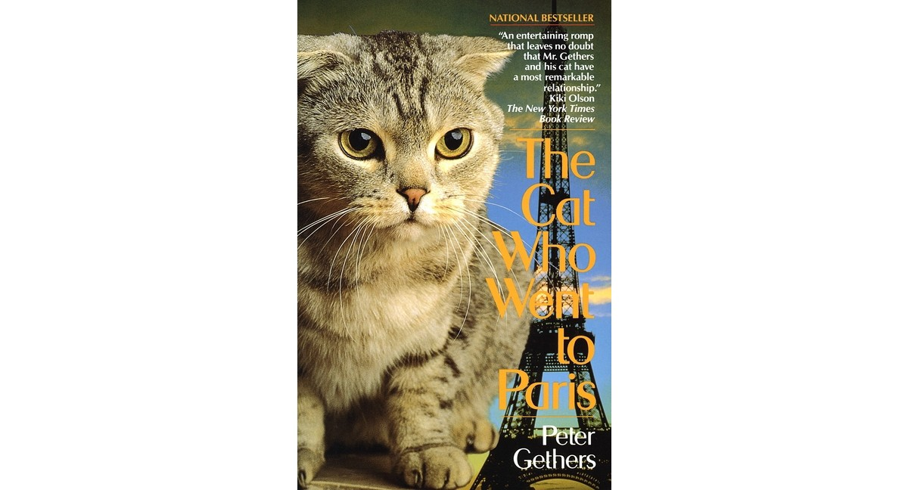
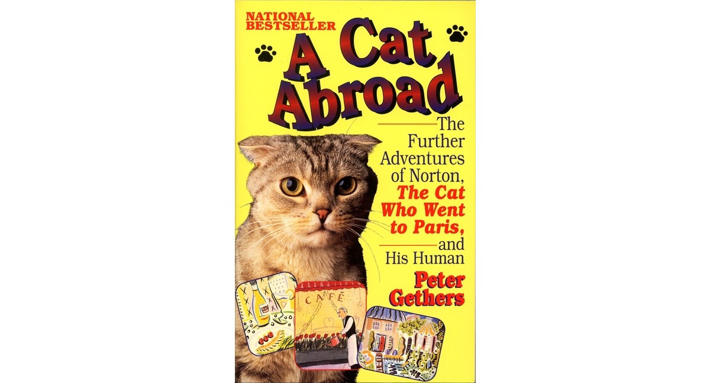

# 今天的文学猫角色：Norton（诺顿）

彼得·盖瑟斯（Peter Gethers）曾在一张自认绝不会改变的清单上写下：他讨厌猫。后来，诺顿走进他的生活，清单里的这一条先失效了。盖瑟斯在回忆录《The Cat Who Went to Paris》中，把这只真实的灰色苏格兰折耳猫写成一位随时可能改变行程的同行者：圆脸、折下来的耳朵、安静而机灵的眼睛，常从他的肩包里探出头来。书名说它去了巴黎，但诺顿的本领远不止适应一次旅行。

诺顿跟人散步时不用牵绳。在海滩上，它可以走很长一段路，时而落在盖瑟斯身后，时而跑到前面；留在旅馆庭院里时，等主人叫它，它会先喵一声，再从藏身处出来。这些情景让盖瑟斯愿意带它坐地铁、搭飞机，甚至乘协和式客机越过大西洋。巴黎一家旅馆接到他的订房电话，会记得问猫是否同行。诺顿也能坐在餐馆自己的椅子上，仿佛出门用餐本来就是日常生活的一部分。1991 年，这本书在洛杉矶举行庆祝活动时，它就坐在餐厅的桌上。人们围过来招呼，甚至有人把一只狗举到它面前，诺顿都没有慌张。现场最热闹的似乎是向它示好的人，主角自己倒显得从容。

旅行家的镇定之外，它仍有猫的脾气。盖瑟斯在被子下移动手掌，诺顿会扑上来玩摔跤，却尽量不咬伤或抓伤认得出的那只手。偶尔失手，听见盖瑟斯喊疼，它会停下，把鼻子埋进枕头，直到被安抚。它喜欢待在主人近旁：浴缸边可以坐，床中央可以睡；房门若把它隔在外面，它就叫到门重新打开。盖瑟斯原先以独处和不愿受约束自许，却渐渐会为了不惊醒猫而蜷在床角，也会因为旅馆不接待猫而放弃一次假期。回忆录的幽默，常来自这位人类叙述者发现自己的规矩正被诺顿一条条改写。

续作《A Cat Abroad》把两人的路带往法国南部，也留下诺顿一个有趣的反差：陌生的庭院、旅馆和交通工具都挡不住它探索，一只新换的羽绒枕头却把它吓得逃下床。盖瑟斯只好把旧枕头留着。折耳与圆脸让诺顿一眼可认，真正使它成为书中角色的，则是这些并不总符合“勇敢旅行猫”称号的小动作。它既能在人群里安坐，也会因为一扇关上的门或一只陌生枕头表达意见。跟着诺顿出门，读者读到的还有一个人如何学会给另一种生灵留出位置。

### 资料来源

- 彼得·盖瑟斯（Peter Gethers），[《The Cat Who Went to Paris》出版页与公开节选](https://www.penguinrandomhouseretail.com/book/?isbn=9780449907634)，Ballantine Books 平装版
- 彼得·盖瑟斯，[《A Cat Abroad》出版页与公开节选](https://penguinrandomhousehighereducation.com/book/?isbn=9780449909522)，Ballantine Books 平装版
- 艾琳·拉彻（Irene Lacher），[《New York, L.A., Paris--This Cat Goes Everywhere》](https://www.latimes.com/archives/la-xpm-1991-11-20-vw-351-story.html)，《洛杉矶时报》，1991 年 11 月 20 日

### 视觉参考

1. 1992 年 Ballantine 平装本封面：诺顿与巴黎铁塔
   - 来源页面：<https://www.target.com/p/-/A-93506368>
   - 原始图片：<https://target.scene7.com/is/image/Target/GUEST_62691e21-e1f8-400b-bf38-90c8427c3725?wid=1200>
   - 作者/机构：Ballantine Books／Target
   - 说明：《The Cat Who Went to Paris》平装本封面，以诺顿的照片呈现它的灰色毛皮和折耳。

2. 1994 年 Ballantine 续作封面：诺顿与旅行图景
   - 来源页面：<https://www.target.com/p/-/A-94475816>
   - 原始图片：<https://target.scene7.com/is/image/Target/GUEST_d64e0131-d6b9-42d8-8c49-3308b17ce03d?wid=1200>
   - 作者/机构：Ballantine Books／Target
   - 说明：《A Cat Abroad》平装本封面，再次以诺顿的照片配合旅行主题图景。
