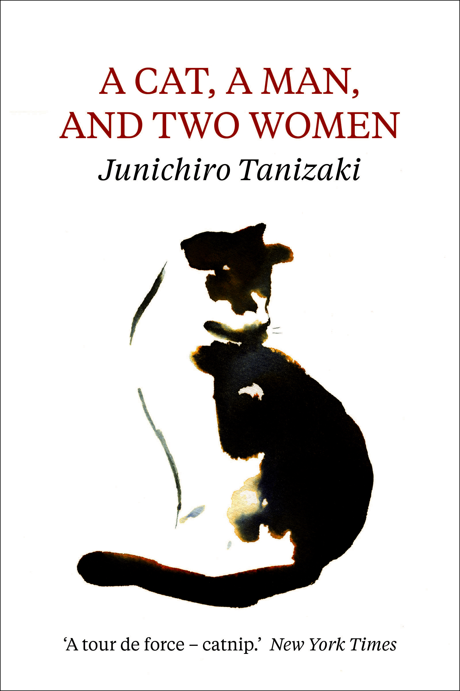
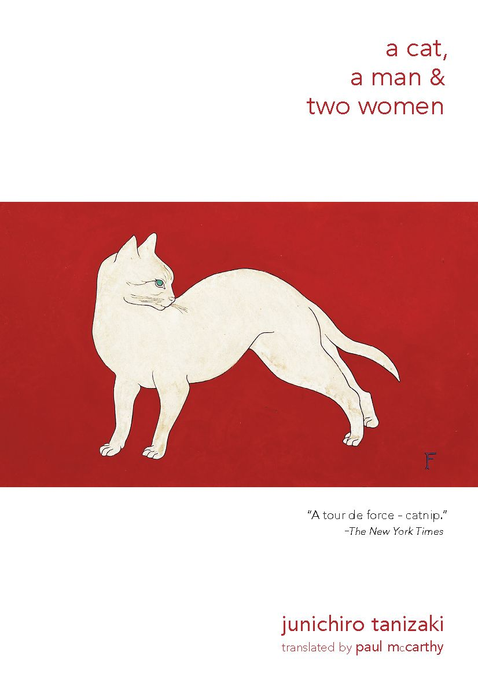

# 今天的文学猫角色：Lily（莉莉）

庄造刚把小竹荚鱼送到嘴边，莉莉便抬起前爪，摇摇晃晃地追过去。鱼肉迟迟吃不到，她索性跃上他的肩，抓得他隔着薄衫直喊疼。庄造嘴上抱怨，手里却继续喂鱼；莉莉把脸贴过去，连他的嘴角也不放过。谷崎润一郎（Jun’ichirō Tanizaki）在《猫与庄造与两个女人》（《猫と庄造と二人のおんな》）中，用这样一顿饭交代了谁最能让庄造心软。

莉莉是一只毛色斑驳的玳瑁母猫，毛软，模样漂亮。她住在芦屋一家杂货铺里，早在庄造结婚前就是他的伴侣。她听见摆饭桌的声音便会出现，夜里还能低头钻过蚊帐，挨着他的被褥睡。庄造觉得她聪明，对她的黏人和淘气几乎没有脾气；新婚妻子福子却发现，吃饭和睡觉时，丈夫留给她的地方总被这只猫占去。她并非从来讨厌莉莉，只是住进这家之后，才渐渐尝到了前妻品子当年的嫉妒。

故事从品子写给福子的一封信展开。离婚后，她说自己什么也不想从旧家带走，只求把莉莉送来陪伴。信里的哀求也藏着算计：她知道庄造舍不得猫，盼望这件事使新婚夫妇争执。福子起初想识破她，却越来越在意庄造与莉莉的亲密，终于要他把猫送走。几个人都想借莉莉试探别人的心，莉莉却只照着自己的习惯生活：要吃的，找暖处睡觉，亲近愿意照料她的人。

她也有叫人无法轻易当成物件的一面。早些年，庄造的母亲曾把她送到尼崎；约一个月后，她独自走回了芦屋。连原本嫌她添麻烦的母亲也因此不再坚持赶她走。庄造记得这段归途，却不知道这一次她还会不会回来。如今再次被送离，庄造怕她在路上难受，特意煮好她爱吃的鸡肉，叮嘱到了新家再喂。这个忙着安排猫的男人，面对妻子和前妻的心思却始终笨拙。谷崎把他们的较劲写得好笑，猫的饥饿、爪子和脚步又让这场家庭角力始终落在日常生活里。

到了品子身边，莉莉最初不安，后来逐渐信任她。品子停下脚步时，她会跑到脚边，用耳根蹭人。一个夜晚，她钻进品子的被窝，找好位置，响亮地打起呼噜；品子摸到她湿凉的鼻尖和柔软的脚掌，才第一次真切地感到她的亲近。过去令品子厌烦的猫砂气味，此时竟唤回她在芦屋生活的记忆。小说写于芦屋，1936 年发表。读它，可以听见院子里的卖鱼声，也能看见一只猫怎样使同一间屋子里的人重新打量彼此。莉莉不解释任何人的爱情，她只是伸爪、吃鱼、穿过蚊帐，再挑一个愿意接纳她的地方睡下。

### 资料来源

- 谷崎润一郎（谷崎潤一郎），[《猫と庄造と二人のおんな》](https://www.aozora.gr.jp/cards/001383/files/59827_73191.html)，青空文库所收文本
- 芦屋市，[《広報あしや》2025 年 9 月号：芦屋の日常生活を丁寧に描く『猫と庄造と二人のをんな』](https://www.city.ashiya.lg.jp/kouhou/kensaku/r7/documents/2025-9-w_03.pdf)
- New Directions，[《A Cat, A Man, and Two Women》图书页](https://www.ndbooks.com/book/a-cat-a-man-and-two-women/)
- 豆瓣阅读，[《猫与庄造与两个女人》图书页](https://read.douban.com/ebook/33362937/)

### 视觉参考

1. 英译本封面，艾伦与昂温：水彩猫影
   - 来源页面：<https://www.allenandunwin.co.nz/browse/book/Junichiro-Tanizaki-Cat%2C-A-Man%2C-And-Two-Women-9781911547037>
   - 原始图片：<https://s3-ap-southeast-2.amazonaws.com/assets.allenandunwin.com/images/original/9781911547037.jpg>
   - 作者/机构：Allen & Unwin
   - 说明：该英译本以水彩猫影呈现作品的猫主题。

2. 2015 年英译本封面，新方向出版社：红底白猫
   - 来源页面：<https://www.ndbooks.com/book/a-cat-a-man-and-two-women/>
   - 原始图片：<https://cdn.sanity.io/images/p34gzxcg/production/bd490acdeffa21724b7e4621135e0cb144ed3c7d-826x1200.jpg>
   - 作者/机构：New Directions
   - 说明：该英译本以红底白猫图案呈现作品的猫主题。
