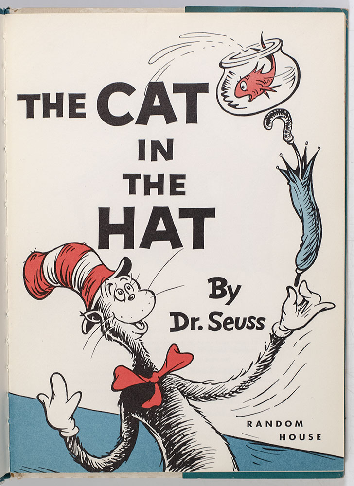
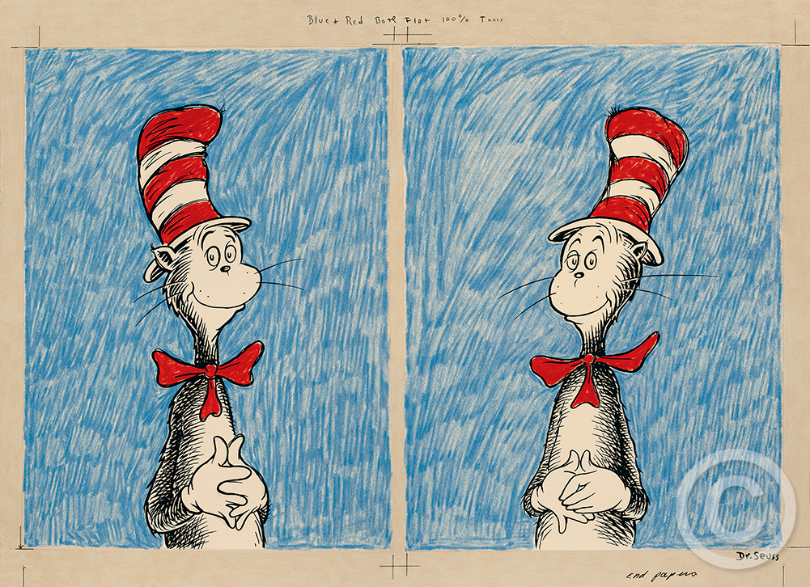

# 今天的文学猫角色：The Cat in the Hat（戴高帽的猫）

雨下个不停，两个孩子只好待在屋里，母亲又不在家。门外来的客人却像是专为打破这种沉闷而生：高高的红白条纹帽、红领结、细长的黑白身体，笑着宣布自己会许多新把戏。这只猫没有姓名，帽子就是他的招牌，也成了苏斯博士（Dr. Seuss）1957 年图画书《戴高帽的猫》（The Cat in the Hat）的书名。萨莉（Sally）和哥哥还没决定该不该欢迎他，他已经把客厅当成了舞台。

猫的表演总有两种观众。孩子们想看看接下来会发生什么；鱼缸里的鱼却不断提醒他们，母亲不会喜欢这些事。猫偏要用杂耍回答警告：鱼连同鱼缸被顶到雨伞上，屋里的东西也卷入他越玩越大的平衡游戏。初版封面把这股摇摇欲坠的兴奋画得很直接：猫咧着嘴，鱼在半空，雨伞斜斜伸出画面。他的神气不在于能保证万无一失，而在于每次闯祸之前，都把危险说成下一场好玩的节目。

一场把戏还没收住，猫又带来一号和二号（Thing One and Thing Two）两个小家伙。它们的出现让“好玩”和“收拾残局”之间的距离越来越短。猫善于号召同伴，却不会先问主人是否愿意把家交给他；鱼越着急，他越要把场面往前推。苏斯博士没有让他始终做一个可靠的教训对象：母亲快回来时，猫也带着清理的办法返回，把乱七八糟的屋子恢复原样。他能制造混乱，也知道混乱不能全留给孩子承担。

这只猫的样子经过作者反复推敲。为书籍环衬所画的双幅草图中，同一顶高帽、同一只红领结下，两张脸只在眼神和嘴角上略有差别，已经让读者感觉他随时会转身说出另一桩主意。书页里的押韵短句与醒目的红、蓝、黑线条一同推进动作：初学阅读的孩子可以跟着重复的声音往下读，也能从画面猜出那句话带来的后果。《戴高帽的猫》后来成为兰登书屋 Beginner Books 系列的起点；猫的莽撞与机灵，正适合把读书变成一件有声响、有悬念的事。

母亲回来后问孩子们今天玩得怎样，故事并没有替他们回答。屋子已经整洁，可鱼刚才的抗议和猫的把戏都真切发生过。若把一切照实讲出来，母亲会怎样看待这场下午的冒险？苏斯博士把问题留在最后一页，让读者跟萨莉和哥哥一起想。故事停在孩子们张口之前。

### 资料来源

- 苏斯博士（Dr. Seuss），[《The Cat in the Hat》兰登书屋图书页](https://www.penguinrandomhouse.com/books/43141/the-cat-in-the-hat-by-dr-seuss/)，1957 年版
- The Art of Dr. Seuss Collection，[《The Cat’s Debut》](https://www.drseussart.com/the-cats-debut)
- The Art of Dr. Seuss Collection，[《I Always Pick Up All My Play-Things》](https://www.drseussart.com/play-things)
- Raptis Rare Books，[《The Cat in the Hat》1957 年初版书目](https://www.raptisrarebooks.com/product/the-cat-in-the-hat-first-edition-signed-rare/)
- 红泥巴读书俱乐部，[《戴高帽的猫》书目与译名介绍](https://www.hongniba.com.cn/bookclub/bookinfo.jsp?bookid=10002466)

### 视觉参考

1. 1957 年初版封面，苏斯博士绘：猫举着鱼缸和雨伞
   - 来源页面：<https://www.raptisrarebooks.com/product/the-cat-in-the-hat-first-edition-signed-rare/>
   - 原始图片：<https://www.raptisrarebooks.com/wp-content/uploads/2023/05/RRB-142017_6.jpg>
   - 作者/机构：苏斯博士；Raptis Rare Books
   - 说明：1957 年初版的封面展示戴高帽的猫与鱼缸、雨伞。

2. 1957 年环衬草图，苏斯博士绘：蓝底上的两种猫神情
   - 来源页面：<https://www.drseussart.com/the-cats-debut>
   - 原始图片：<https://images.squarespace-cdn.com/content/v1/52f51a96e4b0ec7646cd474a/1626123381026-N43H0QDP901V6YLY53K0/End+papers+Diptych+%C2%A9.png>
   - 作者/机构：苏斯博士；The Art of Dr. Seuss Collection
   - 说明：书籍环衬的早期概念草图并列呈现这只猫的两种表情。
