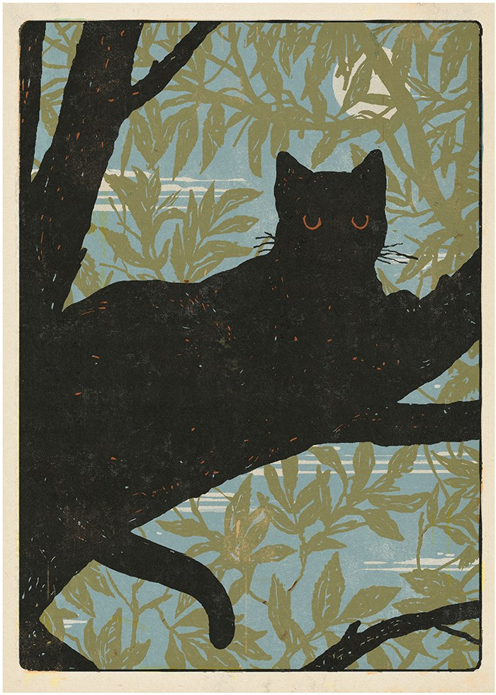
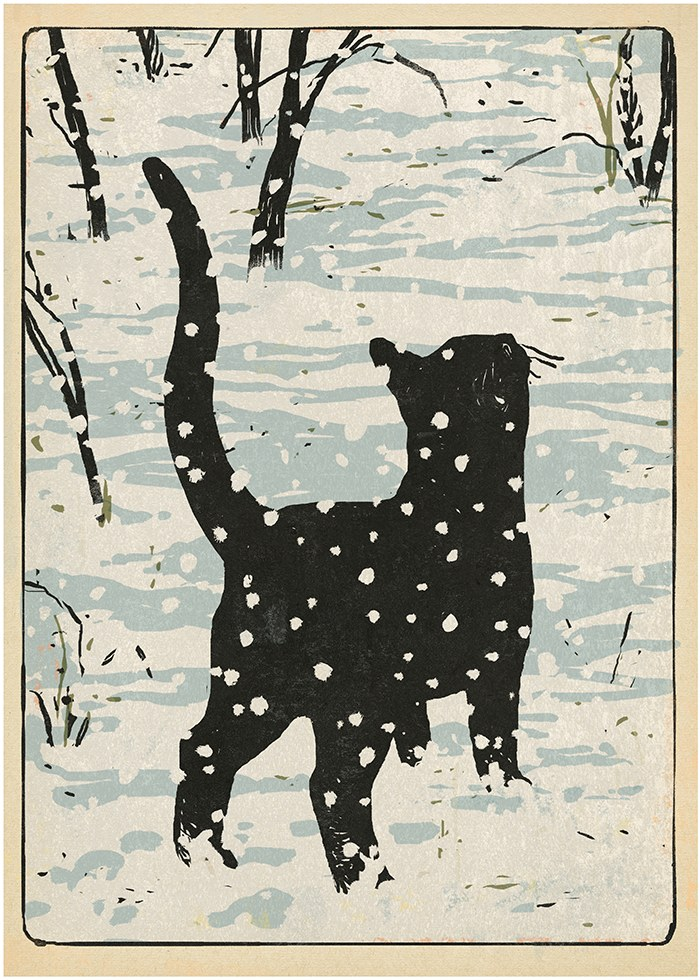

# 今天的文学猫角色：Rroû

秋天的马栗树上，Rroû 把身体舒舒服服地铺在枝杈间，鼻子却没有休息：飞虫一掠过，眼睛就追了过去。法国作家莫里斯·热纳瓦（Maurice Genevoix）写这只猫时，常把读者带到这样的高度——从树上、墙头或草丛里看人住的房子，也看房子之外正在变化的世界。Rroû 是一只黑猫，有人照顾，吃住无忧，可它的脚步总想再向前一点。

《Rroû》于 1931 年出版。小猫最初在一处仓房里长大，活动范围从屋内扩展到院子、街道，终于走进对面人家。那里住着在医生家帮佣的克莱芒丝（Clémence）；她疼爱 Rroû，让它有了安稳的家。热纳瓦没有把它写成一只只会接受抚摸的宠物。它观察、试探，沿着气味和声响认识自己的领地；一棵马栗树、一棵雪松，以及邻近的屋舍，都成为它日常巡行的地方。安静地伏着时，它仍在留意四周，仿佛随时准备跃向新的发现。小说早期的篇章以仓房、院子、街道、对面的人家和马栗树命名；每换一处地方，Rroû 的世界便扩大一圈。房屋在人的眼中只是固定的住处，在它眼中却有可以攀登的枝干、可以躲藏的角落，以及通往更远处的路。

夏天，Rroû 跟着家人来到乡间的夏居。那里有更宽的活动天地，也有别的猫；它结识一只白色的小母猫。等假期结束，人们回到原来的住处，Rroû 却惦记着乡野。入冬之际，它离家出走，重新朝那片地方走去。这是理解它的一个要紧时刻：克莱芒丝的关爱真实而温暖，Rroû 对她也有依恋，但熟悉的屋子留不住它。自由的路并不轻松，天气和野外生活都会让它付出代价；它还是要亲自去走。漫长的失踪之后，克莱芒丝再见到它，凭声音让它认出了自己。她抚看它身上的伤痕，向旁人讲述它可能遇到的险境；她并没有真正同行，却一直想理解这只离家的猫。热纳瓦让牵挂与出走并列存在，Rroû 因而不只是野性或温顺的单一象征。

热纳瓦熟悉卢瓦尔河畔的景色。这部小说的屋舍和树木，有他生活过的故居作底本；据纪念他的友人协会记载，家里曾有一只猫在夏天到过乡间，回城后又自行返回。小说从这件小事生长出来，却让猫拥有完整的感官世界。书中人的爱惜与担忧没有消失，Rroû 的饥饿、好奇和选择也同样有分量。热纳瓦曾以战争见闻成名，又写过卢瓦尔河流域的自然与动物；在这里，他把细致的观察给了一只猫。跟随它穿过院墙和树林，读者不会只知道它最后去了哪里，还会感到它为何总要继续走。读它时，读者跟着一只猫慢慢走出人划定的边界，看到马栗树下和林地里各有怎样的生活。

### 资料来源

- 卢瓦尔河航运博物馆，[“热纳瓦之路：热纳瓦家族的新居”](https://www.musee-marinedeloire.fr/etape-2-la-nouvelle-maison-des-genevoix/)，含《Rroû》节选
- 莫里斯·热纳瓦友人协会，[“传记”](https://mauricegenevoix.wordpress.com/biographie/)
- Synergies Mag，[“《Rroû》：一只勇敢而冒险的猫”](https://synergiesmag.ch/rrou-les-aventures-d-un-chat-courageux-et-temeraire/)，2016 年
- Rémi G.，[“读《Rroû》《白牙》与《三个字母的人》”](https://notessurdeslivres.wordpress.com/2021/10/27/rrou-de-maurice-genevoix-croc-blanc-de-jack-london-et-lhomme-aux-trois-lettres-de-pascal-quignard-finir-par-aimer-a-sa-facon-sauvage/)，2021 年，含《Rroû》第 257—258 页节录

### 视觉参考

1. 2022 年《Rroû》插画，杰拉尔·迪布瓦绘：黑猫伏在树枝上
   - 来源页面：<https://www.commarts.com/project/35277/rro>
   - 原始图片：<https://image2.commarts.com/images1/6/1/5/1/1/1151635_102_1160_MTk3MjM2NzM5NTIwNTMzMTUwOA.jpg>
   - 作者/机构：杰拉尔·迪布瓦（Gérard DuBois）／拉塔布尔龙德出版社（Éditions La Table Ronde）
   - 说明：小说新版插画呈现 Rroû 在树上的身影。

2. 2022 年《Rroû》插画，杰拉尔·迪布瓦绘：黑猫走过雪地
   - 来源页面：<https://www.commarts.com/project/35277/rro>
   - 原始图片：<https://image0.commarts.com/images1/6/1/5/1/1/1151637_102_1160_Mzg2MDgwNDc4LTg3MjY3NDcyNg.jpg>
   - 作者/机构：杰拉尔·迪布瓦（Gérard DuBois）／拉塔布尔龙德出版社（Éditions La Table Ronde）
   - 说明：小说新版插画呈现 Rroû 在冬日户外的形象。
