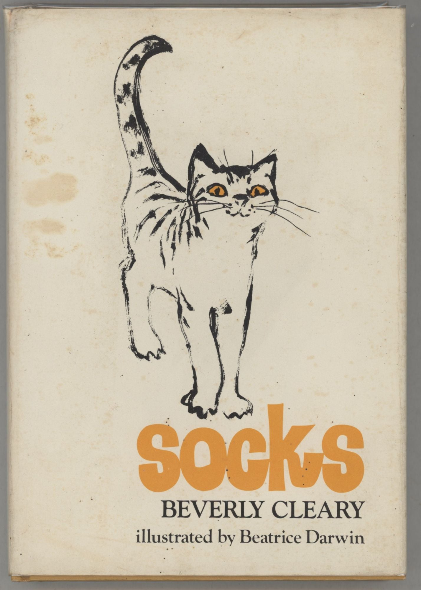
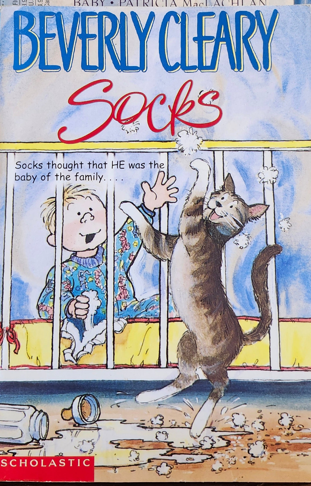

# 今天的文学猫角色：Socks

Bricker 夫妇领回的小猫有四只白脚，像穿着袜子，Socks 这个名字便从这里来。它原先和别的幼猫一起等着被人带走，一度被塞进邮筒；到了新家，客厅沙发、膝头和每天的抚摸迅速成了它认定的生活。贝弗莉·克莱瑞（Beverly Cleary）在 1973 年出版的《Socks》把这个家交给一只猫来观察：人说的是人话，读者却能从它寻找座位、食物与目光的动作里，看见它怎样理解“被爱”。

这只白脚虎斑猫喜欢牛奶和睡觉，也喜欢人伸手摸它。它有个只供亲近者使用的小名 Ticky；家里的沙发是它惯常打盹的地方。这些偏好让 Socks 看起来像一位要求很多的小主人，但它的底气十分具体：只要 Bricker 夫妇有空，它就能得到一个暖和的位置。故事里最早的变化，也正落在这个位置上——Marilyn 的膝头渐渐容不下它了，接着她去了医院，回来时怀里抱着一个会哭闹的婴儿。

婴儿叫 Charles William。Socks 无法理解家中来了什么人，只知道这个“新宠物”占去了原本属于自己的注意力。大人忙着照顾孩子，它想亲近时却未必有人腾得出手；熟悉的屋子仍在，屋子里的规则已经变了。它感到嫉妒，开始惹麻烦，却也并非一个专为制造笑料而存在的捣蛋鬼。对于一只靠日常习惯判断安稳的猫，少掉的抚摸比任何解释都响亮。克莱瑞让读者贴着它的困惑去看一桩家庭里的常事：一个新成员到来后，原先被照顾得最周到的那位，该把自己放在哪里？

Socks 的世界并不只剩下婴儿。它还要在家中寻找舒服的角落，提防名叫 Old Taylor 的公猫，也会遇到让它不喜欢的客人。祖母的一顶假发，在它眼里也可以成为玩伴；它与 Old Taylor 的冲突，则让屋外的领地闯进这场家庭风波。作者没有让它突然懂得大人的安排；它仍凭猫的习惯试探边界，想睡就睡，想要抚摸便靠过去。它对膝头的执着和对另一只猫的戒备放在一起，读者便能看到：这场风波既关乎家庭的关爱，也关乎一只猫每天如何生活。这样的细节使它的失落有了重量：一张不能再独占的膝头、一只暂时不来摸它的手，就是它能感到的变化。

到了故事末尾，Socks 与 Charles William 终于能够相处，甚至一同把婴儿房弄得乱糟糟。读者知道孩子会长大，猫却只能在每一次靠近里重新确认自己是否还被接纳。《Socks》的趣味就在这种视角的错位：婴儿在大人眼里是儿子，在猫眼里先是难以理解的竞争者，后来才成为可以一起闯祸的伙伴。两位新朋友把婴儿房闹翻时，Socks 已经找到了自己在这个家里的新位置。

### 资料来源

- Beverly Cleary 官方网站，[Socks 角色介绍](https://www.beverlycleary.com/characters/socks)
- Beverly Cleary 官方网站，[Socks 角色问答](https://www.beverlycleary.com/fun-games/socks-quiz)
- Kirkus Reviews，[《Socks》1973 年书评](https://www.kirkusreviews.com/book-reviews/beverly-cleary/socks/)
- Google Books，[Beverly Cleary《Socks》1973 年版书目与简介](https://books.google.com/books/about/Socks.html?id=otFsTnq9WmEC)

### 视觉参考

1. 1973 年初版封面，Beatrice Darwin 绘：白脚虎斑猫
   - 来源页面：<https://www.abebooks.com/first-edition/Socks-Cleary-Beverly-William-Morrow-Company/32338194218/bd>
   - 原始图片：<https://pictures.abebooks.com/inventory/32338194218.jpg>
   - 作者/机构：Beatrice Darwin；Evening Star Books
   - 说明：1973 年初版书衣上的 Socks 形象。

2. Scholastic 版封面：Socks 在婴儿床旁伸爪
   - 来源页面：<https://deadtreedreams.com/products/socks-by-beverly-cleary>
   - 原始图片：<https://deadtreedreams.com/cdn/shop/files/20250325_132352.jpg?v=1743037589>
   - 作者/机构：Scholastic；Dead Tree Dreams
   - 说明：后出版本以 Socks 和婴儿的相遇呈现故事情境。
