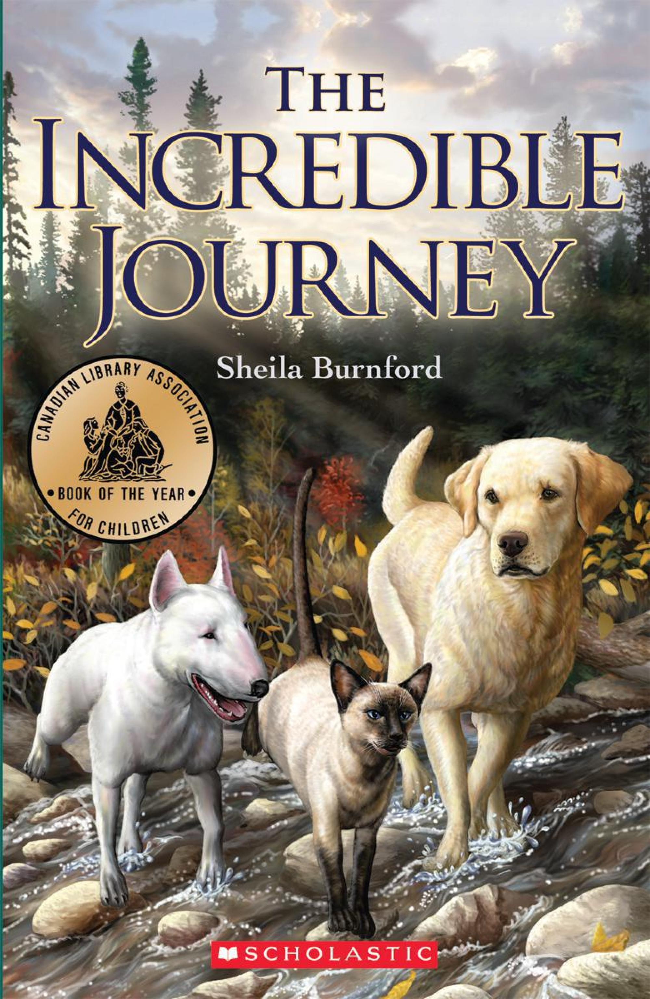
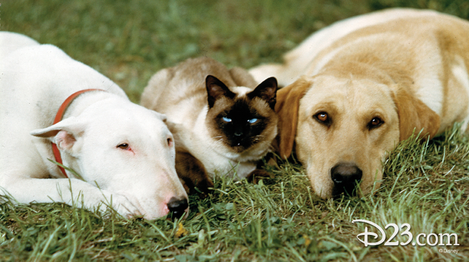

# 今天的文学猫角色：Tao

一只老狗倒在泥水里，棕熊幼崽正用爪子碰它。Tao 叼着刚捕到的山鹑折回，立刻松开猎物，炸起一身浅麦色的毛，扑上小熊的后颈。母熊赶来，它尖叫着侧身逼近，仍挡在同伴前面。年轻的狗冲到身旁，熊终于退进树林。危险过去，Tao 抖抖爪子，回去找那只山鹑。

Tao 是 Sheila Burnford 的小说《The Incredible Journey》里的暹罗猫。它有蓝眼睛、深色的面部和尾巴，身形比同行的两只狗小得多：Bodger 是年迈的牛头梗，Luath 是年轻的拉布拉多犬。1961 年初版的故事从一次照看安排的误会出发：主人远行，三只宠物暂住在朋友家，后来结伴穿过加拿大安大略北部的荒野，朝家的方向前进。路上有湍急的河流、饥饿和野兽。Tao 有自己的速度、胃口和警觉，跟两只狗走在同一条路上，却始终保留着猫的脾气。

Tao 先显出猎手的一面。清晨，它已抓到鸟；饿着肚子的老狗只能看着它吃。午间它又捕到花栗鼠，Bodger 摇着尾巴上前，它低吼一声，把猎物带进灌木。过一会儿，它从树丛里出来，仔细清理胡须；老狗舔舔它的黑脸，它便伸爪轻拍对方的鼻子。它不按人的期待分享每一口食物，仍把这位疲惫的旅伴当作亲近的同伴。这份亲近有自己的分寸，能从一个轻拍的动作里看出来。

熊出现之前，Bodger 已走得摇摇晃晃。Tao 放慢脚步，贴近它，发出焦急的叫声。熊被赶走后，它又把山鹑拖到老狗鼻尖，撕开鸟肉，却不再驱赶它。气味让昏迷的 Bodger 睁开眼，慢慢起身吃下猎物；入夜，Tao 还叼来一只小鼠，丢在它身边。先前守着自己的猎物、此时把食物留给老朋友的，是同一只猫。赶走熊后，它的蓝眼睛又恢复了冷静的神情，仿佛不需要谁为它的英勇喝彩。

三只动物一路相伴，却各有求生的本领和限度。Luath 有寻回犬的天性，不愿捕杀；Bodger 年老体衰；Tao 能自行猎食，也敢在体形悬殊的对手面前挺身而出。故事读起来有惊险的跋涉，也有溪边舔脸、夜里送来小鼠这样的安静时刻。河流与寒冷不断耗去队伍的力气，彼此的关系便藏在停步等待、靠近和分食之中。读者看见它们的不同，也看见这三种性情怎样凑成一支队伍。

1963 年，迪士尼把小说拍成同名电影。银幕上的 Tao 由一只名叫 Syn 的暹罗猫扮演；影片让动物保持沉默，以旁白讲述旅程。从小说里的蓝眼猎手，到电影中伏在两只狗之间的同伴，它始终是那只既能独自捕猎、又会回头照顾老狗的猫。林道上的危险过去后，它把自己的猎物带到 Bodger 身边，陪它等到重新站起来。

### 资料来源

- Sheila Burnford，[《The Incredible Journey》Scholastic Canada 版试读](https://www.scholastic.ca/books/app/webroot/img/pdfs/9781443100182.pdf)，第 31—42 页
- Scholastic Canada，[《The Incredible Journey》图书页](https://www.scholastic.ca/our-books/book/incredible-journey-the-9781443100182)
- D23，[《The Incredible Journey Stars》](https://d23.com/featured-photo/incredible-journey-stars/)
- D23，[《Incredible Journey, The (film)》](https://d23.com/a-to-z/incredible-journey-the-film/)

### 视觉参考

1. 2010 年书封，Paul Perreault 绘：Tao 与两只狗
   - 来源页面：<https://www.scholastic.ca/our-books/book/incredible-journey-the-9781443100182>
   - 原始图片：<https://www.scholastic.ca/hipoint/648/?src=9781443100182.jpg&w=2000>
   - 作者/机构：Paul Perreault／Scholastic Canada
   - 说明：Scholastic Canada 版小说封面呈现 Tao 与同行的两只狗。

2. 1963 年迪士尼电影剧照：Tao 与两只狗
   - 来源页面：<https://d23.com/featured-photo/incredible-journey-stars/>
   - 原始图片：<https://d23.com/app/uploads/2018/01/028_762-547c.jpg>
   - 作者/机构：迪士尼／D23
   - 说明：同名电影的三位动物主角合影，Tao 位于两只狗之间。
