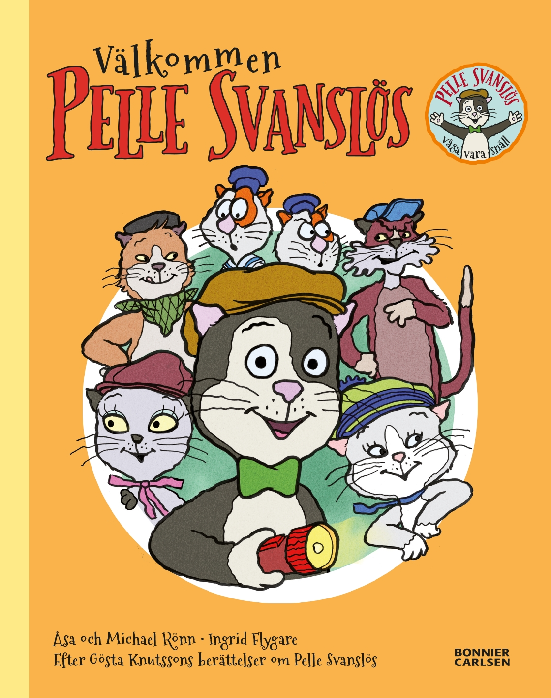
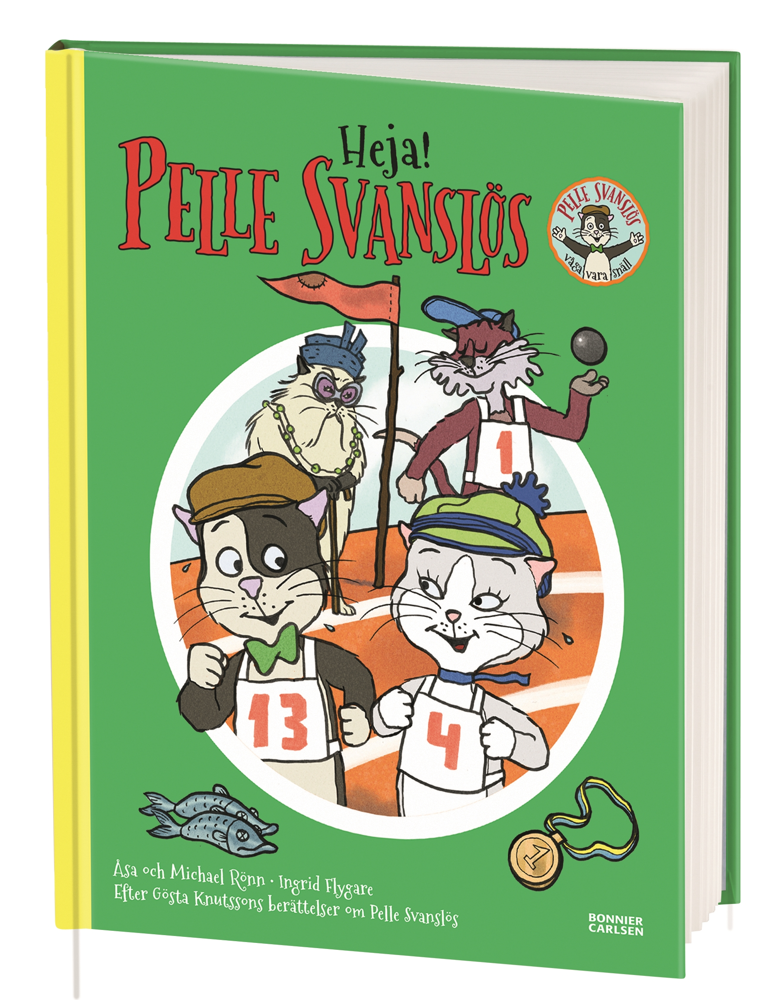

# 今天的文学猫角色：Pelle Svanslös（派勒）

派勒进城，起因只是钻进一辆汽车睡了个觉。这只住在农场的小猫醒来后，成了瑞典乌普萨拉一户人家的猫，也进入了一个会交朋友、办聚会、暗中使坏的猫咪社会。在《Välkommen Pelle Svanslös》（书名意为“欢迎派勒”）的改写中，他脖子上的蝴蝶结和身后缺少的尾巴，很快惹来邻居坏猫的不满。连一场欢迎会，都可能藏着捉弄新来者的计划。初来乍到的派勒，还得慢慢学会辨认别人的好意。

这只猫由瑞典作家约斯塔·克努特松（Gösta Knutsson）创造，“无尾猫派勒”系列（Pelle Svanslös）的第一本书在 1939 年出版。名字里的 Svanslös 就是“没有尾巴”的意思：他幼小时被老鼠咬掉了尾巴。故事把他放在真实的乌普萨拉街区里，给他安排了人类家庭，也给了他一圈有自己脾气和规矩的猫邻居。他们的世界离日常生活很近，连排挤一个新伙伴，都有一套冠冕堂皇的理由。

在 Ingrid Flygare 延续 Jan Gissberg 造型的插画里，派勒有灰黑色的头背、白色的脸胸，大眼睛配一只粉鼻子，常戴着帽子和绿色蝴蝶结。这样的装束使他带着一点认真过日子的神气。他的性格却不完美：善良，替别人着想，也有些迷糊、容易受骗，还爱吹一点牛。这些小毛病使他的远行充满意外：他会坐错火车，也会被坏猫骗得团团转。读他的故事，不必先把他当成时时正确的小榜样。

派勒最难摆脱的邻居是 Måns，以及跟着他起哄的 Bill 和 Bull。尾巴成了他们随时能拿出来取笑的东西，派勒无论做什么，都可能被先叫作那个“没尾巴的”。不过，他在城里也有愿意接纳他的朋友。谨慎、守规矩的他，尤其会被朋友 Maja 的勇敢吸引。猫群的热闹因此有了两面：一边有人故意让他难堪，一边有人肯站到他身旁。他需要学的，是怎样继续与别人相处，同时不接受别人对自己的轻慢。

《Heja, Pelle Svanslös!》（书名意为“加油，派勒！”）把这种处境搬上了运动场。这里采用 Åsa 和 Michael Rönn 根据经典故事改写的绘本版本：猫咪们准备参加田径赛，Måns 和他的坏脾气表亲却掌握着比赛安排。派勒遇上的铅球重得可疑，别的选手也接连受挫，奖项仿佛都要落进同一只猫的爪子里。等到跑步项目开始，缺少尾巴却未必还是坏事。这场比赛的笑料，落在猫怎样利用规则、又怎样被自己的小算盘绊住脚上。

克努特松笔下的派勒后来走进电视和动画，二十世纪八十年代的两部动画电影采用了 Jan Gissberg 的设计。Flygare 又把这一形象带进新的绘本，使一代代读者继续认得这个戴帽子的小家伙。欢迎篇的封面把他放在一群猫中间，运动会篇则给他穿上了醒目的 13 号背心：他握着爪子，与朋友一起站在跑道上。

### 资料来源

- Sagogränd AB，[《Om Pelle》角色与作品沿革](https://www.pellesvanslos.se/om-pelle/)
- Sagogränd AB，[《Pelle Svanslös》角色介绍](https://www.pellesvanslos.se/kattaktarer/pelle/)
- Bonnier Carlsen，[《Välkommen Pelle Svanslös》图书页](https://www.bonniercarlsen.se/bocker/213459/valkommen-pelle-svanslos/)，2016 年版
- Sagogränd AB，[《Heja, Pelle Svanslös!》图书页](https://www.pellesvanslos.se/bocker/heja-pelle-svanslos/)，Åsa、Michael Rönn 改写，Ingrid Flygare 插画
- 接力出版社，[《2020 年秋季书目》](https://ccbf-storage.event-lightning.com/DTP/como_webform_import/files/JMVU1601018719_PWMkyv.pdf)，第 67 页“无尾猫派勒系列”

### 视觉参考

1. 2016 年版封面，Ingrid Flygare 绘：派勒与群猫
   - 来源页面：<https://www.pellesvanslos.se/bocker/valkommen-pelle-svanslos/>
   - 原始图片：<https://www.pellesvanslos.se/wp-content/uploads/valkommenpellesvanslos.jpg>
   - 作者/机构：Ingrid Flygare（沿用 Jan Gissberg 角色造型）／Bonnier Carlsen；Sagogränd AB 提供
   - 说明：《Välkommen Pelle Svanslös》封面，中央戴帽子和绿色蝴蝶结的是派勒，周围是猫邻居们。

2. 2016 年版封面，Ingrid Flygare 绘：猫咪运动会
   - 来源页面：<https://www.pellesvanslos.se/bocker/heja-pelle-svanslos/>
   - 原始图片：<https://www.pellesvanslos.se/wp-content/uploads/hejapellesvanslos.jpg>
   - 作者/机构：Ingrid Flygare（沿用 Jan Gissberg 角色造型）／Bonnier Carlsen；Sagogränd AB 提供
   - 说明：《Heja, Pelle Svanslös!》书影，派勒穿着 13 号背心，与朋友一起出现在运动场上。
