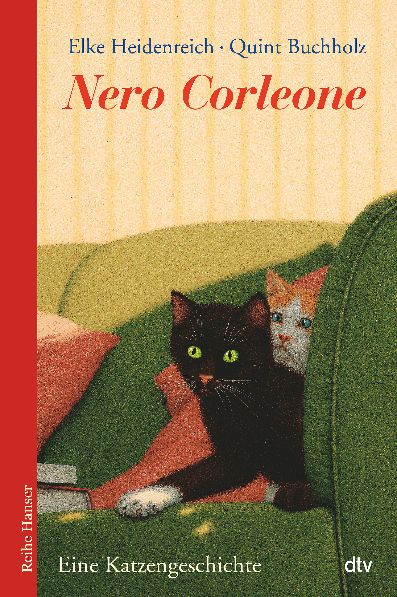

# 今天的文学猫角色：Nero Corleone（尼禄）

一身黑毛，偏偏留着一只白色前爪，尼禄走到哪里，都像带着自己的签名。它出生在意大利农场，降生那夜又逢风雨交加的黑色星期五；若照人类的迷信，这开场实在不吉利。可这只小猫很快就让大家明白，需要担心运气的恐怕是别的动物。狗、驴和公鸡都怕它，它知道怎样利用这种畏惧，把农场变成自己的地盘。

这位猫中“教父”来自德国作家伊尔克·海登赖希（Elke Heidenreich）1995 年出版的《黑猫尼禄》（Nero Corleone），插画由布赫兹（Quint Buchholz）绘制。故事写给孩子，也容得下成年读者熟悉的人情世故：谁占上风，谁肯让步，谁以为自己正在照顾别人，却早已被对方安排好了生活。尼禄的名字和派头使这些关系带着黑帮喜剧的味道；它用来发号施令的，却仍是一只猫的爪子。

尼禄的胆量里掺着精明。面对四条腿的邻居，它敢横行霸道；面对能给它更舒适生活的人，它又懂得让自己讨人喜欢。一对来自科隆的德国夫妇在附近度假，成了它的新目标。农场里的日子虽然称王称霸，却未必比得上一间有人疼爱的屋子，于是它设法赢得夫妇的欢心，最后连同猫伙伴 Rosa 一起，被带回德国。人类看见的是一只值得收养的猫，尼禄看见的则是一条通向好日子的路。

这样的主角不太适合拿来当乖巧的榜样。它要的东西常常直接去拿，也不怎么替别的动物着想；读者可以被它逗笑，同时察觉它的专横。海登赖希把猫的自信放大到人类社会的尺度，便写出了一个会争地盘、会经营关系的小人物。换了国家，住进公寓，改变的是生活条件，那股认定自己有资格做老大的劲头仍在。读这本书的乐趣，也在于看人类如何心甘情愿地接受它的支配。

布赫兹给这种气势画出了安静的表面：黑毛、黄绿色眼睛、细长的白胡须，白爪搁在沙发上，另一只猫从靠垫旁探出脸。没有龇牙咧嘴，尼禄已经占住了画面的中心。柔软的家具与它警醒的目光放在一起，让“家猫”和“老大”两种身份同时成立。文字里的算计与插画里的从容相互照应，这只猫即使不动，也显得十分有主意。

到了年老时，尼禄又回到意大利。它与人类的关系没有因此就结束：2011 年出版的续作《Nero Corleone kehrt zurück》，书名意为“尼禄回来了”，继续写那位女主人 Isolde 对它的思念。她回到意大利的小村庄，迟迟等不到黑猫；等另一只猫走进她的生活，尼禄却又出现了。续作的封面上，它和一只灰色虎斑猫卧在草地里，身后是房屋与远山，白色前爪仍伸在最前面。

### 资料来源

- 台北市立图书馆，[《黑猫尼禄》馆藏介绍](https://blind.tpml.edu.tw/TaipeiLib/wSite/ct?ctNode=419&mp=1&xItem=161250)，伊尔克·海登赖希作，林敏雅译，玉山社版
- Goethe-Institut，[《Nero Cuordileone. La storia di un gatto prepotente e latin lover》德意版本介绍](https://www.goethe.de/ins/it/de/kul/kuf/uak/bue.cfm?publicationId=19356)
- dtv，[《Nero Corleone》图书页](https://www.dtv.de/buch/nero-corleone)，2011 年版
- Kirkus Reviews，[《Nero Corleone: A Cat’s Story》书评](https://www.kirkusreviews.com/book-reviews/elke-heidenreich/nero-corleone/)，1997 年 8 月 15 日
- dtv，[《Nero Corleone kehrt zurück》图书页](https://www.dtv.de/buch/nero-corleone-kehrt-zurueck)，2013 年版
- literaturkritik.de，[《Zum 25. Geburtstag von Elke Heidenreichs süßem Kater Nero Corleone》](https://literaturkritik.de/heidenreich-nero-corleone-heidenreich-buchholz-nero-corleone-kehrt-zurueck-25-geburtstag-suessem-kater,27484.html)，2020 年 12 月

### 视觉参考

1. 2011 年 dtv 版封面，布赫兹绘：沙发上的尼禄
   - 来源页面：<https://www.dtv.de/buch/nero-corleone>
   - 原始图片：<https://www.dtv.de/media/df/b1/e7/1721987733/9783423625081.jpg?ts=1721987733>
   - 作者/机构：Quint Buchholz／dtv
   - 说明：《Nero Corleone》封面，黑猫尼禄伸着白色前爪坐在沙发上，另一只猫从身后探出脸。

2. 2013 年 dtv 续作封面，布赫兹绘：草地上的尼禄
   - 来源页面：<https://www.dtv.de/buch/nero-corleone-kehrt-zurueck>
   - 原始图片：<https://www.dtv.de/media/f9/75/a3/1721987823/9783423625715.jpg?ts=1721987823>
   - 作者/机构：Quint Buchholz／dtv
   - 说明：《Nero Corleone kehrt zurück》封面，尼禄与灰色虎斑猫卧在意大利乡村的草地上。
