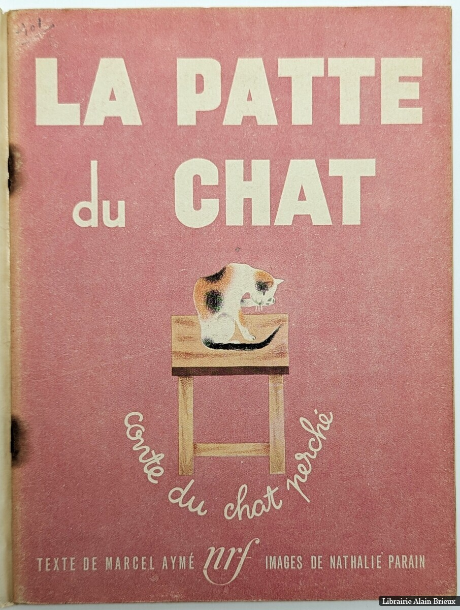
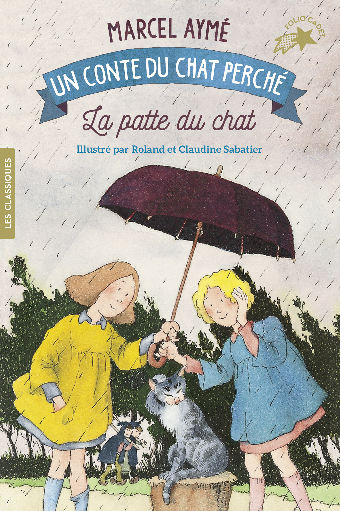

# 今天的文学猫角色：Alphonse

一只猫把爪子擦到耳后，第二天就下起雨来。对农场里的大人，这是耽误下田的坏消息；对两个不愿出门的小女孩，却是一场及时的援救。Alphonse 不必离开木柴堆，也不必和家长争赢，只消认真洗一回脸，就能把他们安排好的明天整个改掉。

这只猫出自法国作家马塞尔·埃梅（Marcel Aymé）的《捉猫故事集》（Les Contes du chat perché），在其中的《La Patte du chat》——题意是“猫爪”——里担任主角。故事的天地是一座农场，两个小女孩 Delphine 和 Marinette 能与动物交谈，猫、鸭、猪、马各有主意，也各有脾气。Alphonse 的名字就是女孩们给取的。它习惯坐在窗边看雨，白天睡觉，夜里在阁楼奔跑；被大人责备白吃饭、不捉老鼠时，它会当面争辩，提醒他们：自己夜间忙碌的时候，可没人跟在身后夸奖。

它对孩子们也没有一味纵容。女孩们绕着桌子追逐，它先提醒这样玩会打碎东西；果然，一只家传的陶盘落地碎了。可等到父母要罚她们去探望凶恶的姨妈，它又替她们抱不平。大人定下的条件是“明天不下雨就去”，女孩便想到请它继续把爪子擦到耳后。这个主意让一场寻常的家庭争执忽然接通了天气：孩子无法取消惩罚，却能请猫让出门的条件迟迟不成立。

Alphonse 身上的魔法带着日常生活的质感。它没有咒语、法杖，也不摆出预言家的神气；洗脸、跳窗、打盹这些小动作，足以撑起整个故事。它原本也爱爬树，爱在田野和树林里跑，并不乐意为了帮忙就永远关在雨天里。这一点让它的友爱有了分量：帮助朋友占用了它自己的快活时光。它又会记恨无端挨的打，温和与倔强并存，远比一位随叫随到的动物助手难以摆布。

埃梅还把这份倔强推到一个危险的关口。连日的雨惹怒了父母，他们决定把猫装袋投入河里。女孩们偷偷解开袋口，愿意承担违抗命令的后果，它却不肯用她们长期受罚来换自己的安全，竟又把头缩回袋中。这一刻，它对朋友的认真近乎固执。农场动物随后聚到一起商量营救，轻巧的童话因此露出严厉的一面：大人的命令可能不公，顺从也可能使弱小者付出代价。读者会笑它们一本正经的议论，也会替那只不肯逃走的猫着急。

插画给 Alphonse 留下了不同的面貌。Nathalie Parain 为 1944 年单行本绘制的封面里，它身上带着深浅斑块，坐在方凳上专心洗脸，周围大片粉红色衬得动作格外安静。到了 2018 年 Roland 与 Claudine Sabatier 的版本，它成为一只灰白猫，坐在树桩上，由两个女孩合撑一把伞。雨线斜斜落下，女孩把伞留给猫，猫仍抬着爪子照料自己的耳朵。

### 资料来源

- 马塞尔·埃梅，[《Les Contes du chat perché》公开试读，《La Patte du chat》](https://media.electre-ng.com/extraits/extrait-id/c671b5e5d8c546cf3902ea982206095a192946b2ee8bbdd5e8ca1c0bcd432611.pdf)
- Journal des Instituteurs、Gallimard Jeunesse，[《La Patte du chat》教学阅读指南](https://www.cercle-enseignement.com/content/download/25275/678736/file/Patte_du_chat.pdf)
- Gallimard，[《La patte du chat》2018 年版图书页](https://www.cercle-enseignement.com/Ouvrages/Gallimard-Jeunesse/Folio-Cadet-Les-classiques/La-patte-du-chat)
- Société des amis de Marcel Aymé，[《La Patte du chat》版本书目](https://marcelayme.net/marcel_ayme/editions/contes/la_patte_du_chat.html)

### 视觉参考

1. 1944 年初版封面，Parain 绘：凳上洗脸的猫
   - 来源页面：<https://www.abebooks.fr/Patte-Chat-Conte-Perch%C3%A9-AYM%C3%89-Marcel/32422945347/bd>
   - 原始图片：<https://pictures.abebooks.com/inventory/32422945347.jpg>
   - 作者/机构：Nathalie Parain 绘；Gallimard 出版；Librairie Alain Brieux 提供书影
   - 说明：1944 年《La Patte du chat》单行本封面，以洗脸动作表现 Alphonse 的招雨本领。

2. 2018 年版封面，Sabatier 夫妇绘：雨伞下的猫
   - 来源页面：<https://www.gallimard-jeunesse.fr/9782075106399/la-patte-du-chat.html>
   - 原始图片：<https://media.groupe.gallimard.fr/couvHD/J01366.jpg>
   - 作者/机构：Roland 与 Claudine Sabatier 绘；Gallimard Jeunesse
   - 说明：2018 年 Folio Cadet 版封面，以女孩们撑伞陪伴 Alphonse 的雨中场景呈现角色关系。
