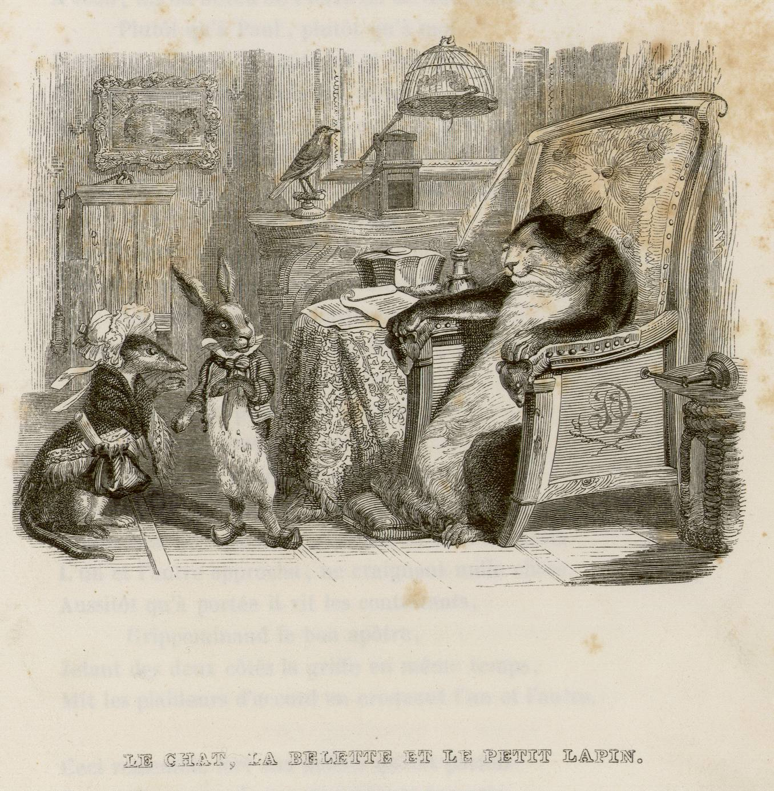
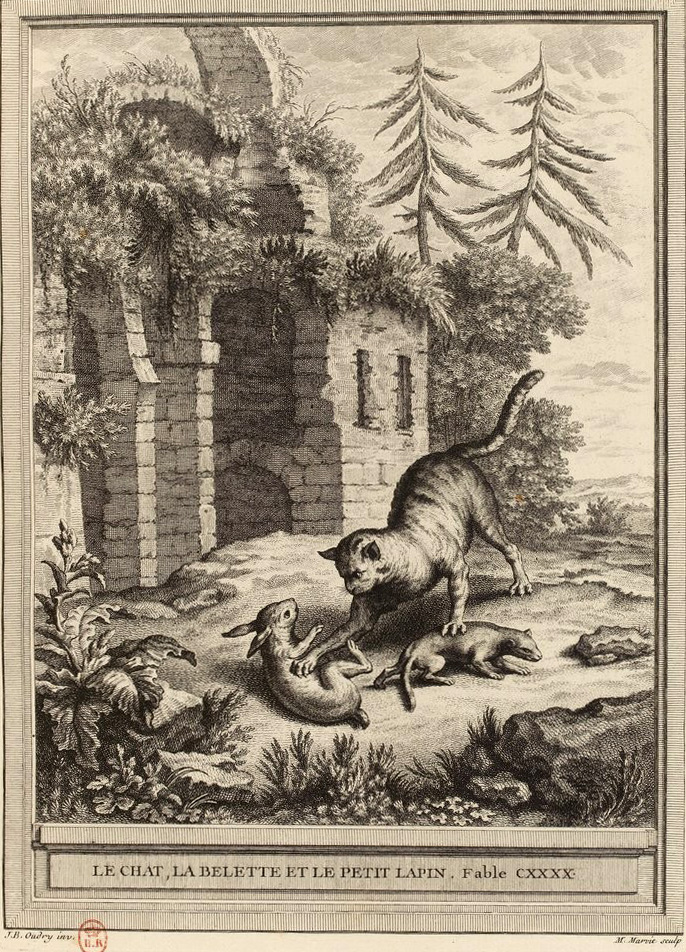

# 今天的文学猫角色：Raminagrobis

“孩子们，靠近些。”一只胖猫接下官司，先请双方走到面前，又解释自己年纪大了，耳朵不灵。口气如此和蔼，连称呼都带着长辈的亲切。兔子与黄鼠狼原本互不相让，到了它面前却一起放下戒心。这位叫 Raminagrobis 的仲裁者，只须让来客再走近几步，就能用爪子替自己的话作结。

它出自法国诗人让·德·拉封丹（Jean de La Fontaine）的《猫、黄鼠狼和小兔子》（Le Chat, la Belette et le Petit Lapin），这首寓言诗于 1678 年发表，收入《拉封丹寓言》第七卷。拉封丹给猫的出场留了很短的篇幅，却把它写得轮廓分明：皮毛厚实，身躯肥胖，过着仿佛虔诚隐士的生活，又有能裁断各种案件的声望。柔软的皮毛、安稳的体态和超然的名声，全都成了它让别的动物安心的本钱。

送上门的争端起于一个兔窝。兔子清早出门，回来时发现黄鼠狼已占据住处；它援引祖辈传下来的居住权，对方却搬出先占者的道理。双方争执不下，黄鼠狼提议去找猫评判，兔子也同意了。猫无需四处追逐猎物，甚至不用费力挑起矛盾：它只要接受那个看似公正的席位，就有人主动把自己的安危交到它手里。它的耐心与不动声色，因此比扑咬更值得留意。

诗中还有一个属于它的名字：Grippeminaud。两个名字指向同一位猫法官，陪伴它的称谓也不断变换，先是圣徒般的猫，继而成了裹着皮毛的陛下。这样的尊称读来有些滑稽，危险却藏在其中：兔子和黄鼠狼把一只会捕食自己的动物，当成了可以信赖的权威。猫开口时并不讨论谁对谁错，只把距离当作唯一要解决的问题。所谓耳聋，是一个多么便利的请求——再靠近一点，便进入爪子够得着的地方。

后来的插画家把这份体面画出了不同模样。Grandville 的 1838 年插图让胖猫陷在宽大的扶手椅里，前爪搭着扶手，兔子与黄鼠狼穿戴整齐地站在旁边；桌上的书卷、茶具和身后的陈设，让求见它成了一场煞有介事的拜访。另一种形象见于 1755—1759 年版的雕版插图：Martin Marvie 根据让-巴蒂斯特·乌德里（Jean-Baptiste Oudry）的画稿，把猫放回户外，让它弓身伸爪，面对地上的两只小兽。一个版本保留从容接见的姿态，另一个直接显出捕食的身体。

拉封丹在结尾把猫的做法与小君主求助于国王的争端相提并论，使它的胃口越出了兔窝的范围。不过，读到最后，最清楚的仍是那个动作：两位当事人一到跟前，它便同时向两边伸爪，把双方都吃了。官司就这样“和解”了，胖猫从头到尾没有作出一句判词。

### 资料来源

- 让·德·拉封丹，[《Le Chat, la Belette, et le petit Lapin》](https://fr.wikisource.org/wiki/Le_Chat,_la_Belette,_et_le_petit_Lapin)，1678 年版，第七卷第十五则
- 让·德·拉封丹，[《Fables de La Fontaine》](https://www.gutenberg.org/files/56327/56327-h/56327-h.htm#Page_349)，Grandville 插图，Garnier Frères 1868 年版，第 349—351 页
- 南锡图书馆／Limédia，[Grandville《Le chat, la belette, et le petit lapin》馆藏记录](https://galeries.limedia.fr/ark:/31124/dbnph6hc8lz4jxp7/)，1838 年版，第 286 页
- Wikimedia Commons，[Marvie 据 Oudry 原画制作的《Le chat, la belette et le petit lapin》版画记录](https://commons.wikimedia.org/wiki/File:Marvie-Oudry-La_Fontaine-Le_chat,_la_belette_et_le_petit_lapin.jpg)，1755—1759 年版

### 视觉参考

1. 1838 年版，Grandville 绘：扶手椅上的猫法官
   - 来源页面：<https://galeries.limedia.fr/ark:/31124/dbnph6hc8lz4jxp7/>
   - 原始图片：<https://rgw.atolcd.com/swift/v1/sillon_container_prod/entrepot/B543956101R10795_01_286_1_p.jpg>
   - 作者/机构：Grandville；南锡图书馆／Limédia
   - 说明：1838 年《拉封丹寓言》第一卷第 286 页插图，表现 Raminagrobis 接见兔子与黄鼠狼。

2. 1755—1759 年版，Marvie 刻：猫向两只小兽伸爪
   - 来源页面：<https://commons.wikimedia.org/wiki/File:Marvie-Oudry-La_Fontaine-Le_chat,_la_belette_et_le_petit_lapin.jpg>
   - 原始图片：<https://upload.wikimedia.org/wikipedia/commons/1/1f/Marvie-Oudry-La_Fontaine-Le_chat%2C_la_belette_et_le_petit_lapin.jpg>
   - 作者/机构：Martin Marvie 刻，Jean-Baptiste Oudry 原画；法国国家图书馆／Wikimedia Commons
   - 说明：Desaint & Saillant 版《拉封丹寓言》中的同篇插图，表现猫向两位争执者伸爪的场面。
