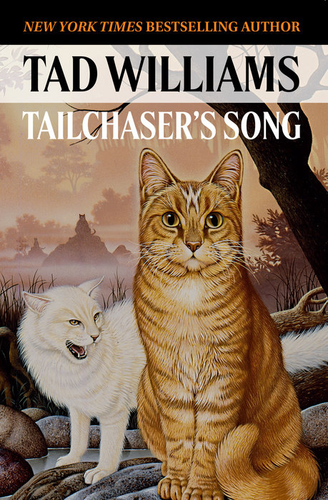

# 今天的文学猫角色：Fritti Tailchaser

捕猎扑空以后，Fritti Tailchaser 会羞得咬自己的脚。他原先伏在草丛里，绷紧后腿，尾巴来回摆动，自以为已经算准距离；落地时却差了一截，猎物早钻回洞里。这个准备闯荡世界的年轻猎手，有一身姜黄色的毛，也有受不了同伴取笑的自尊。饿了半夜，最后仍得回到人类放出的食碗旁，把晚饭舔干净。

这只公猫是美国作家泰德·威廉姆斯（Tad Williams）1985 年出版的处女作《Tailchaser’s Song》的主人公。书名意为“Tailchaser 的歌”，但这首歌的天地相当辽阔：猫有自己的语言、神祇、古老传说和聚会，连人类也只是他们眼中没毛、直立行走的奇怪生物。叙述贴着猫的感官移动，风带来消息，气味帮助辨认来客，耳朵和胡须先于思考察觉异样。屋顶、草地和围墙之间，已经容得下一个等待探索的世界。

Fritti 的勇气里混着好奇与牵挂。朋友 Hushpad 失踪后，他离开熟悉的地方去寻找她，旅途渐渐通向猫族神话中的危险。他并非一出场便懂得担当的英雄：惦记喜欢的母猫时，他会心神不宁，也会把坏情绪撒在凑到身边的小猫身上；发觉自己做错，又肯低头道歉。他既盼望得到承认，也还在学着照顾别人的感受。这些小小的失态，使后来承担风险的他有了可以亲近的起点。寻友把他推向远方，故事中的成长则始终绕着忠诚、责任与失落展开。

威廉姆斯在 2001 年的创作回忆里，把这部小说与自己第一次养猫的经历连在一起。他养过一只名叫 Fever 的姜黄色公猫，惊讶于猫能够如此理所当然地享受人的供养，于是开始设想：如果整个宇宙以猫为中心，猫会怎样理解人类，又会讲些什么故事？Fritti 的冒险就从这样的日常观察里长出来。小说让猫拥有史诗的规模，同时保留他们对食物、领地和自己那身毛的关切。

后来的封面也给了这场冒险不同的面貌。DAW 的 2024 年版让一只姜黄色虎斑猫端坐在前，白猫在他身旁露出牙齿，远处是朦胧的山水；Ben Summers 为 2015 年英国版绘制的封面则用黑白猫形、泼墨般的边缘和额头上的白星，铺开更幽暗的气氛。封面的黑猫形象属于这个版本的视觉设计，小说中的 Fritti 仍是那只姜黄色公猫。

就连猫族的高贵与神秘，也总会被猫自己的身体拉回地面。威廉姆斯回忆，书中 Fritti 见到尊贵的猫女王时，发现她正在咬自己的屁股；这个场面带着他对托尔金式庄严奇幻的调侃。神话、王廷与漫长远征都可以暂且等一等，猫眼前还有一处必须认真料理的痒。

### 资料来源

- 泰德·威廉姆斯，[《Tailchaser’s Song》官方试读](https://www.tadwilliams.com/books/novels/tailchasers-song/excerpt/)，序章及第一章
- 泰德·威廉姆斯，[《Thanks to That Imaginary Cat》](https://www.tadwilliams.com/books/novels/tailchasers-song/thanks-to-that-imaginary-cat/)，2001 年 2 月
- Astra Publishing House，[《Tailchaser’s Song》图书页](https://astrapublishinghouse.com/product/tailchasers-song-9780756415518/)，2024 年 DAW 版
- Olaf Keith，[《New UK Editions of Memory, Sorrow and Thorn and Tailchaser’s Song》](https://www.tadwilliams.com/2015/10/new-uk-editions-of-memory-sorrow-and-thorn-and-tailchasers-song/)，2015 年 10 月 25 日

### 视觉参考

1. 2024 年 DAW 版封面：姜黄色猫与白猫
   - 来源页面：<https://astrapublishinghouse.com/product/tailchasers-song-9780756415518/>
   - 原始图片：<https://images.penguinrandomhouse.com/cover/700jpg/9780756415518>
   - 作者/机构：DAW Books / Astra Publishing House
   - 说明：2024 年 DAW 版封面，以姜黄色猫与白猫呈现小说的猫族冒险。

2. 2015 年英国版封面：Ben Summers 绘的猫
   - 来源页面：<https://www.hachette.co.uk/titles/tad-williams-6/tailchasers-song/9781473617100/>
   - 原始图片：<https://www.hachette.co.uk/wp-content/uploads/2019/04/hbg-title-tailchasers-song-2-10.jpg>
   - 作者/机构：Ben Summers / Hodder & Stoughton
   - 说明：2015 年英国版封面，以额头有白星的黑猫构成这一版本的视觉形象。
