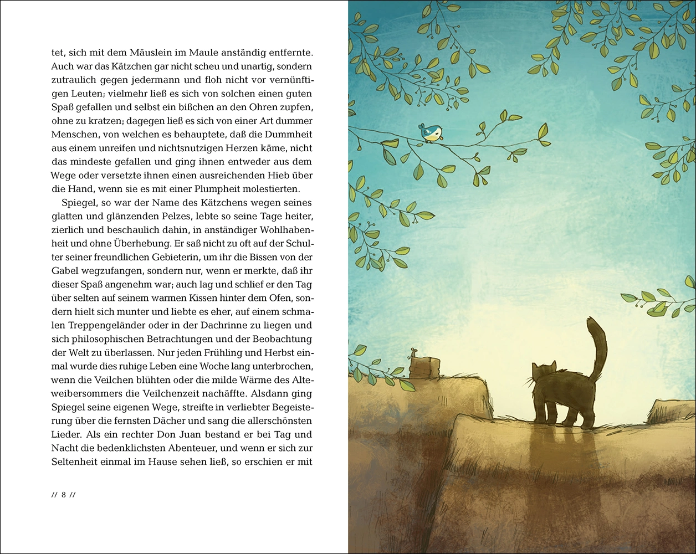
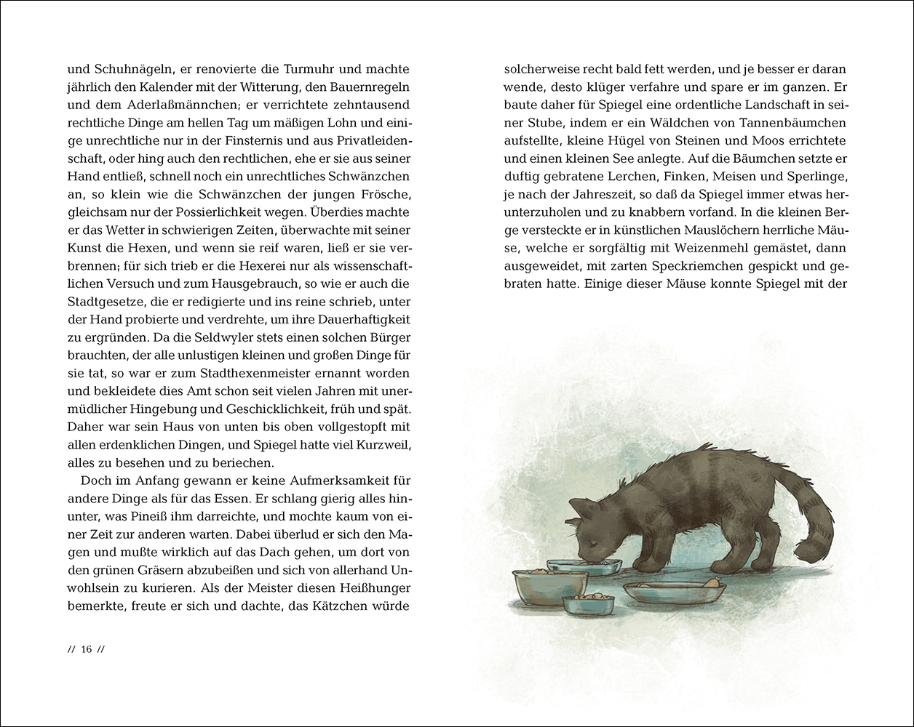

# 今天的文学猫角色：Spiegel

去邻居家捉老鼠之前，Spiegel 会先客客气气地征求许可。进去以后，他不碰奶罐，也不跳起来偷墙上的火腿，办完自己的事，便叼着猎物体面地离开。这只懂规矩的公猫也有明确的脾气：善意的玩笑可以容忍，粗鲁的捉弄就可能换来一爪。他亲近人，却懂得挑选值得亲近的人。

Spiegel 的名字在德语里是“镜子”，来自那身平滑发亮的灰黑色皮毛。他出自瑞士作家戈特弗里德·凯勒（Gottfried Keller）的《Spiegel, das Kätzchen》，题名意为“小猫 Spiegel”。故事于 1856 年收入小说集《Die Leute von Seldwyla》，并带着“一个童话”的副标题。这个“小猫”已经正当壮年，爱捕猎，也爱思考，常把狭窄的楼梯扶手或屋檐当作观察世界的座位。2020 年 Insel 版里，Joëlle Tourlonias 用蓬松的深色毛、竖起的尾巴和铺满天空的枝叶，画出了他在屋顶活动的神情。

这样一位讲究生活的猫先生，失去依靠后却迅速变了样。照顾他的老妇人死去，继承者忙着争财产，把他赶到门外。他逐渐消瘦，毛蓬乱起来，注意力全耗在寻找下一口食物上。先前敢对恶犬还击的猫，如今远远听见动静就逃；即使遭人打骂，仍会盯着那只带有香肠或鲱鱼气味的手。凯勒把饥饿写得具体而难堪：猫的礼貌、勇气和闲心，都需要有饭吃、有地方住才能维持。

城里的巫师 Pineiß 正是在这时提出交易。他需要猫油施法，而且必须由猫自愿、依约交出才有效。他答应把 Spiegel 喂得肥肥壮壮，代价则是猫的性命。Spiegel 明白这里有危险，却仍被食物吸引，签了契约，只争取到养肥之后延至下一次满月的宽限。巫师的殷勤因此带着寒意：每一份美食，都在催促这具身体长成他想要的材料。

有趣的是，巫师算得出脂肪，算不准猫的脑子。稳定的饮食让 Spiegel 恢复了光泽，也让他恢复判断。有一次，他吃鸟时看到鸟胃里尚未消化的种子和红浆果，忽然想到：这只鸟才刚吃饱便丢了命，自己的处境又好到哪里去？他开始节制食量，拒绝整天躺在软垫上，重新到屋顶和阁楼捕猎。巫师希望食物制造一只迟钝的肥猫，得到的却是一只身体灵活、会追问契约究竟写了什么的猫。他仍然贪恋好滋味，也会被爱情冲昏头脑，清醒与软弱始终挤在同一副毛皮里。

这篇童话的乐趣，就藏在猫的口腹之欲和人的精明算计相遇之处。Spiegel 说话彬彬有礼，思量起利害也很周密，身上的猫性却没有被这些谈吐抹掉：他要晒太阳，要爬到高处，要自己捉到活物。读他的故事，可以同时留意一笔买卖如何设下圈套，以及一只猫怎样重新找到自己的生活节奏。Pineiß 在屋内摆着烤鸟、烤熟的老鼠和盛满牛奶的小湖，Spiegel 却跑到屋顶上，凭自己的本领去追一只寻常的麻雀。

### 资料来源

- 戈特弗里德·凯勒，[《Spiegel, das Kätzchen》原文](https://projekt-gutenberg.org/authors/gottfried-keller/books/gottfried-keller-spiegel-das-kaetzchen/)，Projekt Gutenberg 电子版，第 1—2 节
- 苏黎世大学，[《Spiegel, das Kätzchen》人物与作品介绍](https://www.gottfriedkeller.uzh.ch/schule/spiegel.php)
- Insel Verlag，[《Spiegel, das Kätzchen》2020 年插图版图书页](https://www.suhrkamp.de/buch/gottfried-keller-spiegel-das-kaetzchen-t-9783458200390)

### 视觉参考

1. 2020 年版插图：Spiegel 在屋顶望鸟
   - 来源页面：<https://www.suhrkamp.de/buch/gottfried-keller-spiegel-das-kaetzchen-t-9783458200390>
   - 原始图片：<https://res.cloudinary.com/suhrkamp/images/v1741944310/143819/spiegel-das-kaetzchen_9783458200390_innenabbildung.webp>
   - 作者/机构：Joëlle Tourlonias / Insel Verlag
   - 说明：2020 年插图版第 8—9 页跨页，呈现 Spiegel 在屋顶与鸟相望的形象。

2. 2020 年版插图：Spiegel 在食盆前进食
   - 来源页面：<https://www.suhrkamp.de/buch/gottfried-keller-spiegel-das-kaetzchen-t-9783458200390>
   - 原始图片：<https://res.cloudinary.com/suhrkamp/images/v1741944314/143821/spiegel-das-kaetzchen_9783458200390_innenabbildung.webp>
   - 作者/机构：Joëlle Tourlonias / Insel Verlag
   - 说明：2020 年插图版第 16—17 页跨页，呈现 Spiegel 接受巫师供食时的形象。
