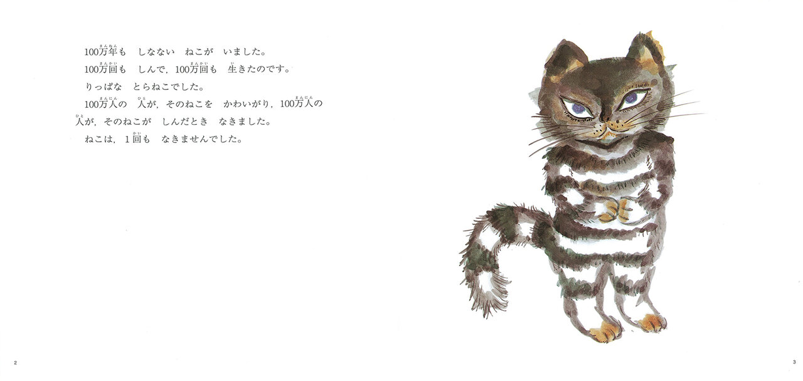
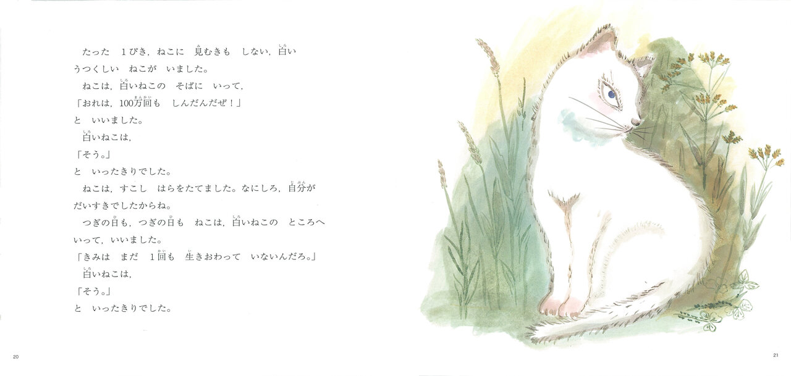

# 今天的文学猫角色：活了100万次的猫

一只猫死了一百万次，疼爱过他的主人也为他哭了一百万次，他自己却一次也没哭过。这样的开场，听来像是在夸耀一位见惯生死的英雄；偏偏站在读者面前的，是一只眯着眼、爪子收在胸前的虎斑猫。他活得太久，连死亡都成了可以拿来炫耀的资历，却还不知道怎样在另一个生命面前放下这份资历。

这只没有名字的猫，出自佐野洋子（Yoko Sano）自写自画、1977年由讲谈社出版的绘本《活了100万次的猫》（100万回生きたねこ）。他的毛纹浓重，尾巴蓬松，眼角斜斜挑起，神情带着一点不耐烦。佐野洋子的画没有把他修饰成温顺可爱的宠物：那副挺胸站立的样子，正适合一个对自己十分满意的家伙。读者很容易先注意到他的傲气，随后才发现，这份傲气也是他与别人相处时始终没有放下的东西。

过去的主人们爱他，他却讨厌他们。被珍惜、被需要、被人失去时痛哭，都没有使他学会回应。他记得一生又一生，也把这些经历积攒成了优越感。这是个有趣又有些难亲近的主角：他并不缺少别人给的感情，却总把自己放在感情之外。故事反复讲起他的生与死，语气十分平静，读者渐渐习惯了重来一次的可能，仿佛任何关系结束，都还能换一个地方继续。

转折落在一只白猫身上。她对他的光辉履历毫不热衷。他凑过去夸耀自己死过多少次，她只淡淡应一声；他又拿她尚未活完一生这件事说嘴，她依旧不为所动。这场求关注的交谈很像猫的脾气：越是不理睬，越要再去试试。他的恼火也很具体——一向觉得自己了不起，竟然遇到了一个不肯捧场的对象。那一百万次经历，在她面前忽然没有了用处。

后来，他爱上白猫，有了小猫，开始盼望与她一直生活下去。这个愿望改变了死亡的分量：过去可以轻轻带过的事，如今成了他不愿发生的事。白猫老去、死去，他抱着她哭，白天过去，夜晚又来。故事把开头的一百万次重新交还给眼泪。猫的变化全在这些动作里：从等别人注意自己，到愿意与另一个生命共同度日，再到无法挽留时的悲伤。

这本绘本的篇幅很短，猫的骄傲、依恋和失去却留下了足够长的回声。图画与文字各自说着一部分，尤其到了结尾，文字不再替读者解释他的心情，也没有安排一个可以抵消悲伤的重逢。那只曾经无数次回来的猫，这回没有再醒来。最后的跨页留下了草地，虎斑猫和白猫都不在了。

### 资料来源

- 佐野洋子，[《100万回生きたねこ》图书页](https://www.kodansha.co.jp/book/products/0000134240)，讲谈社，1977年；作品简介与书目信息
- 讲谈社，[宫崎哲弥访谈前篇](https://cocreco.kodansha.co.jp/ehon/news/100mankai/UXw9p)，2026年7月9日；含原作第2—3页跨页
- 讲谈社，[宫崎哲弥访谈后篇](https://cocreco.kodansha.co.jp/ehon/news/100mankai/1xD2l)，2026年7月10日，第1—2页；含原作第20—21页跨页及结局讨论

### 视觉参考

1. 1977年原作，佐野洋子绘：虎斑猫登场
   - 来源页面：<https://cocreco.kodansha.co.jp/ehon/news/100mankai/UXw9p>
   - 原始图片：<https://d34gglw95p9zsk.cloudfront.net/item_cocreco_images/images/000/457/329/large/be214023-709f-4b89-bfcd-764ac9682a27.jpg?1782271853>
   - 作者/机构：佐野洋子；©JIROCHO, Inc. / KODANSHA
   - 说明：《活了100万次的猫》第2—3页，虎斑猫与故事开篇。

2. 1977年原作，佐野洋子绘：草丛中的白猫
   - 来源页面：<https://cocreco.kodansha.co.jp/ehon/news/100mankai/1xD2l>
   - 原始图片：<https://d34gglw95p9zsk.cloudfront.net/item_cocreco_images/images/000/457/332/large/9f07bdfd-012d-4eb0-832a-ad18468def21.jpg?1782272056>
   - 作者/机构：佐野洋子；©JIROCHO, Inc. / KODANSHA
   - 说明：《活了100万次的猫》第20—21页，白猫对虎斑猫的夸耀淡然回应。
