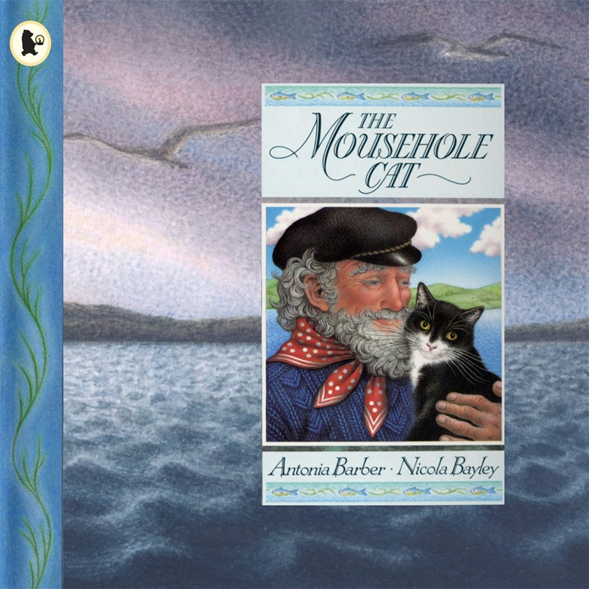
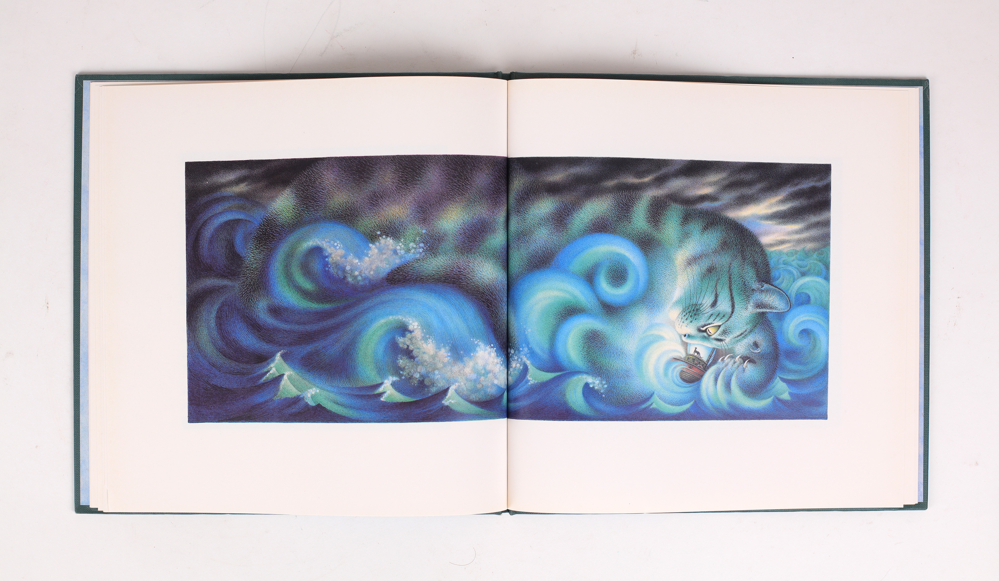

# 今天的文学猫角色：Mowzer

Mowzer 对自己养的人类很满意。老渔夫汤姆（Tom）倒奶油不会洒，摇椅晃得不快不慢，还知道她左耳后面哪一处最喜欢被挠。他每天驾船出海，在她看来，也是在做一件很有用的事：替她捕晚餐吃的鱼。她把这一切安排得理所当然，直到有一天，这个需要照看的老人决定驶进风暴里。

这只上了年纪的母猫，住在英国康沃尔的渔村 Mousehole，出自 Antonia Barber 写、Nicola Bayley 绘的《The Mousehole Cat》。绘本于 1990 年首次出版，把当地渔夫冒险出海救村的传说，交给一只猫重新讲述。Bayley 笔下的她有黑色的背、白色的胸口和口鼻，眼睛明亮，依偎在汤姆怀里时格外安稳。海在画面里占据很大地方，屋里一人一猫的亲密便显得更可贵。

她有自己的待客标准，也有一点长辈的挑剔。孩子们都长大离家了，可他们家里的人会把啤酒洒到她头上，或不小心踩到她的尾巴；她觉得，是孩子们没把人类教好。这套猫的生活逻辑，让她既有脾气，又不失可亲。她爱炉火、摇椅和鲜鱼，珍惜每一种被妥善照料的感觉。书里的村庄也随之换了主人：住在那里的，是猫，以及猫们各自的人。

冬天的危机同样有一副猫的面孔。巨大的风暴猫扑向港墙，伸爪探进港口，把出海的船当作可以追逐的老鼠。渔船虽然躲得过巨浪，却捕不到鱼，村里的食物渐渐吃光。圣诞节临近，汤姆不能坐看孩子们挨饿，决定冒险出海。Mowzer 原本很清楚，坏天气里最舒服的地方就在炉边；可汤姆要去，她便跟着去。在她眼里，人类在风暴面前太小，需要一只猫保护。

她的本领是听得懂另一只猫。风浪的嚎叫传来时，她竟替那个永远在黑暗中追猎、无家可归的大家伙感到难过，于是唱歌安抚它。汤姆负责撒网，她负责让风暴暂缓攻击。到了归航的时候，歌声又变成呼噜声：想到热食和家，她发出的声音让风暴猫也渐渐安静下来。这场海上历险把家猫最熟悉的声音写成了力量；她带去海上的，正是平日守着炉火过日子的那份经验。

Bayley 把浪尖、泡沫和猫的爪子画在一起，让读者看见 Mowzer 听见的世界。后来 Grasshopper Productions 将绘本拍成动画，沿着她的目光展开故事，也让这些原画动了起来。书中，当小船终于接近村庄，港墙上已经亮起一盏盏灯。人们等着汤姆，汤姆带回鱼，而始终陪在船上的那只猫，也可以回到她熟悉的摇椅边了。

### 资料来源

- Antonia Barber、Nicola Bayley，[《The Mousehole Cat》](https://www.lunsford.kent.sch.uk/_site/data/files/migrated/year-3/the-mousehole-cat.pdf)，Walker Books，1993 年版，故事正文及版权页
- Walker Books，[《The Mousehole Cat》图书页](https://www.walker.co.uk/9780744523539/the-mousehole-cat/)
- Publishers Weekly，[《The Mousehole Cat》书评](https://www.publishersweekly.com/9780027083316)，1990 年 8 月 29 日
- Grasshopper Productions，[《The Mousehole Cat》动画介绍](https://www.grasshopper.co.uk/the-mousehole-cat)

### 视觉参考

1. 1993 年平装版，Nicola Bayley 绘：Mowzer 与汤姆
   - 来源页面：<https://www.walker.co.uk/9780744523539/the-mousehole-cat/>
   - 原始图片：<https://walker-books-uk.imgix.net/covers/9780744523539.jpg>
   - 作者/机构：Nicola Bayley / Walker Books
   - 说明：平装版封面以汤姆抱着 Mowzer 的原作插画呈现两位主角。

2. 1990 年初版跨页，Nicola Bayley 绘：风暴猫与小船
   - 来源页面：<https://www.jonkers.co.uk/rare-book/13641/the-mousehole-cat/nicola-bayley>
   - 原始图片：<https://www.jonkers.co.uk/uploads/00072/00072754.jpg?v=1>
   - 作者/机构：Nicola Bayley / Jonkers Rare Books
   - 说明：初版书内跨页将海浪绘成风暴猫，小船驶在它的巨爪之间。
