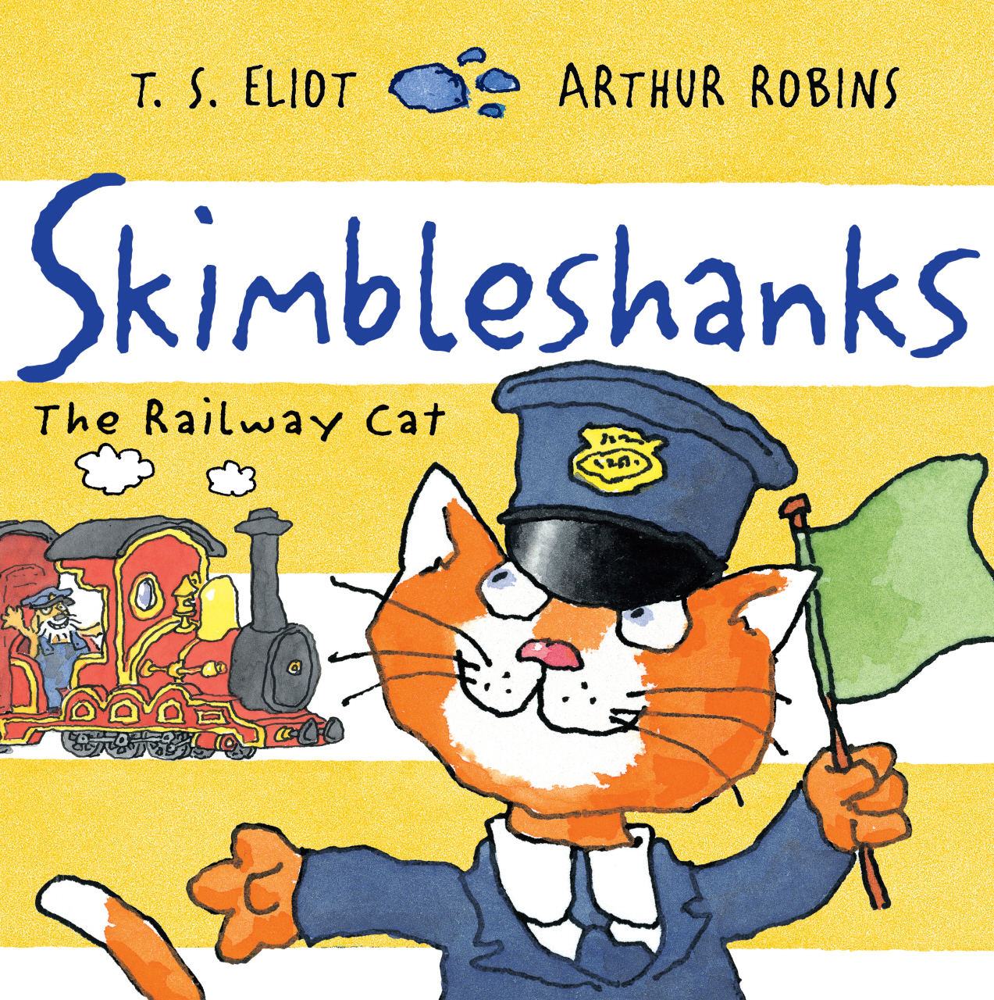
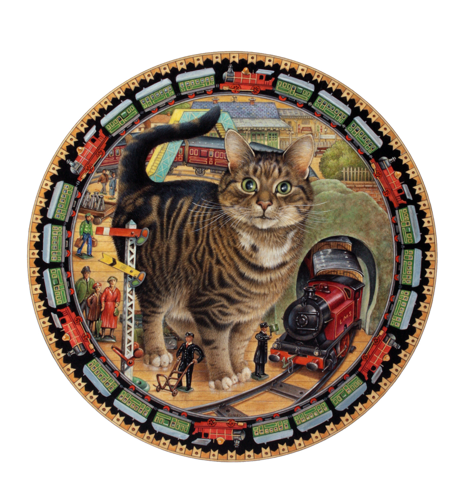

# 今天的文学猫角色：Skimbleshanks

夜里十一点三十九分，邮车已经准备出发，站台上却在四处找猫。列车员、搬运工，连站长的女儿们也加入搜寻：Skimble 去哪儿了？没有他，车就不能开。三分钟后，Skimbleshanks 才从忙碌的行李车厢里出来，慢悠悠地走向车尾；玻璃般碧绿的眼睛一闪，放行信号随即亮起。一整列火车的焦急，被这只猫从容的出场接住了。

这位铁路猫出自 T. S. 艾略特（T. S. Eliot）1939 年出版的《老负鼠的实用猫经》（Old Possum’s Book of Practical Cats），拥有一首以自己命名的诗《Skimbleshanks: The Railway Cat》。写《荒原》的诗人，在这里把猫写成各有脾气、职业和生活规矩的邻人。这些诗与他写给教子女的信密切相连。瓦莱丽·艾略特（Valerie Eliot）回顾其创作时记下，1938 年他曾在给教女的信里说，正尝试写一首关于铁路列车猫的诗，随后便有了 Skimbleshanks。他的世界从一开始就适合大声念出来：长短句交替，名字与韵脚接连滚动，找猫的呼声也让候车的忙乱有了节拍。

原诗给他一双绿眼睛和一条长长的棕色尾巴，最鲜明的轮廓则来自他的工作姿态。他沿走廊踱步，查看头等车厢和三等车厢里每一张面孔；司机、列车员，乃至打牌的旅客，都在他的监督范围内。只要他正在巡视，喧闹的人就会安静下来。他盯人时不眨眼，仿佛连别人在想什么都看得出来。猫在狭窄空间里自信地穿行，本来是熟悉的动作，到了这首诗里，便成了一套谁也不敢轻忽的巡查制度。

他的认真也有让人放心的一面。卧铺收拾妥当，床单整洁，地板没有灰尘，旅客可以调灯、通风，舒舒服服钻进被窝。列车员来问晨茶要浓还是淡，Skimble 就在后面，随时准备提醒对方别出差错。旅客不必惦记老鼠，这件事自然归铁路猫照管。艾略特把一只猫的捕鼠本领和一位老练职员的尽责揉在一起：他管的都是旅行中不起眼、出了差错却很烦人的小事，因而他的威严带着切实的用处。

不过，值夜班并没有让他变成一架机器。他也喝茶，茶里或许加一点苏格兰威士忌，忙碌间还要停下来捉跳蚤。这些猫的琐事，让那位无所不管的主管露出了一点滑稽。后来的画家也为他找到了不同面貌：Arthur Robins 在 2015 年绘本版封面上，给橘白猫戴上铁路制服帽，配一面绿旗；Lesley Anne Ivory 在 1999 年的装饰盘设计稿里，则让一只写实虎斑猫立在铁路场景中央，周围环绕微小的车辆与人物。两种画法都让人一眼认出，铁路是他的地盘。

当旅客熟睡时，他仍在沿途车站忙碌，向站长打招呼，有事还会与警察交谈。到了下车的时候，他又来帮忙，把这趟夜行送到末尾。送别不用郑重的演说：那条长棕尾巴一挥，便像在约定，下次搭午夜邮车，还会遇见这位铁路猫。

### 资料来源

- T. S. 艾略特，[《Old Possum’s Book of Practical Cats》](https://www.fadedpage.com/link.php?file=20160525.html)，1939 年，《Skimbleshanks: The Railway Cat》
- 瓦莱丽·艾略特，[《Apropos of Practical Cats》](https://tseliot.com/editorials/reception-old-possums-book-of-practical-cats)
- Faber，[《Skimbleshanks》2015 年绘本版](https://www.faber.co.uk/product/9780571324835-skimbleshanks/)
- Chris Beetles Gallery，[《Octopussy as Skimbleshanks the Railway Cat》](https://www.chrisbeetles.com/artwork/40006/octopussy-as-skimbleshanks-the-railway-cat)，Lesley Anne Ivory，1999 年

### 视觉参考

1. 2015 年绘本封面，Arthur Robins 绘：铁路猫举绿旗
   - 来源页面：<https://www.faber.co.uk/product/9780571324835-skimbleshanks/>
   - 原始图片：<https://www.faber.co.uk/wp-content/uploads/2025/06/Skimbleshanks.jpg>
   - 作者/机构：Arthur Robins／Faber
   - 说明：2015 年独立绘本版封面，以制服帽与绿旗表现 Skimbleshanks 的铁路职员身份。

2. 1999 年装饰盘设计，Lesley Anne Ivory 绘：铁路猫
   - 来源页面：<https://www.chrisbeetles.com/artwork/40006/octopussy-as-skimbleshanks-the-railway-cat>
   - 原始图片：<https://chrisbeetles.com/storage/44805/conversions/mvlbnx5rxpv-default.jpg>
   - 作者/机构：Lesley Anne Ivory／Chris Beetles Gallery
   - 说明：为 Danbury Mint 1999 年艾略特猫诗装饰盘系列绘制的设计稿，以 Octopussy 的形象扮演 Skimbleshanks。
