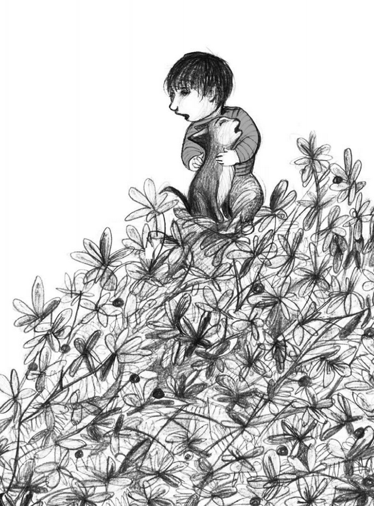
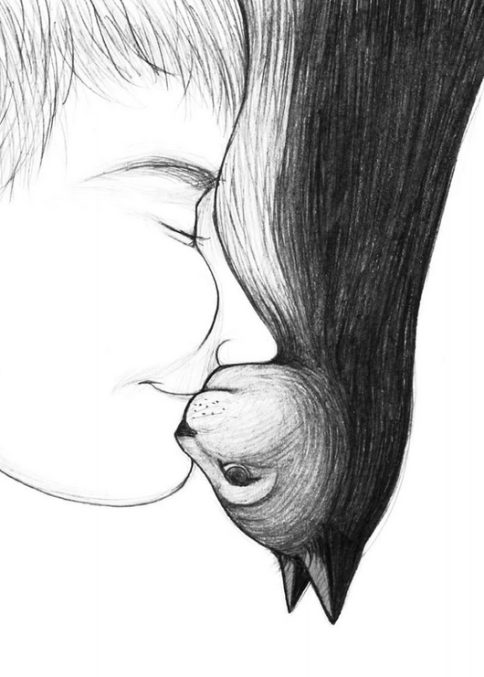

# 今天的文学猫角色：Mix（小米）

小米小时候爬上高高的栗树，到了树顶才发现，下去比上来困难。男孩小马赶来救他，爬到同一根高枝上，往下一看，也不敢动了。于是，等待消防员搭梯子营救的，变成了一人一猫。小马紧紧抱着小米，开始教他以后应该怎样练习爬树；这番忠告，说话的人自己也很需要。

这对一起闯祸的朋友，出自智利作家路易斯·塞普尔维达（Luis Sepúlveda）2012年的《小米、小马和小墨》（Historia de Mix, de Max y de Mex）。三个只差一个字母的名字，分别属于猫、男孩和老鼠。小米的原名是Mix：背上黑，胸前白，有一双大大的黄眼睛，长大后体格强健。他还有一张被称为“希腊式侧脸”的面孔。小马会翻字典、找古希腊人物的图画，认真研究朋友这副特别的相貌。猫的庄重，与男孩郑重其事的欣赏，凑成了这部小书温和的幽默。

小米的生活有熟悉的屋子，也有屋顶。他守着食品柜，保护小马喜欢的巧克力麦片；即使家里并没有老鼠，他也乐于承担这份差事。他享用朋友准备的鱼味猫粮，又照看朋友珍惜的东西。至于独自外出、攀树和跳上房顶，仍是他的自由。小马找不到他时，会向街坊打听；知道他正在高处游荡，便放心等他回来。两者之间的亲密，容得下猫暂时离开人的视线。

这样的相处也构成了全书的叙述方式。开篇先后试着把小米称为小马的猫、把小马称为小米的人，随后放下归属的说法，转而讲他们彼此喜爱。塞普尔维达常在简短的生活片段后，添上一句关于朋友的体会。这些话带着讲给孩子听的清楚节奏，却落在很小的事情上：记得对方爱吃什么，陪着对方犯错，也承认对方有自己的去处。猫并不需要时时依偎，才能证明他与人相爱。

后来小马长大、开始工作，小米也老了，失去了视力。白天独处的时间越来越长，这只曾经来往于屋顶的猫，需要重新认识身边的世界。此时来到他生活中的，是墨西哥老鼠小墨（Mex）。小米给这位新朋友起了名字，小墨则把自己看见的世界告诉他。过去守食品柜的猫，与本来该被防备的老鼠，能够各自拿出对方缺少的东西。失明改变了小米活动的条件，朋友的眼睛又让他的生活向外打开。

小米还有真实生活中的来处。塞普尔维达在介绍这本书时回忆，儿子从慕尼黑动物保护机构领养的小猫，小得能放在手上，却已经显得很有尊严；那张独特的侧脸也令他惊讶。Noemí Villamuza为书画的铅笔插图，把这种亲近画得很具体：猫和男孩困在枝叶间，两张侧脸又在另一幅里相贴。树上获救时，他们一起回家，身上都沾着栗树花粉。

### 资料来源

- 路易斯·塞普尔维达，[《Historia de Mix, de Max y de Mex》出版社试读](https://proassetspdlcom.cdnstatics2.com/usuaris/libros_contenido/arxius/44/43322_HISTORIA_DE_MIX_DE_MAX_Y_DE_MEX.pdf)，Tusquets，2020年版，第1—2章
- WMagazín，[Luis Sepulveda y su visión de la amistad en «Historia de Mix, de Max y de Mex»](https://wmagazin.com/relatos/luis-sepulveda-y-su-vision-de-la-amistad-en-historia-de-mix-de-max-y-de-mex/)，2020年5月15日，作者谈话与原作节选
- Agencia Literaria Carmen Balcells，[《Historia de Mix, de Max y de Mex》作品介绍](https://www.agenciabalcells.com/en/authors/works/luis-sepulveda/historia-de-max-de-mix-y-de-mex/)
- Tusquets / Planeta de Libros，[《Historia de Mix, de Max y de Mex》图书页](https://www.planetadelibros.com/libro-historia-de-mix-de-max-y-de-mex/313713)

### 视觉参考

1. 2020年版插画，Villamuza绘：树上的小马与小米
   - 来源页面：<https://wmagazin.com/relatos/luis-sepulveda-y-su-vision-de-la-amistad-en-historia-de-mix-de-max-y-de-mex/>
   - 原始图片：<https://wmagazin.com/wp-content/uploads/2020/05/Luis-Sepulveda-MaxyMix-Ilustracion1-WMagazin.png>
   - 作者/机构：Noemí Villamuza；Tusquets提供，WMagazín刊载
   - 说明：书中插画表现小马抱着小米，两位朋友一同困在高高的树枝上。

2. 2020年版插画，Villamuza绘：小马与小米的脸相贴
   - 来源页面：<https://wmagazin.com/relatos/luis-sepulveda-y-su-vision-de-la-amistad-en-historia-de-mix-de-max-y-de-mex/>
   - 原始图片：<https://wmagazin.com/wp-content/uploads/2020/05/Luis-Sepulveda-MaxyMix-Ilustracion2-WMagazin.png>
   - 作者/机构：Noemí Villamuza；Tusquets提供，WMagazín刊载
   - 说明：书中插画以相对的两张侧脸，表现小米与小马的亲密关系。
