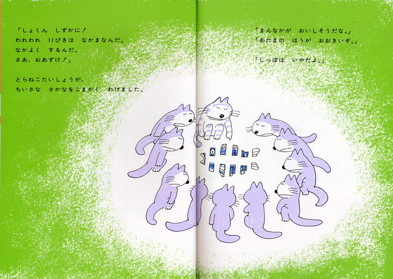
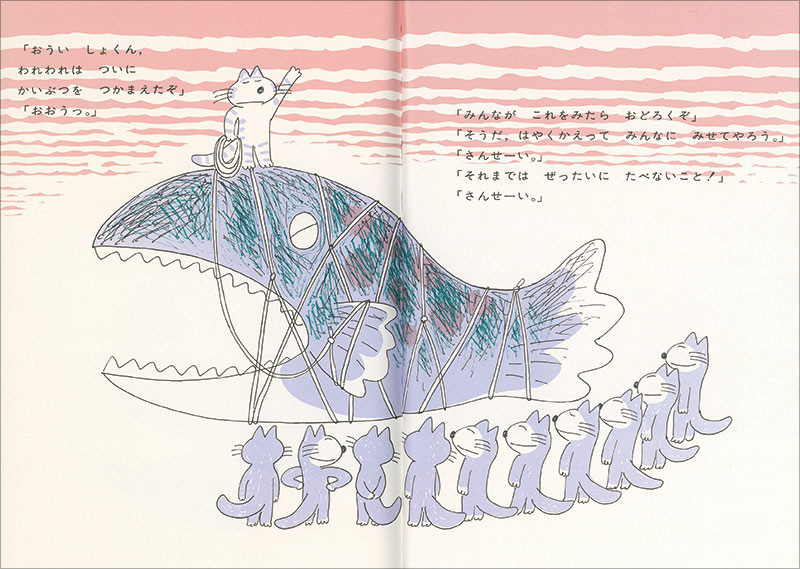

# 今天的文学猫角色：とらねこ大将（虎猫大将）

一条小鱼分成十一份，轮到每只猫嘴里的便只剩一点点。负责分鱼的那只虎斑猫还得先维持秩序，提醒伙伴们好好相处；围成一圈的猫却已经盯上别人的份，连鱼尾巴也成了不愿接受的部位。这位忙着调停的领头猫，就是马场登（馬場のぼる）的《11只猫》（11ぴきのねこ）里的とらねこ大将，也被称为虎猫大将。它管得住队伍的形状，却很难管住十一只猫的胃口。

虎猫大将很好认：同伴们大多一身蓝紫色，只有它带着虎斑纹。它们都有白肚皮、圆脑袋和长尾巴，能够直立行走，脸上常挂着一副眯眼的神情。大将的职责是走在前面，听取大家的意见，再把伙伴们组织起来。它的领袖身份并没有让它脱离这群流浪猫的生活：同样会饿，同样需要分食，也同样被好吃的东西吸引。把它单独挑出来看，很容易漏掉它身旁那十个总有意见的同伴。

1967 年，こぐま社出版了系列第一本《11只猫》。马场登此前已经是一位漫画家，后来逐渐把创作重心移向绘本。画面保留了漫画式的动作和停顿，简短的文字给表情留下了位置：分鱼时，没有谁需要长篇诉苦，只消看看猫嘴的方向和地上细碎的鱼块，就能明白这顿饭为何不能让大家满意。原作的文字与图画都出自马场登，虎斑大将的模样和这群猫的滑稽举止也由他一并创造。

第一本书里，饥饿的猫们听老猫说湖中有条大鱼，便出发去捕捉它。等到费尽力气终于捉住怪鱼，大将站上鱼背，抬起一只爪子，向伙伴们宣布胜利。大家一想到可以把猎物带回去给别的猫看，就兴奋起来，并约定在那之前绝不偷吃。鱼被绳子捆得结结实实，旁边的十只猫仰着头，队伍暂时空前整齐。可把如此多馋嘴的伙伴聚到一条大鱼旁，那个郑重的约定本身就让人担心。

食欲在后续作品里仍会替它们出主意。《11只猫开饼店》（11ぴきのねことあほうどり）中，猫们已经开起了可乐饼店，却吃腻了每天剩下的可乐饼，开始惦记烤鸟。大将带领的是一群能合作、会盘算，也会算错的伙伴；它的号召力总要和大家不断冒出的欲望打交道。书里的笑话容得下这种小小的自私，猫们也因此始终带着令人熟悉的毛病。

还有一个找大将的办法，藏在第一本书的封面上。正面数来数去只有十只猫，虎斑大将并没有挤在其中。把书翻到背面，才能找到它：它正独自躺着，望向天空。数到第十一只猫时，读者已经把整本书翻了个面。

### 资料来源

- 马场登、こぐま社，[《11ぴきのねこ》图书页与原书内页](https://kogumasha.co.jp/product/155/)，1967 年
- こぐま社，[《11ぴきのねこ》系列专题](https://www.kogumasha.co.jp/11pikinoneko)，角色介绍与封面趣闻
- こぐま社，[《11ぴきのねことあほうどり》图书页](https://www.kogumasha.co.jp/product/158/)，1972 年
- 练马区立美术馆，[《没後20年 まるごと馬場のぼる展》展览介绍](https://www.neribun.or.jp/event/detail_m.cgi?id=202104211619004534)，2021 年

### 视觉参考

1. 1967年《11只猫》，马场登绘：虎猫大将分鱼
   - 来源页面：<https://kogumasha.co.jp/product/155/>
   - 原始图片：<https://kogumasha.co.jp/uploads/media/1001_2.jpg>
   - 作者/机构：马场登（馬場のぼる）／こぐま社
   - 说明：虎猫大将把小鱼分给围坐的十个伙伴，呈现它的领队身份与猫们的食欲。

2. 1967年《11只猫》，马场登绘：大将站上怪鱼
   - 来源页面：<https://kogumasha.co.jp/product/155/>
   - 原始图片：<https://kogumasha.co.jp/uploads/media/7779a43e6e3b1bdb9790f623c2a98eecf37000eb.jpg>
   - 作者/机构：马场登（馬場のぼる）／こぐま社
   - 说明：虎猫大将站在捕获的大鱼背上，伙伴们围在鱼旁响应它。
