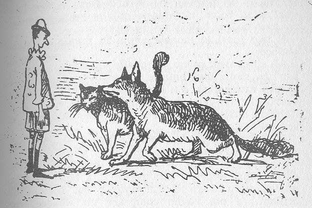
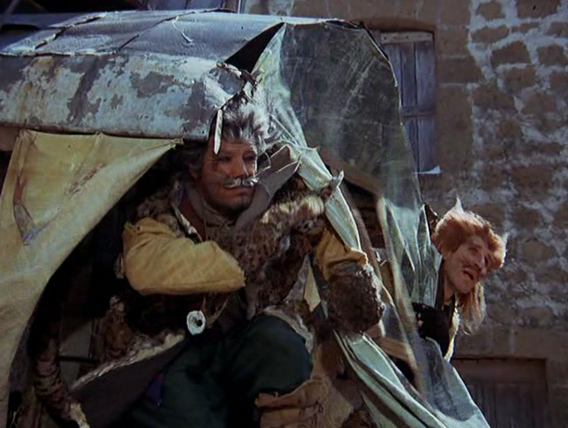

# 今天的文学猫角色：Il Gatto（《木偶奇遇记》中的猫）

金币一响，瞎猫的两只眼睛忽然睁得老大，又赶紧闭上。皮诺曹没有发现，读者却已经看见了破绽。在《木偶奇遇记》（Le avventure di Pinocchio）里，这只猫用闭眼来谋生：他假装失明，与假装瘸腿的狐狸相互搀扶，沿路寻找愿意相信他们的人。

卡洛·科洛迪（Carlo Collodi）的这部意大利童话在 1883 年出版单行本。书中的猫没有另起名字，就叫 Il Gatto，意思是“猫”。他有长胡须，会说话，懂得礼貌应酬，也懂得把恶意藏进关怀里。马赞蒂（Enrico Mazzanti）的早期插图仍让他保有完整的动物身体：狐狸向前探身，猫贴在同伴身侧，尾巴高高翘起。画里不需要一个戴着恶人面具的怪物，两只普通动物就足以把木偶引离回家的路。

这对搭档有一套鲜明的说话节奏。狐狸负责长篇大论，解释怎样把金币埋进土里，长出挂满钱的树；猫则挑出几个词，跟在后面重复。狐狸劝皮诺曹别错过好运，他也重复好运；狐狸声称只想帮助别人发财，他也接上一句。单独看，这些话没有多少内容，连在一起却替谎言添了一个证人。他不必另造一套说辞，只要让受骗者觉得，在场的两位朋友都同意这件事。

闭着眼睛的猫也随时能扑向猎物。一只乌鸫在路边提醒皮诺曹不要听信坏主意，他立刻跃起，把鸟连羽毛吞下，擦擦胡须，又恢复失明的模样。这一笔把他的危险写得很实：捕猎的敏捷全在，装出来的无助也全在。皮诺曹把同路当作友谊，猫却连一句可能破坏买卖的警告也容不下。他与狐狸轮番应声的滑稽，因此始终带着寒意。

到了所谓的奇迹田，两位好心人让皮诺曹埋下剩余的四枚金币，浇水，再到别处等待。等他回来，钱已经被他们挖走。猫在这场骗局里的位置很小，却不可少：他陪着走路、作证、接受感谢，最后参与分赃。科洛迪把会说话的动物放进借钱、吃饭、赶路、求发财的日常中，让童话的怪诞紧贴着现实生活。这只猫身上最突出的本领，也正是顺着别人的贪念和盼望说话；他说得越省力，皮诺曹替未来安排得就越热闹。

猫与狐狸后来被改编成许多不同的模样。1972 年的意大利真人改编让他们穿上破旧衣服，猫由 Franco Franchi 饰演，胡须和尖耳朵仍留在人的脸与帽子上。回到书的末章，猫已经真的失明，与落魄的狐狸坐在路边乞讨。这一次，他依然重复同伴求助的话，皮诺曹却不再留下。他那套熟练的应声还在，愿意听信它的人已经走远了。

### 资料来源

- 卡洛·科洛迪，[《The Adventures of Pinocchio》](https://www.gutenberg.org/files/500/500-h/500-h.htm)，Carol Della Chiesa 英译，第 12、18、19、36 章
- 博洛尼亚 Archiginnasio 图书馆，[《Le avventure di Pinocchio. Storia di un burattino》1883 年版介绍](https://www.archiginnasio.it/lang/en/objects/le-avventure-di-pinocchio-963e5b)
- Wikimedia Commons，[《Il Gatto e la Volpe》1972 年改编剧照及人物说明](https://commons.wikimedia.org/wiki/File:Il_Gatto_e_la_Volpe.jpg)

### 视觉参考

1. 《木偶奇遇记》，马赞蒂绘：猫与狐狸遇见皮诺曹
   - 来源页面：<https://commons.wikimedia.org/wiki/File:Gatto_e_volpe.jpg>
   - 原始图片：<https://upload.wikimedia.org/wikipedia/commons/4/4f/Gatto_e_volpe.jpg>
   - 作者/机构：Enrico Mazzanti；Wikimedia Commons 存档
   - 说明：早期插图描绘猫与狐狸结伴接近皮诺曹的场景。

2. 1972 年意大利改编剧照：猫在前，狐狸在后
   - 来源页面：<https://commons.wikimedia.org/wiki/File:Il_Gatto_e_la_Volpe.jpg>
   - 原始图片：<https://upload.wikimedia.org/wikipedia/commons/a/af/Il_Gatto_e_la_Volpe.jpg>
   - 作者/机构：《Le avventure di Pinocchio》（1972）剧组；Wikimedia Commons 存档
   - 说明：Franco Franchi 饰演猫，Ciccio Ingrassia 饰演狐狸，展现角色的真人改编形象。
