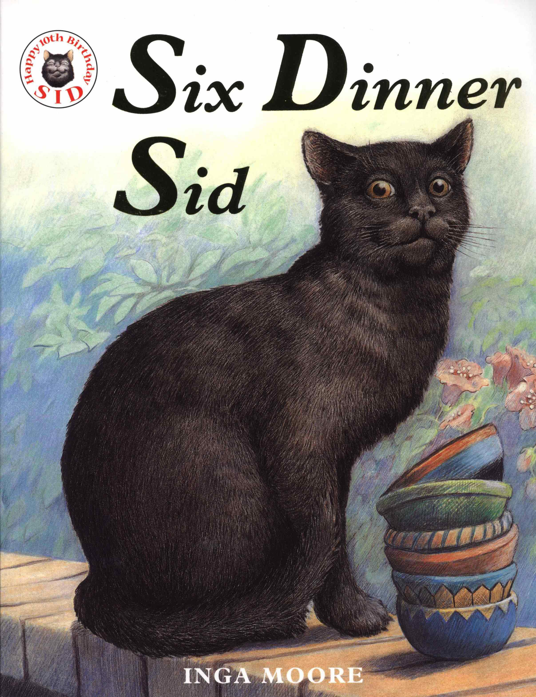
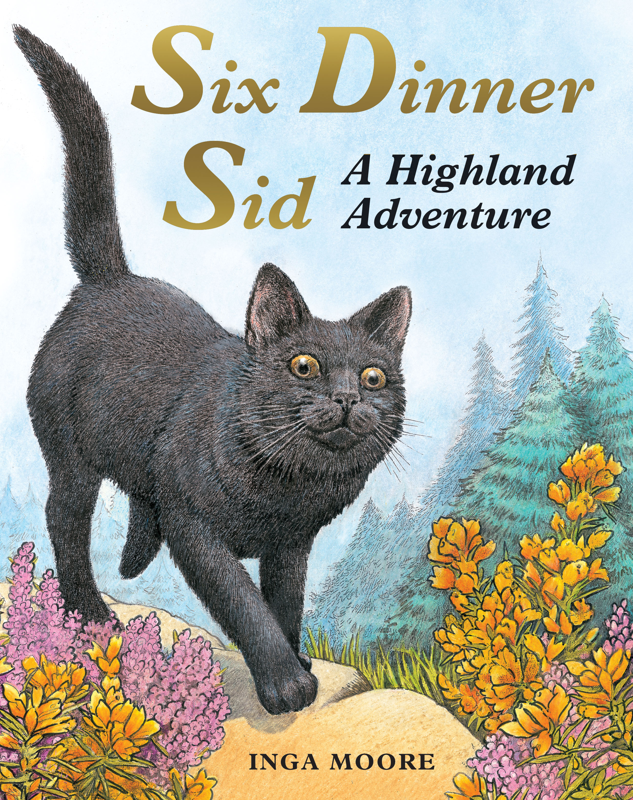

# 今天的文学猫角色：Sid（席德）

亚里斯多德街的一号住着一只叫席德（Sid）的猫，二号也住着他，三号到六号同样如此。六户人家都以为自己养着这只猫，于是每天替他准备晚餐。席德照单全收，把六顿饭安排成了日常。这是英格·莫尔（Inga Moore）自写自画的《吃六顿晚餐的猫》（Six Dinner Sid）的开场：一只黑猫利用邻居们互不交谈的习惯，给自己过上了六倍丰足的生活。

莫尔笔下的席德全身乌黑，眼睛明亮，身形结实。封面里，他端坐在一摞六只饭碗旁，耳朵竖着，神情相当坦然。水彩中的花草和住宅让他的世界显得温暖、熟悉，猫的胡须、毛发与姿态又画得细致。他的外形保持着家猫的模样，生动的神态却让那些小心思有了着落。看着这张脸，很容易明白六户人家为什么都乐意替他开门。

席德的本领也不止是能吃。六个家给了他六个名字，他得应付不同的期待，拿出不同的性格，还享受在不同部位被搔痒、睡在六张床上的待遇。读起来，他像一位熟练的演员，能把同一个自己分配给六种家庭生活。这也让他的贪嘴有了具体的分量：为了把好日子维持下去，他忙着扮演、讨好，在不同的人面前显出不同的模样。猫与人相处的本领，也成了他每天的功课。

麻烦来自一场咳嗽。六位主人各自带席德去看病，偏偏找的是同一位兽医。平时可以反复领取的关爱，在诊室里成了六次就诊；那只猫得了什么病，也变成了主人们迟早要互相核对的问题。兽医识破了席德的多重身份，六户人家终于发现自己都在喂同一只猫，随即决定把他的晚餐减到每天一顿。重复了许多次的“六”，就在这里把喜剧翻了个面。

可是，席德没有留下来等待大家改变主意。他搬到毕达哥拉斯街，照旧住进一号到六号。这回邻居们会彼此说话，大家从一开始就知道他的生活安排，也都不介意。这个结尾让席德保留了自己的胃口和行动力。读者当然可以说他狡猾，也可以看见他准确地找到了愿意接纳自己的地方；故事没有安排一堂训诫，把他收拾成只属于某一个人的乖猫。

莫尔既写故事，也用图画表现席德的多副面孔，短短的篇幅因而适合慢慢翻看：文字在数晚餐，画面则让人端详猫与各户人家的相处。后来，他又走进续作《Six Dinner Sid: A Highland Adventure》，书名说的是一场高地冒险。席德已经在新街区安顿下来，六位主人却同时决定出门度假。他那六顿晚餐的日程表，又遇到了一件需要自己解决的事。

### 资料来源

- Simon & Schuster，[《Six-Dinner Sid》图书页](https://www.simonandschuster.net/books/Six-Dinner-Sid/Inga-Moore/9780671796136)
- Publishers Weekly，[《Six-Dinner Sid》书评](https://www.publishersweekly.com/978-0-671-73199-1)，1991 年 4 月 29 日
- Kirkus Reviews，[《Six-Dinner Sid》书评](https://www.kirkusreviews.com/book-reviews/inga-moore/six-dinner-sid/)，1991 年 6 月 1 日刊
- 臺北市政府，[《吃六頓晚餐的貓》绘本资料与简介](https://www-ws.gov.taipei/001/Upload/public/Attachment/51221175144.pdf)，第 109 页
- Hachette Australia，[《Six Dinner Sid: A Highland Adventure》图书页](https://www.hachette.com.au/inga-moore/six-dinner-sid-a-highland-adventure)

### 视觉参考

1. Hodder版封面，英格·莫尔绘：席德与六只碗
   - 来源页面：<https://www.hachette.com.au/inga-moore/six-dinner-sid>
   - 原始图片：<https://www.hachette.com.au/api/images/download?path=books%2F9780340894118.jpg>
   - 作者/机构：英格·莫尔 / Hodder Children's Books / Hachette Australia
   - 说明：原作者绘制的《吃六顿晚餐的猫》封面，以黑猫和六只饭碗呈现席德的生活。

2. 2010年续作封面，英格·莫尔绘：高地上的席德
   - 来源页面：<https://www.hachette.com.au/inga-moore/six-dinner-sid-a-highland-adventure>
   - 原始图片：<https://www.hachette.com.au/api/images/download?path=books%2F9780340988954.jpg>
   - 作者/机构：英格·莫尔 / Hodder Children's Books / Hachette Australia
   - 说明：原作者绘制的高地冒险续作封面，让席德从家门前走入开阔的户外景物。
