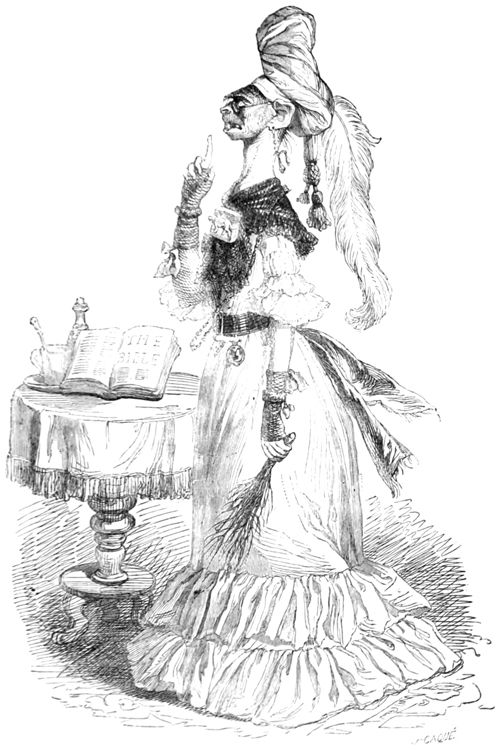
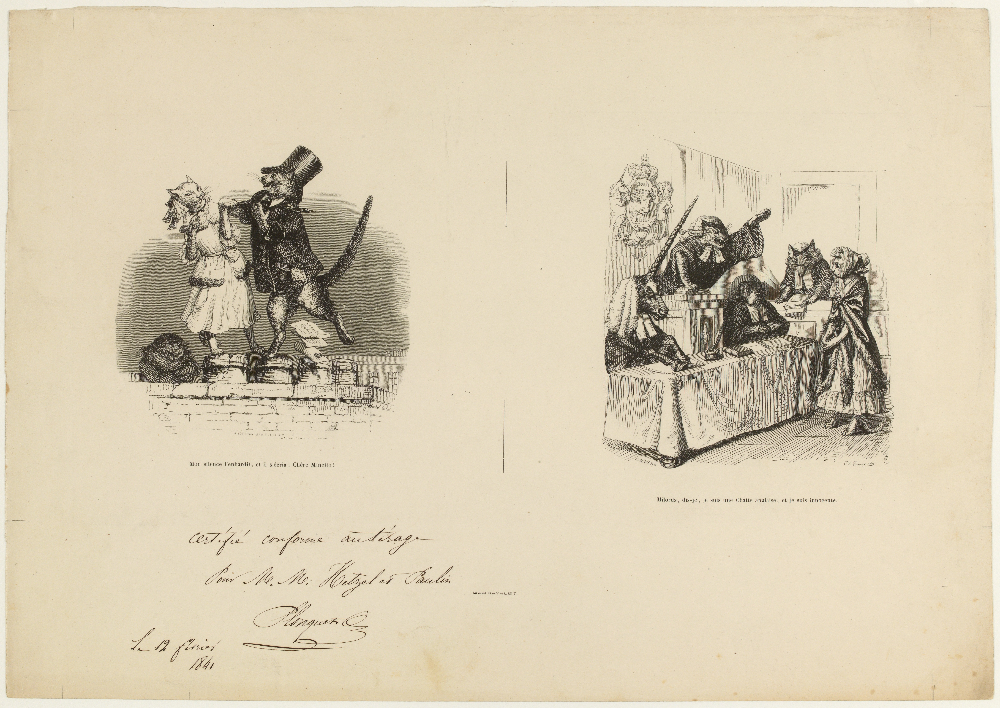

# 今天的文学猫角色：Beauty

Beauty 学会做淑女以后，先把爱吃的东西藏到了床底下。再没有人看见她进食、喝水或梳洗，女主人便称赞她是猫中的珍品。这只白猫心里却清楚：自己的胃口一点没变，改变的只是让别人看见多少。她在巴尔扎克（Honoré de Balzac）的《一只英国猫的苦难》（Peines de cœur d’une chatte anglaise）里亲自讲述身世，语气时而委屈，时而刻薄，连人类自以为高明的解释也不肯放过。

她出生在牧师家，因一身纯白的毛获准留下，没有和其他幼猫一起被溺死；Beauty 这个名字，也来自她的美貌。两个月大时，一位独身女士把她带走。女主人看她总坐在《圣经》上，以为她天生虔诚；她自己交代，原因只是家里找不到别处干净的落脚点。这样的小小岔口，贯穿了她的叙述：人类忙着给猫的举动安上崇高意义，猫则记得身体当时需要什么。她能看穿误会，却没有因此免受管教。

一次，她拨开碗上的松饼，舔了奶油，又在地毯上小便，立刻挨了桦条抽打。女主人教她，所有身体需求都要藏好，宁可受苦，也不能显得失礼；独处时倒可以随意。Beauty 起初觉得这套道理虚伪，终于还是学会了遮掩。被称作优雅的安静，因而带着另一层滋味：她已经熟悉怎样压住冲动、等待许可，以及把一只活猫的日常从客厅里抹去。格朗维尔（Grandville）的插画让猫戴上帽子、穿起裙装，衣着与礼节一起，把她裹进了人的社会。

Beauty 也没有把自己写成全然清醒的旁观者。她向往体面的生活，后来嫁给有身份的黑色安哥拉公猫 Puff，仍用英国上流社会的眼光打量别的猫。法国猫 Brisquet 出现时，他毛发蓬乱，举止轻快，情绪全写在动作里；这种不可预料的活力使她动心。可当他邀请她离开，Beauty 先问的却是，他有没有足够的钱支付给 Puff 的赔偿。她渴望自由，也认真盘算日后的吃住。爱情、财产与教养挤在同一只猫的脑袋里，使她的迟疑有了可笑又可怜的分量。

这篇故事属于十九世纪的动物讽刺集《动物私生活与公共生活场景》，文字与格朗维尔的人兽漫画相互呼应。Beauty 虽然会说话、结婚、出庭，仍有一副具体的猫身体：舔奶油的舌头、能爬烟囱的爪子、会随着心情摆动的尾巴。她对亲近也保留着猫的表达；当后来收养她的年轻女主人意外体会了她的恋爱心情，她便弓起背，蹭着对方的腿，用低沉的呼噜声回应。那些被礼貌压住的感觉，在这个动作里短暂地找到了出口。

等到婚姻纠纷把她送上法庭，Beauty 尝试为自己申辩，声音却被听众的喧哗盖过。她从中明白，自己学得再会守规矩，也未必有机会解释遭遇。于是她换了一处说话的地方：在故事开头，她看见女人们校改书稿，便想到自己既然有爪子，何不也用来写作；到结尾，她已经在写一部给动物劳动者看的政治论著，劝它们摆脱替人拉小车、转烤肉叉的生活。那双曾被要求规规矩矩收好的爪子，现在正忙着写字。

### 资料来源

- 奥诺雷·德·巴尔扎克，[《Peines de cœur d’une chatte anglaise》](https://www.gutenberg.org/cache/epub/57075/pg57075-images.html#ch_4)，载《Vie privée et publique des animaux》，Hetzel 1867 年增订完整版，第 62–80 页
- 普瓦捷大学图书馆，Marie-Agnès Godefroy，[《从英国猫的爱情苦恼到非洲狮的巴黎之旅：格朗维尔的奇妙动物》](https://blogs.univ-poitiers.fr/budl/2017/01/11/des-peines-de-coeur-dune-chatte-anglaise-au-voyage-dun-lion-dafrique-a-paris-les-merveilleux-animaux-de-grandville/)，2017 年

### 视觉参考

1. 1867 年版，格朗维尔绘：女主人训诫 Beauty
   - 来源页面：<https://www.gutenberg.org/cache/epub/57075/pg57075-images.html#Page_64>
   - 原始图片：<https://www.gutenberg.org/cache/epub/57075/images/page-64.jpg>
   - 作者/机构：格朗维尔；Project Gutenberg
   - 说明：1867 年 Hetzel 版第 64 页插画，女主人抱着 Beauty，向她传授淑女的规矩。

2. 1841 年格朗维尔版画：屋顶相会与法庭申辩
   - 来源页面：<https://commons.wikimedia.org/wiki/File:Peines_de_coeur_d%27une_Chatte_anglaise_(caricature)._G.8729_(1_of_2).jpg>
   - 原始图片：<https://upload.wikimedia.org/wikipedia/commons/4/47/Peines_de_coeur_d%27une_Chatte_anglaise_%28caricature%29._G.8729_%281_of_2%29.jpg>
   - 作者/机构：格朗维尔；巴黎卡纳瓦莱博物馆，藏品 G.8729；Wikimedia Commons
   - 说明：同一张早期版画并列呈现 Beauty 与 Brisquet 在屋顶相会，以及她在动物法庭申辩的场景。
