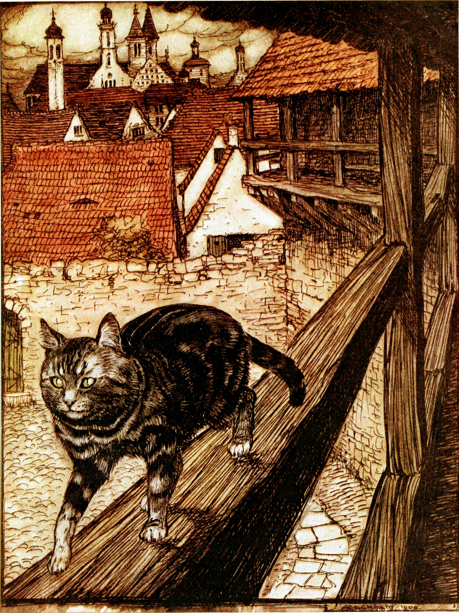
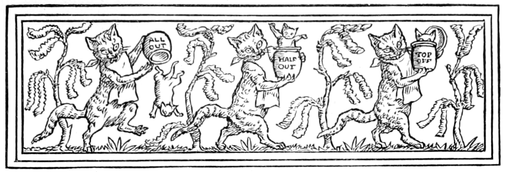

# 今天的文学猫角色：《猫和老鼠合伙》中的猫

这只猫劝老鼠与她同住时，说了许多友爱的话。连过冬的打算，她也替对方想好了：小老鼠出门容易碰上捕鼠夹，不如两人合买一罐油脂，留到天冷时吃。听起来，她是个可靠又会持家的伙伴。格林兄弟（Jacob und Wilhelm Grimm）的《猫和老鼠合伙》（Katze und Maus in Gesellschaft）却让这份体贴，一点点露出了牙齿。

故事收入《格林童话》，主角没有专名。在 Margaret Hunt 的英译本里，她是一只会自称教母、会替谎话编出整套亲戚关系的母猫。她的毛色没有交代，写得最活的倒是嘴：嘴上许诺友谊，舌头惦记油脂，吃完还要舔舔嘴唇。她能像人一样谈家计、讲礼数，也保留了猫上屋顶、晒太阳、纵身扑食的动作。人的花言巧语和动物的食欲，就这样长在同一个身体里。

最能看清她的，是第一次独自出门。她说表亲生了孩子，邀她去洗礼时当教母，便把看家的活留给老鼠。其实她直奔教堂，舔掉了油罐最上面一层。把储粮藏在祭坛底下，本来也是她的主意：那里没人敢偷。她替共同财产挑了个看似安全的地方，又亲自利用这份安全感。吃够后，她到城里的屋顶闲逛，躺在阳光下，一想起油脂就舔嘴，直到晚上才回家。

猫的可怕之处还在于，她并不费力掩藏得滴水不漏。老鼠问受洗的小孩叫什么，她竟把偷吃的进度报成名字：先是“去掉顶层”，后来是“吃掉一半”，最后是“全部吃光”。这些名字古怪得足以引起疑心，她却能镇定地顶回去，讥笑老鼠家的名字也好不到哪里去，或说老鼠整天待在家里才会胡思乱想。她负责出门享受，也负责解释世界；留在屋里的伙伴，连自己的疑问都要受她训斥。

这篇短童话的辛辣，来自猫始终若无其事的口气。她把独吞说成舒心的享受，把对方的信任当作行动的便利；承诺与贪欲之间，看不到什么挣扎。她并不是被临时的饥饿逼得失信：冬天尚未来到，储备已经进了她的肚子。读者跟着她一次次离家，知道真相，却只能听老鼠在门口询问那些荒唐的名字。

阿瑟·拉克姆（Arthur Rackham）的插图让她带着深色条纹走过高处的木板，城市的屋顶与尖塔铺在身后；沃尔特·克兰（Walter Crane）的题头画则把猫与油罐排成连续的小场面，连罐上的字都参与讲故事。到了文字的结尾，老鼠终于对着空罐说出了那串名字的意思。猫先喝令它闭嘴，又在它说出“全部吃光”时扑上去，把伙伴也吞了下去。

### 资料来源

- 格林兄弟，Margaret Hunt 英译，[《Household Tales》第二篇《Cat and Mouse in Partnership》](https://www.gutenberg.org/files/5314/5314-h/5314-h.htm#chap02)
- Wikimedia Commons，[拉克姆《The Cat and Mouse in Partnership》插图及版本记录](https://commons.wikimedia.org/wiki/File:Grimm-Rackham-101.jpg)
- Wikimedia Commons，[克兰《Cat and Mouse in Partnership》题头画及版本记录](https://commons.wikimedia.org/wiki/File:Household_stories_Bros_Grimm_(L_%26_W_Crane)_headpiece_p037.png)

### 视觉参考

1. 1909 年格林童话插图，拉克姆绘：猫走过屋顶木板
   - 来源页面：<https://commons.wikimedia.org/wiki/File:Grimm-Rackham-101.jpg>
   - 原始图片：<https://upload.wikimedia.org/wikipedia/commons/9/95/Grimm-Rackham-101.jpg>
   - 作者/机构：Arthur Rackham；Wikimedia Commons
   - 说明：拉克姆为《猫和老鼠合伙》绘制的彩色插图，表现猫在屋顶行走的形象。

2. 格林童话题头画，克兰绘：猫、油罐与老鼠
   - 来源页面：<https://commons.wikimedia.org/wiki/File:Household_stories_Bros_Grimm_(L_%26_W_Crane)_headpiece_p037.png>
   - 原始图片：<https://upload.wikimedia.org/wikipedia/commons/d/db/Household_stories_Bros_Grimm_%28L_%26_W_Crane%29_headpiece_p037.png>
   - 作者/机构：Walter Crane；Wikimedia Commons
   - 说明：Lucy Crane 英译格林童话中本篇的题头插画，以油罐文字串联猫的偷吃行为。
