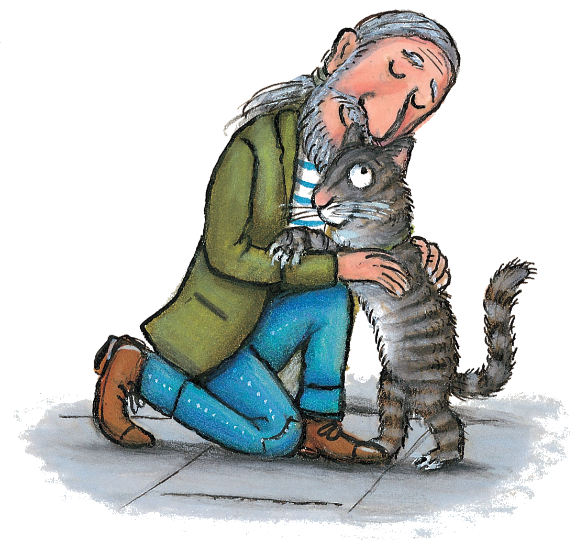
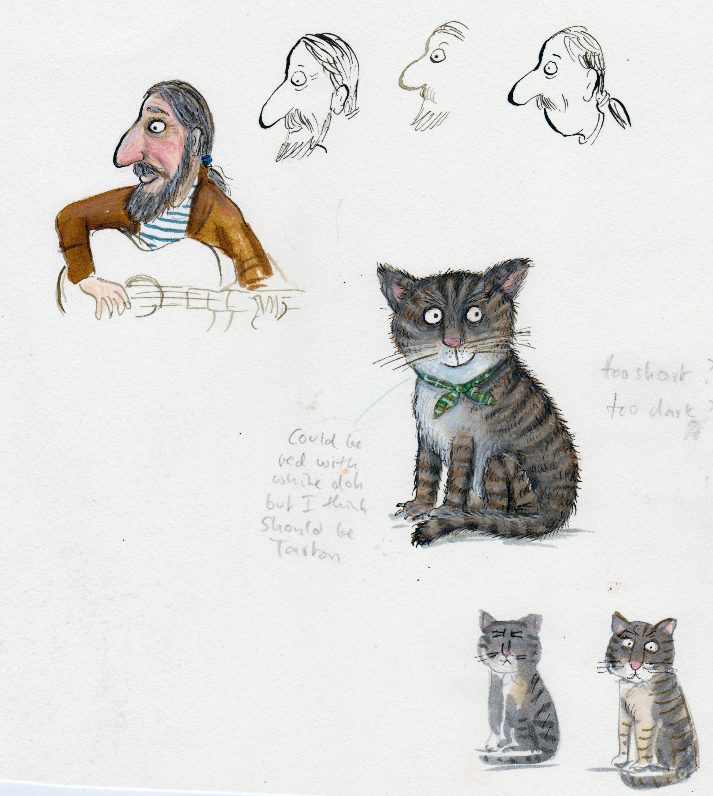

# 今天的文学猫角色：Tabby McTat

吉他一响，Tabby McTat 就跟着唱起来。街头艺人 Fred 弹琴，这只虎斑猫用喵声加入，路人把硬币投进帽子里。对他而言，街头有熟悉的搭档，也有每天一起唱的歌；生活的快乐，可以由一把旧吉他和一副猫嗓子合奏出来。

他是朱莉娅·唐纳森（Julia Donaldson）与阿克塞尔·舍夫勒（Axel Scheffler）合作绘本《多喵快乐》（Tabby McTat）的主角。舍夫勒给他画了圆睁的眼睛、粉红鼻头和一身深浅相间的条纹，脸颊的胡须向两边伸展。跟 Fred 在一起时，他可以站起身，把前爪搭在人身上；猫与人的身形差距，被一个拥抱缩短了。那种热乎乎的亲昵，也让他们的合唱有了可见的模样。

唐纳森自己爱猫，也曾和丈夫 Malcolm 一起街头卖唱。她在谈到创作时说，正是把猫与街头艺人放到一起，才有了这个故事。于是，这只猫的本领十分贴近作者熟悉的生活：他不施魔法，也不替主人谋取王国，只管把声音送进歌里。原文用押韵的节奏讲述，适合念出声来；读到猫参加演唱的地方，朗读者也很难始终保持一本正经的语气。

分离却发生在寻常的一天。Tabby McTat 结识母猫 Sock，和她聊天时，有人偷走了 Fred 装钱的帽子。Fred 追赶小偷受伤，进了医院；猫回来，已找不到搭档。Sock 带他住进自己的家，后来他们有了三只小猫。他能接受新生活，也能在其中得到快乐，可是对旧友的想念并没有随之消失。这让他的牵挂很容易被理解：有地方安顿，不等于所有惦念都有了着落。

舍夫勒公开的角色草图，把这只猫画得毛茸茸、眼睛发亮，旁边还留着关于毛色的手写讨论。定稿前，猫的模样也曾有过不同可能。画家谈起这本书时还笑说，封面上的猫大得荒唐，画出的牙齿则被删掉了。比起严格的动物比例，他更关心角色怎样进入这个带着日常街景的故事；一只猫能与人相拥，也能有自己要回去的家。

等 Tabby McTat 终于找到 Fred，团聚又带来新的为难：他想念 Sock 和家。最小的儿子 Samuel Sprat 此时提出，要成为街头艺人的新搭档。小猫先前因为喵声太响，迟迟没有被人领养，那副令别人退却的嗓门，恰好能加入吉他的歌声。Fred 身边重新有了唱歌的猫，Tabby McTat 则回到 Sock 身旁。旧搭档的歌继续唱下去，父亲也可以回家。

### 资料来源

- 朱莉娅·唐纳森，[《Tabby McTat》作品介绍与创作回忆](https://www.juliadonaldson.co.uk/books/picture-books/tabby-mctat/)
- 阿克塞尔·舍夫勒，[《Tabby McTat》插画、角色草图与画家自述](https://axelscheffler.com/books-with-julia-donaldson/tabby-mctat)
- Scholastic Book Fairs，[《Tabby McTat》Book Talk 教学资料](https://images.scholastic.co.uk/assets/a/1b/4a/book-talk-tabby-mctat-325681.pdf)，第 2 页
- Scholastic Canada，[《Tabby McTat, the Musical Cat》图书介绍](https://www.scholastic.ca/our-books/book/tabby-mctat-the-musical-cat-9781546110668)
- 诚品线上，[《多喵快乐》中文版本资料](https://www.eslite.com/product/1003128672295730)

### 视觉参考

1. 舍夫勒官网插画：Fred 抱住虎斑猫
   - 来源页面：<https://axelscheffler.com/books-with-julia-donaldson/tabby-mctat>
   - 原始图片：<https://axelscheffler.com/media/pages/books-with-julia-donaldson/tabby-mctat/672f6dae50-1642776615/tabby-mctat.png>
   - 作者/机构：Axel Scheffler
   - 说明：画家官网展示的《Tabby McTat》插画，表现猫与街头艺人 Fred 的亲密关系。

2. 舍夫勒角色设计草图：猫与街头歌手
   - 来源页面：<https://axelscheffler.com/books-with-julia-donaldson/tabby-mctat>
   - 原始图片：<https://axelscheffler.com/media/pages/books-with-julia-donaldson/tabby-mctat/8778d8df9d-1642776613/tabby-charac-dev.jpg>
   - 作者/机构：Axel Scheffler
   - 说明：画家官网公开的角色设计页，包含 Tabby McTat 与 Fred 的造型探索。
