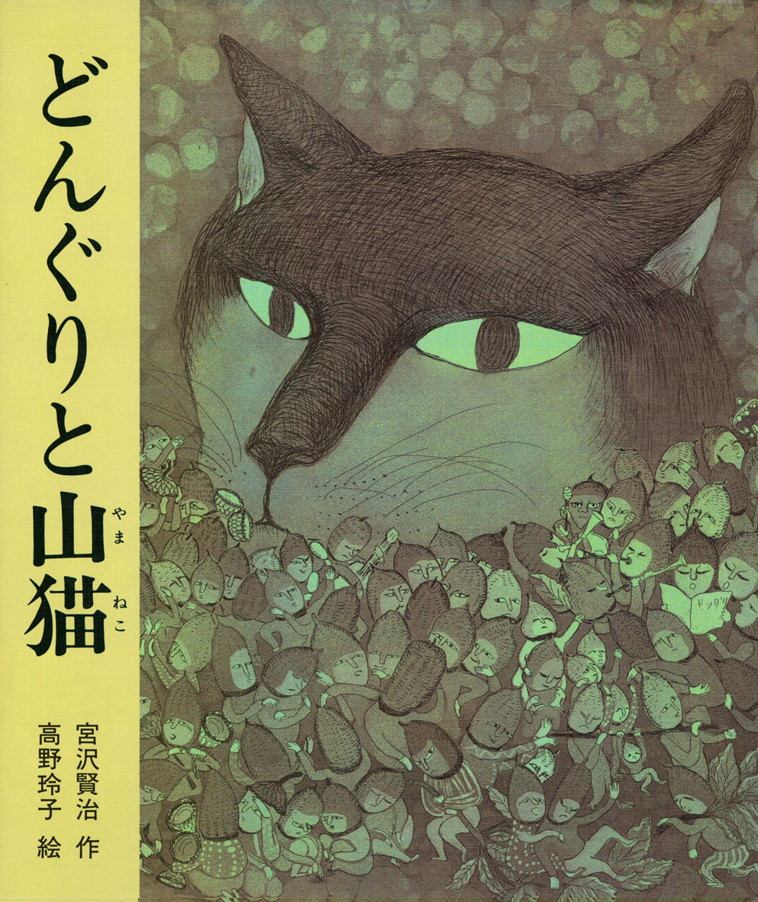
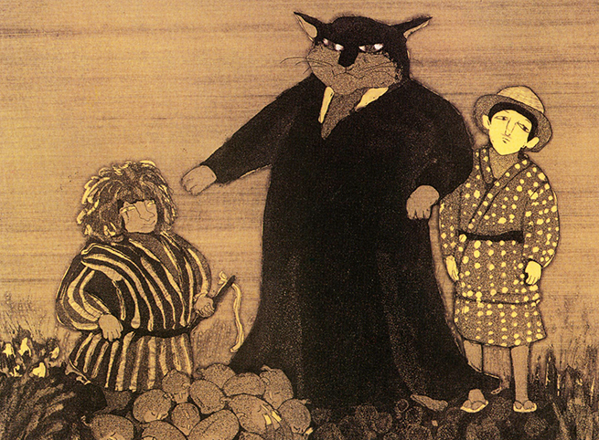

# 今天的文学猫角色：山猫

山猫把胡须一拉，肚子一挺，郑重地接待前来帮忙的孩子。它有圆睁的绿眼睛、直立的尖耳朵，身上穿着黄色阵羽织，一件近似武士外罩的衣服。这副气派很适合当山林里的大人物；偏偏它正为一群橡子伤透脑筋，同一场官司已经审了三天。

它出自宫泽贤治（宮沢賢治）的童话《橡子与山猫》（どんぐりと山猫），作品于 1924 年收入童话集《要求太多的餐馆》（注文の多い料理店）。故事从一张寄给男孩一郎的明信片开始：山猫邀他明天来参加麻烦的审判，还特意叮嘱不要带射击武器。字写得歪歪扭扭，用词也错漏不断，一郎却兴奋得睡不着。沿着山间小路走去，他能向栗树、瀑布和蘑菇问路。山猫的世界有草木的声音，也有一套煞有介事的人间规矩，连赴约都得先收到通知。

山猫很看重这些规矩。客人到了，它递出香烟；孩子不接，它便摆出长辈姿态，点火、皱脸、吐烟。开庭时，它又换上黑色长缎袍，庄严地坐到橡子们面前，身旁还有替它摇铃、挥鞭的马车侍从。黄色外衣与黑色礼服，把它的身份层层装点起来。高野玲子为 1989 年偕成社绘本绘制的铜版画，也保留了这份隆重：厚重的黑袍裹住山猫，孩子站在旁边，猫脸上的神情却远没有衣服那么威严。

它的难处在于，橡子们各有一套评判标准。尖的认为尖最好，圆的坚持圆最好，大的、高的也都要争第一。山猫只能反复喝令安静，劝大家和好；侍从一挥鞭，争吵暂时停下，再问一句，又重新闹开。它的威风只能管住片刻的声音，解决不了大家为什么争。于是，这位法官悄悄转向一郎讨主意。这个低声求助的动作，让山猫从一身官服里露出本来面目：它要体面，也确实着急，愿意承认自己没办法。

一郎建议把标准倒过来，宣布最笨、最不像样的才最了不起。山猫立刻照办，橡子们终于全都闭了嘴。它如释重负，脱掉黑袍擦汗，拉住一郎的手，还想请他做名誉法官。可刚解决困难，它又琢磨起下次通知的措辞，想把邀请改成命令对方前来报到的口气。得到帮助的感激与摆官架子的习惯，就这样挤在同一只猫身上；宫泽贤治没有把它写成纯粹的恶官，也没有让一次求助治好它的虚荣。

读这篇童话，可以留心山猫那些细小的动作：捻胡须、眨眼、低头，话到嘴边还要犹豫。山林的奇异与它的局促并排存在，读来既好笑，又有一点惆怅。故事最后，一郎带回的金色橡子失去光泽，变成普通的褐色橡子；山猫和蘑菇马车也消失了。此后再没有明信片寄来，男孩偶尔还会想，当初答应那句别扭的传唤措辞就好了。

### 资料来源

- 宫泽贤治，[《どんぐりと山猫》](https://www.aozora.gr.jp/cards/000081/files/43752_17657.html)，青空文库，底本为新潮文库《注文の多い料理店》1990 年版
- 偕成社，[《どんぐりと山猫》图书页](https://www.kaiseisha.co.jp/books/9784039634108)，高野玲子绘，1989 年 2 月出版
- 偕成社 Kaisei web，[《どんぐりたちの裁判がユニーク！　宮沢賢治の童話絵本『どんぐりと山猫』》](https://kaiseiweb.kaiseisha.co.jp/s/osusume/osm211108/)，2021 年 11 月 8 日

### 视觉参考

1. 1989 年偕成社版，高野玲子绘：山猫与橡子
   - 来源页面：<https://www.kaiseisha.co.jp/books/9784039634108>
   - 原始图片：<https://s3-ap-northeast-1.amazonaws.com/kss-data001/book_images/9784039634108.jpg>
   - 作者/机构：高野玲子／偕成社
   - 说明：绘本封面以山猫的面孔和聚集的橡子呈现故事中的审判双方。

2. 1989 年偕成社版，高野玲子绘：山猫主持审判
   - 来源页面：<https://kaiseiweb.kaiseisha.co.jp/s/osusume/osm211108/>
   - 原始图片：<https://kaiseiweb.kaiseisha.co.jp/wp-content/uploads/2021/10/osm211108-3.jpg>
   - 作者/机构：高野玲子／偕成社
   - 说明：绘本内页描绘穿黑色长袍的山猫、一郎和马车侍从。
