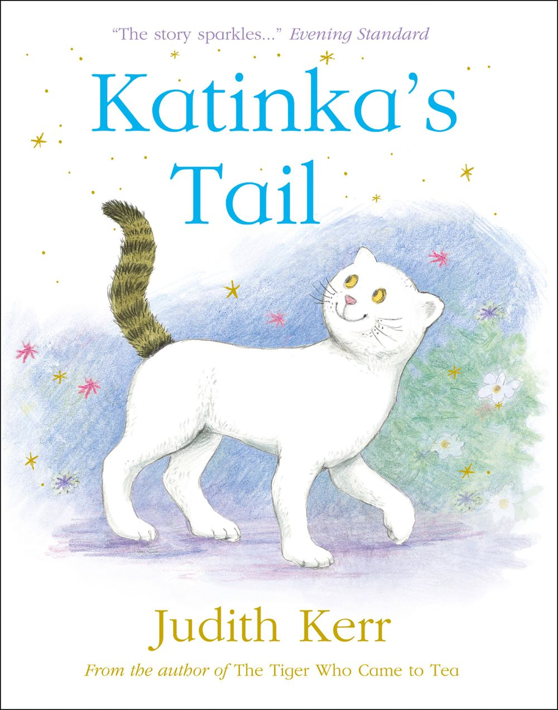
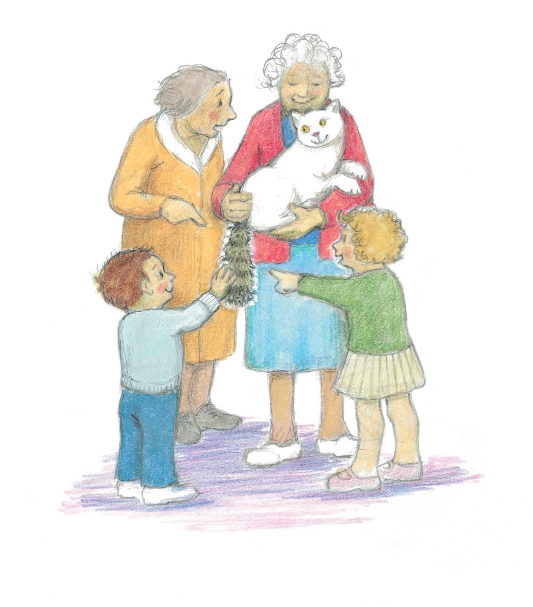

# 今天的文学猫角色：Katinka

每天早晨，卧室的窗帘一拉开，Katinka 就已经等在窗外了。她沿着屋外的藤蔓爬上来，赶在女主人醒来前占好位置。这只白猫长着一条蓬松的虎斑尾巴，仿佛穿了一身白衣服，却偏偏留下一个不同花色的袖口。路人总盯着尾巴看，和她朝夕相处的人却觉得，她只是自己那只可爱的猫。

Katinka 是朱迪丝·克尔（Judith Kerr）自写自绘的《Katinka’s Tail》里的主角，书名意为“Katinka 的尾巴”。这本绘本于 2017 年出版，克尔当时已是九十四岁的老人。她早已创造出莫格这样的文学猫，却仍在观察身边的新猫怎样生活。Katinka 的原型就是她养的猫；在一次访谈里，克尔说起猫沿藤爬窗、躺在桌上故意慢慢滑落的把戏，语气像是在谈一位会逗她开心的老朋友。书里的白发女主人也带着作者自己的模样。

尾巴让 Katinka 一出门就成了话题。有人觉得滑稽，有人追问她是不是还有其他古怪之处，女主人听着便生气，急忙替她辩护。克尔把这种熟悉的护短写得很轻：旁人看到的是一处醒目的差异，养猫的人想起的却是每天相处的整只猫。插画里的 Katinka 有黄色的眼睛、粉色的鼻子，嘴边像含着笑；她被抱在人怀里，身体松软，尾巴垂下来，任由周围的人指指点点。

她对自己的生活却颇有主意。女主人穿衣时，她要凑过去帮忙，鞋子里有没有蜘蛛，也要先检查。到树林里玩脏了，她可以接受梳毛，唯独尾巴不许碰。这份小小的坚持让尾巴先于魔法拥有了秘密。厨房地上偶尔还会出现她带回来的死老鼠，甚至只有半只，女主人只好趁她不注意偷偷扔掉。书里没有把亲昵的猫洗成一件乖巧摆设：她能陪人生活，也照样有自己的兴趣和猎获。

故事的奇幻部分从这些家常琐事中生长出来。夜里，尾巴显出金色的光，Katinka、女主人和许多动物一同飞向星空。此前被人议论的花纹，忽然成了带路的光亮。克尔的画仍保留柔软的线条和亲近的神情，飞行没有把这对伙伴变成陌生的英雄；日常积累起来的信任，使人愿意跟着这只猫走出卧室，去看看她知道些什么。

等女主人重新躺回床上，她可以把这一夜解释成梦。可是窗边的 Katinka 还在那里，尾巴依旧闪着金光。清晨拉开窗帘的动作又回来了，读者却已经不能像最初那样，把窗外等候的白猫看得一清二楚。

### 资料来源

- 朱迪丝·克尔，[《Katinka’s Tail》公开试读](https://www.lovereading4kids.co.uk/extract/14707/Katinkas-Tail-by-Judith-Kerr.html)，HarperCollins，2017 年，开篇六页
- Nicholas Tucker，[《A Talent for Happiness》：朱迪丝·克尔访谈](https://booksforkeeps.co.uk/article/a-talent-for-happiness-judith-kerr-interviewed/)，Books for Keeps，第 227 期，2017 年 11 月
- BookTrust，[《Katinka’s Tail》图书介绍](https://www.booktrust.org.uk/book-recommendations/bookfinder/katinkas-tail/)
- HarperCollins Children's Books，[《Katinka’s Tail》图书页](https://harpercollinschildrensbooks.co.uk/products/katinkas-tail-judith-kerr-9780008255336/)

### 视觉参考

1. HarperCollins 版封面，克尔绘：白猫与虎斑尾巴
   - 来源页面：<https://harpercollinschildrensbooks.co.uk/products/katinkas-tail-judith-kerr-9780008255336/>
   - 原始图片：<https://i.harperapps.com/hcuk/covers/9780008255336/x1000.jpg>
   - 作者/机构：Judith Kerr / HarperCollins
   - 说明：作者绘制的封面呈现 Katinka 的白色身体与虎斑尾巴。

2. 2017 年内页，克尔绘：被人们围观尾巴的猫
   - 来源页面：<https://www.theguardian.com/books/2017/dec/10/picture-books-roundup-review-a-christmas-carol-quentin-blake-judith-katinkas-tail>
   - 原始图片：<https://i.guim.co.uk/img/media/9c90e99526188e62d7ebb6296cb768a0b35f3011/0_0_1404_1600/master/1404.jpg?width=1404&dpr=1&s=none&crop=none>
   - 作者/机构：Judith Kerr / HarperCollins；The Guardian 刊载
   - 说明：原书插画中，女主人抱着 Katinka，旁人注意着她特别的尾巴。
