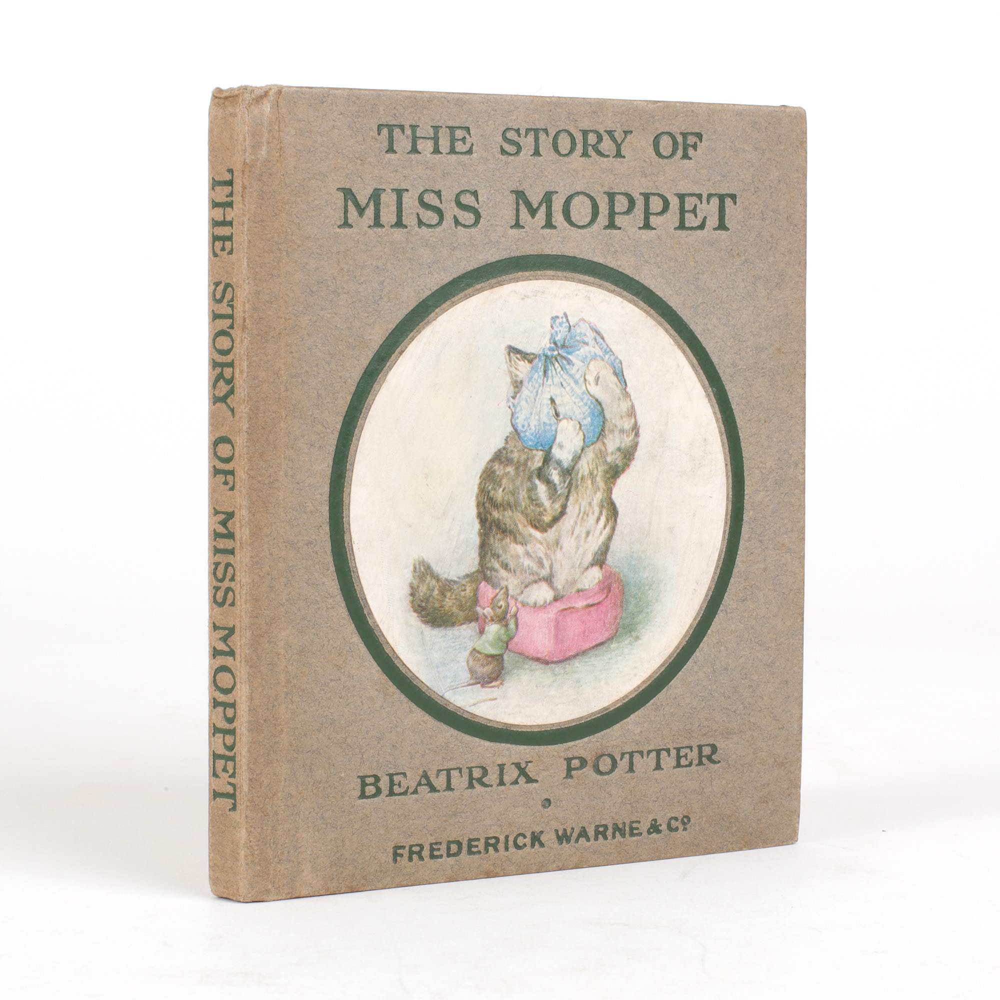
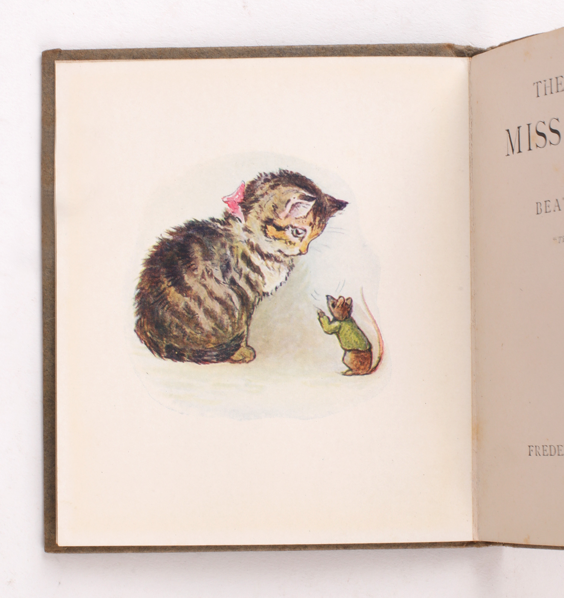

# 今天的文学猫角色：Miss Moppet

Miss Moppet 把头裹进一块抹布，两只前爪抱着脑袋，看起来病得越来越厉害。可布上有个洞，她正从那里偷看老鼠。刚才追捕时撞疼了头的小猫，已经学会把自己的狼狈变成圈套：只要对方再靠近一点，她就能扑过去。

这只小母猫是碧雅翠丝·波特（Beatrix Potter）自写自绘的《The Story of Miss Moppet》的主角，故事初版于 1906 年。她有一身虎斑，耳朵竖着，眼睛睁得圆圆的；波特画她时，保留了幼猫毛茸茸的身体和还不够利落的动作，却也让她像个会赌气、会想办法的孩子。书里的屋子不大，柜子、炉火和坐垫就足以搭出她的整个战场。老鼠敢在柜子后面取笑她，正因为他看得出，这还只是一只小猫。

Miss Moppet 的聪明带着临时起意的痕迹。第一次扑空，她拿脑袋碰到了柜子，随后觉得这柜子可真硬；受挫之后，她没有继续乱追，而是坐到炉火前，借抹布掩护自己。那副抱头的模样兼有疼痛和表演，读者既能看见她确实吃了苦头，也知道她仍在盘算。波特没有替她安排长篇自白，只让姿势、视线和老鼠逐步缩短的距离，交代出这一点小心机。

抓到老鼠以后，她又暴露了另一面：对方捉弄过她，她就要捉弄回去。她把老鼠包进抹布，像抛球一样抛来抛去，却忘记了那个洞。刚刚帮助她窥视猎物的破口，转眼成了老鼠的逃生通道。这个失误很符合她的年纪和脾气：能想出一个好主意，未必能耐心照看它的后果；得手的快意一上来，眼前最要紧的事便被丢到脑后。

波特对她的态度也颇有分寸。她容许读者欣赏小猫的机灵，到了小猫报复的时候，又直接点出这样做并不好。于是猫鼠双方都保留了让人发笑、也让人不大赞同的地方，没有谁始终占据乖孩子的位置。文字短得可以一口气读完，画面却不断提醒人停一下：看她怎样抱头，怎样盯住对手，怎样在打开空布包时愣住。同一块抹布几次改变用途，便把她的性格串了起来。

早期书本版的封面选了她蒙头窥看的形象；卷首则让她低头面对一只小得多的老鼠，体形上的优势清清楚楚。故事偏偏不肯让这份优势保证胜利。最后，老鼠在柜顶跳起舞来，Miss Moppet 的狩猎课就停在这里：她已经会设局，还没学会在得意的时候留神。

### 资料来源

- 碧雅翠丝·波特，[《The Story of Miss Moppet》全文及原绘插图](https://www.gutenberg.org/files/14848/14848-h/14848-h.htm)，Project Gutenberg 电子版，原书初版于 1906 年
- Jonkers Rare Books，[《The Story of Miss Moppet》早期书本版书目与实物照片](https://www.jonkers.co.uk/rare-book/13286/the-story-of-miss-moppet/beatrix-potter)，1916 年版，库存编号 42412

### 视觉参考

1. 1916 年版封面，波特绘：蒙着头的小猫与老鼠
   - 来源页面：<https://www.jonkers.co.uk/rare-book/13286/the-story-of-miss-moppet/beatrix-potter>
   - 原始图片：<https://www.jonkers.co.uk/uploads/00071/00071212.jpg?v=1>
   - 作者/机构：碧雅翠丝·波特（绘）；Jonkers Rare Books（实物照片）
   - 说明：早期书本版封面采用 Miss Moppet 蒙头窥看老鼠的原绘形象。

2. 1916 年版卷首插图，波特绘：小猫俯看老鼠
   - 来源页面：<https://www.jonkers.co.uk/rare-book/13286/the-story-of-miss-moppet/beatrix-potter>
   - 原始图片：<https://www.jonkers.co.uk/uploads/00071/00071216.jpg?v=1>
   - 作者/机构：碧雅翠丝·波特（绘）；Jonkers Rare Books（实物照片）
   - 说明：同一版本的卷首彩色插图呈现 Miss Moppet 与老鼠相对的姿态。
