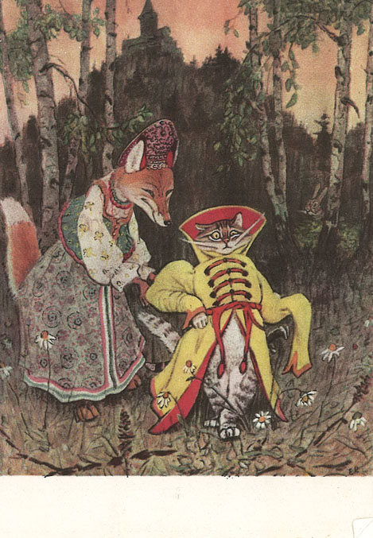
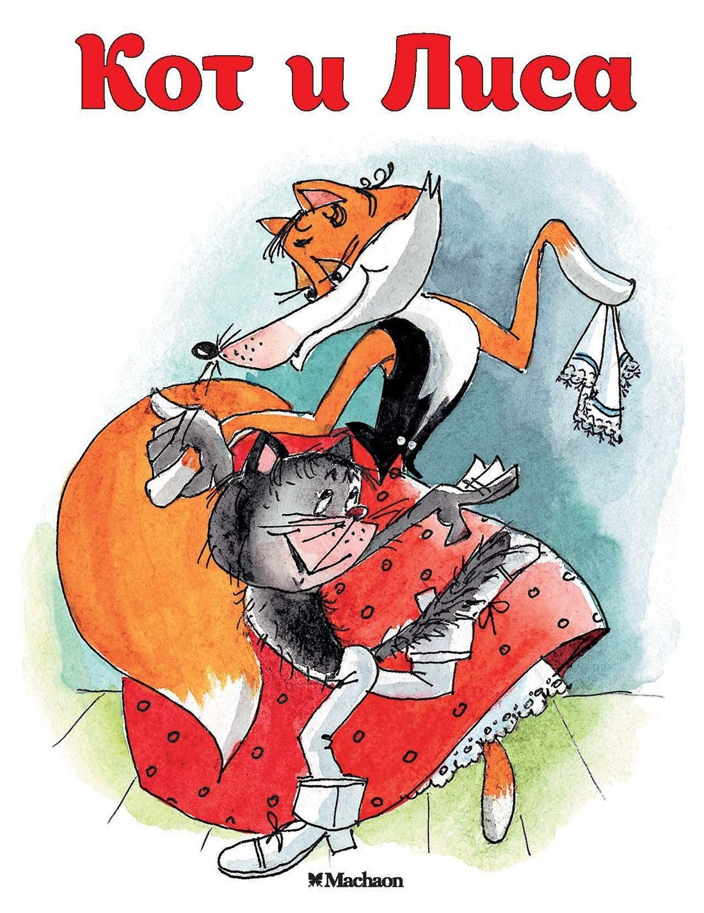

# 今天的文学猫角色：Cat Ivanovitch

森林里的熊和狼都不敢靠近一只家猫。他们听说，这位新来的大人物从遥远的西伯利亚奉命而来，是统管森林的长官。可读者知道，他刚刚被主人缝进麻袋，丢到了树林里；那副派头十足的身子，还少了一只耳朵。

他是俄罗斯民间故事《猫和狐狸》（Кот и лиса）里的猫。在阿瑟·兰塞姆（Arthur Ransome）1916 年出版的《Old Peter’s Russian Tales》中，这个故事被改写为《The Cat Who Became Head-Forester》，猫的名字写作 Cat Ivanovitch。兰塞姆让老彼得在林间小屋里给孩子们讲故事，这只猫的遭遇也带着炉边闲谈的口吻：叙述者知道他的底细，却乐意看他怎样重新安顿自己。

兰塞姆笔下，他是一只上了年纪、爱打架的公猫，缺耳朵，也算不上漂亮。这样的外表没有妨碍他自重。撕破麻袋脱身以后，他先伸展四肢，把自己洗干净，骄傲地翘起尾巴，竖着仅剩的耳朵往前走。他很快找到一间废弃的护林人小屋，拿阁楼上的干草当床，靠捕鸟捉鼠填饱肚子。生存本领不缺，牢骚也跟着来了：从前有人天天喂他，捉老鼠只是消遣；以他的身份，怎么能什么活都自己干？

他的威风便从这份理直气壮里长出来。狐狸从没见过这样的动物，连缺耳朵都觉得好看。他弓起背、竖起毛，慢条斯理地报出自己的官职，随后接受邀请，住进狐狸家，又答应和她结婚。这对搭档分工鲜明：猫在家梳理胡须、睡觉，狐狸在外面替丈夫经营声势。熊和狼想拜见，她就要他们带来牛羊，还叮嘱送完礼立刻藏好，免得惹怒长官。猫说过的那几句话，就这样被狐狸扩成了一套谁也不敢查问的身份。

故事的笑声落在猫最平常的习惯上。他扑向牛肉，边撕咬边发出呼噜声，躲在树上的熊却听成他嫌食物太少。枯叶下露出的狼鼻子稍微一动，又勾起他的捕鼠本能；他扑过去，才发现那里藏着一头狼，吓得尖叫着往树上逃。偏偏熊就在树梢，以为猫追来索命，慌忙跳了下去。读者同时看见两件事：野兽眼中势不可挡的长官，正在忙着逃跑。猫既有傲气，也会害怕，爪子和胆量都仍是家猫的尺寸。

后来，拉乔夫（Евгений Рачёв）的插画把猫装进阔领华服，狐狸陪在身边，森严的派头有了衣襟和袖口；柳德米拉·雅克希斯（Людмила Якшис）的现代版封面则让这对搭档跳起舞来。不同画家都抓住了他们结伴的趣味。兰塞姆的故事结束时，两位新婚伴侣已经不愁鲜肉：那些被吓跑的森林居民，仍会把食物送来，远远地放下。

### 资料来源

- 阿瑟·兰塞姆（Arthur Ransome），[《Old Peter’s Russian Tales》](https://www.gutenberg.org/files/16981/16981-h/16981-h.htm)，1916 年，《The Cat Who Became Head-Forester》，第 106–119 页
- «Речь» 出版社，[《Летела сова — весёлая голова》](https://rech-deti.ru/catalog/7/25147/)，2019 年，目录及拉乔夫插画介绍
- Globus Books，[《Кот и Лиса》](https://www.globusbooks.com/pages/books/19576/kot-i-lisa?soldItem=true)，Махаон，2021 年，插画者及版本记录

### 视觉参考

1. 1969 年明信片，拉乔夫绘：猫与狐狸同行
   - 来源页面：<http://1271.ru/set/skazka/hudognik-rachev/>
   - 原始图片：<http://1271.ru/komplekt/skazka/rachev/a4.jpg>
   - 作者/机构：Евгений Рачёв / Изобразительное искусство
   - 说明：《猫和狐狸》插画明信片，猫穿着华服与狐狸结伴而行。

2. 2021 年版封面，雅克希斯绘：跳舞的猫与狐狸
   - 来源页面：<https://www.globusbooks.com/pages/books/19576/kot-i-lisa?soldItem=true>
   - 原始图片：<https://globusbooks.cdn.bibliopolis.com/pictures/19576.jpg?auto=webp&v=1721380821>
   - 作者/机构：Людмила Якшис / Махаон；Globus Books
   - 说明：《Кот и Лиса》现代俄文版封面，表现故事中的猫与狐狸搭档。
