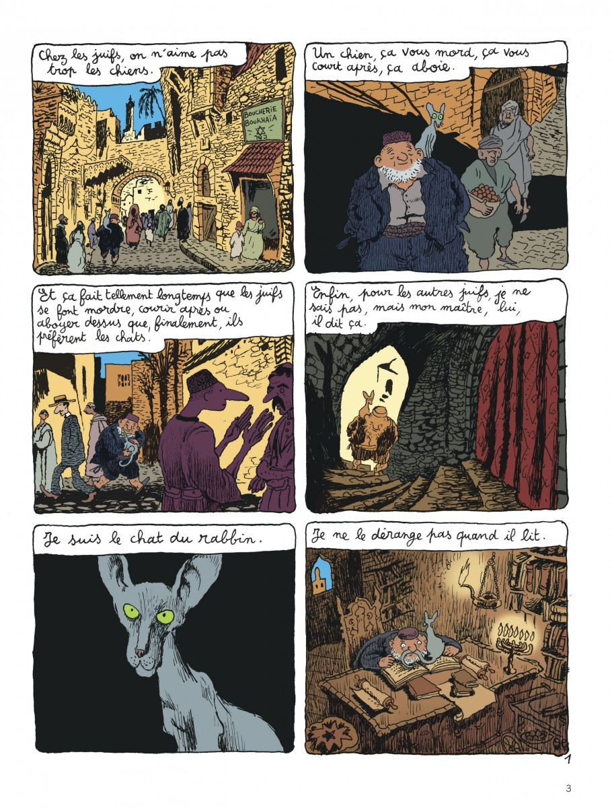
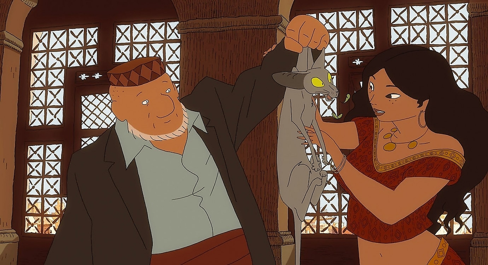

# 今天的文学猫角色：Le Chat du rabbin（穆鲁）

拉比问起家里那只鹦鹉，穆鲁说，它出门办事去了。可他嘴里还塞着羽毛。猫刚刚吞掉了家里最吵闹的住客，也突然有了说话的本领。他刚让人知道猫也能开口，就让人见识了猫怎么撒谎。

穆鲁是尤安·史法（Joann Sfar）的法国漫画《拉比的猫》（Le Chat du Rabbin）的主角，故事从 2002 年出版的首册《成年礼》（La Bar-Mitsva）讲起。法文原作里，他只自称拉比的猫。穆鲁是张怡中译本给读者的称呼。史法把故事放在二十世纪二十年代的阿尔及尔（Alger），让这只猫住在一个犹太拉比家里。他最喜欢待在拉比的女儿扎拉比娅（Zlabya）怀里，安安静静地打呼噜。史法和上色的布丽吉特·芬达克利（Brigitte Findakly）给了他一副瘦长的灰色身子、一对直立的大耳朵和两只黄绿眼睛。拉比出门时，他能稳稳地蹲在主人肩上。到了书房，他就守在拉比的书桌上。

还没吃掉鹦鹉，穆鲁就已经在给读者讲故事。漫画让他把心里的话写在格子上方，再让读者看他在格子里怎样做猫。他说自己从来不打扰拉比读书，画里的拉比几乎把脸贴到书页上，穆鲁就挨在他鼻子前面。等到他真的开口，拉比终于能听见那些从前只归读者听的辩解。他担心这只满嘴谎话的猫带坏女儿，便不许穆鲁去见她，开始教他读犹太经典。穆鲁却顺着这番教导，提出要行犹太成年礼。他要继续留在扎拉比娅身边，于是把一道家门口的禁令变成了连拉比的老师也得出面回答的问题。

穆鲁很擅长从大人的话里找出一个可以接着问下去的地方。他同拉比的老师争论人和猫有什么区别，抓住了人由上帝照自己的形象所造这一说法，又把上帝同言语联系起来。既然猫也能言说，他就问，自己凭什么算不得人？这套推论护着他在家里那一点小小的利益，读来却也让人想听一听老师怎么答。穆鲁每次把话题引向大的问题，心里往往还惦记着一个具体的人。能同别人辩论以后，他甚至开始梦见扎拉比娅生病，梦见她会死。他白天可以在长辈面前理直气壮，到了夜里，却拿这些念头一点办法也没有。

2011 年，史法和安东·德勒斯瓦（Antoine Delesvaux）共同把这套漫画搬上银幕，这部动画电影曾以《拉比有隻賤嘴貓》之名在台北金马影展放映。穆鲁在电影里保留了那对大耳朵和醒目的眼睛。鹦鹉失踪时，拉比把他拎起来，扎拉比娅凑过来，几片羽毛就在他们面前飞。看他的眼神，似乎还在等人信他那句话。

### 资料来源

- 尤安·史法，[《拉比的猫》首册《成年礼》试读](https://www.dargaud.com/bd-en-ligne/le-chat-du-rabbin-tome-1/2932/8081986b36a651f596525a3f13ea7b89)，Dargaud，2002 年
- Dargaud，[《成年礼》图书页](https://www.dargaud.com/bd/le-chat-du-rabbin/le-chat-du-rabbin/le-chat-du-rabbin-tome-1-la-bar-mitsva-bda5020550)
- 《拉比的猫》系列网站，[拉比的猫角色页](https://chat-du-rabbin.com/archive/fre/Serie/Les-personnages/Le-chat-du-rabbin.html)
- 张怡，[《语言的寓言——〈拉比的猫〉的文学传统》](https://www.aisixiang.com/data/108522.html)
- 法国犹太艺术与历史博物馆，[《尤安·史法：画出来的人生》展览教育手册](https://www.mahj.org/sites/default/files/2023-10/DP_Joann-Sfar%20version%20finale_2.pdf)，第 12 页
- 台北金马影展，[《拉比有隻賤嘴貓》影片页](https://www.goldenhorse.org.tw/film/programme/films/detail/427)，2011 年

### 视觉参考

1. 2002 年《成年礼》第 3 页，尤安·史法绘：穆鲁与拉比
   - 来源页面：<https://www.dargaud.com/bd-en-ligne/le-chat-du-rabbin-tome-1/2932/8081986b36a651f596525a3f13ea7b89>
   - 原始图片：<https://bdi.dlpdomain.com/player/7cPaAKwY1DRVaPYl7uvZJMgdwj2hPe0N-page3-1200.jpg>
   - 作者/机构：尤安·史法绘，布丽吉特·芬达克利上色，Dargaud 出版
   - 说明：漫画首册的开篇，穆鲁介绍自己，也让读者看到他怎样陪拉比读书。

2. 2011 年动画剧照：拉比拎起嘴边还飘着羽毛的穆鲁
   - 来源页面：<https://www.goldenhorse.org.tw/film/programme/films/detail/427>
   - 原始图片：<https://storage.googleapis.com/tghff_outland/image/photo/2011/GHFF/163/huge/photo_42269b8128e621fe868f49efa0e40647.jpg>
   - 作者/机构：尤安·史法与安东·德勒斯瓦执导，台北金马影展刊载
   - 说明：动画里拉比和扎拉比娅看着刚刚吃掉鹦鹉的穆鲁。
