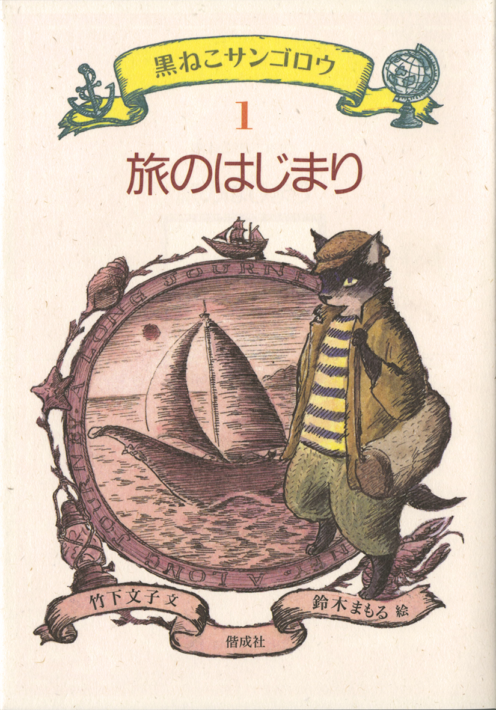
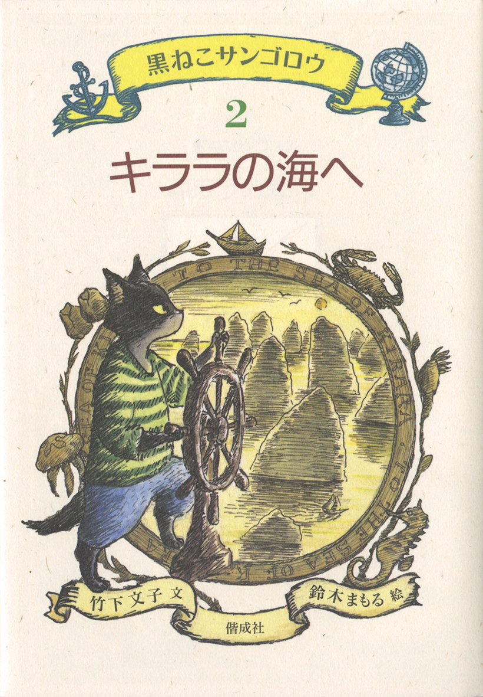

# 今天的文学猫角色：サンゴロウ

列车刚驶出站台，独自去看父亲的男孩ケン就听见有人问旁边的座位空不空。他抬起头，来的是一只戴帽子的黑猫。猫叫サンゴロウ，比男孩早一站下车。ケン问他去那里做什么，他压低声音，说自己是去寻宝的，还拿出一张旧地图。见男孩越听越入神，他便问，要不要一道去？

这只黑猫是竹下文子创作、鈴木まもる绘图的《黒ねこサンゴロウ》系列的主角。开篇《旅のはじまり》于 1994 年出版，写的正是这趟寻找海猫族失落宝物的旅程。故事从ケン的眼睛看出去。男孩先听见声音，抬头才看见乌黑发亮的毛、笔直的长胡须，还有从帽子里伸出的耳尖。サンゴロウ从口袋掏出票，核对了座位号，随后在旁边坐下，把鼓鼓的旅行包放到脚边。第一卷封面也给这位旅客画了帽子、条纹衫和大包，背后是一艘帆船。等サンゴロウ问男孩要不要同行时，他那副熟门熟路的样子，足以让人想知道他还去过哪里。

サンゴロウ原本就向往大海，寻来的宝物给了他出海的机会。到了第二卷《キララの海へ》，他已在海猫岛当船长，先前在旅途中失去的记忆却还没有回来。他的船叫マリン号，与第一卷那趟特快列车同名。海猫族才懂得造这种靠阳光和风行驶的船，也只有他们能驾驭它。鈴木まもる在第二卷封面上画他握着舵轮，望向水面上一座座陡峭的岩峰。第一卷的他随身带着行李，到这一卷，他有了一艘能照自己的意思开往远方的船。

这只猫爱独自航行，也愿意为了别人的事改变航向。海猫族患上会致命的沉睡病时，他把船开进危险的キララ海，寻找能治病的玻璃贝。他说自己的运气由自己决定。把船往哪里开，全由他自己拿主意。海猫族出了事，他也愿意担下这趟差事。十卷故事一边让他往陌生的岛屿走，一边让他从途中遇见的人和事里找回自己的来历。他已经能熟练地掌舵，却还得在一次次靠岸之后，慢慢认清自己属于怎样一段历史。

小说家荒木あかね小时候读这套书，记住了サンゴロウ待船的方式。她回忆，海猫族把船当成相伴过日子的伙伴，这让她后来写小说时，也常把交通工具写进人物的生活里。回头再看系列开头，サンゴロウ还只是个来问座位的旅客。船、岛屿和失去的往事都在后面。ケン先看见的，是一只愿意拿出自己的地图、问他要不要同行的猫。

### 资料来源

- 偕成社，[《旅のはじまり》图书页](https://www.kaiseisha.co.jp/books/9784035282105)，1994 年
- 偕成社，[《キララの海へ》图书页](https://www.kaiseisha.co.jp/books/9784035282204)，1994 年
- 偕成社，[《黒ねこサンゴロウ》系列介绍及第一卷节选](https://kaiseiweb.kaiseisha.co.jp/s/osusume/osm190325/)，2019 年
- 新潟市立中央图书馆吉澤未由，[《旅のはじまり》荐读](https://kids.ohbsn.com/bookshelf/kuronekosangorou1/)，2023 年
- 荒木あかね，[回忆童年阅读《黒ねこサンゴロウ》的随笔](https://book.asahi.com/article/14956530)，2023 年

### 视觉参考

1. 1994 年《旅のはじまり》封面，鈴木まもる绘：背着行囊的黑猫
   - 来源页面：<https://www.kaiseisha.co.jp/books/9784035282105>
   - 原始图片：<https://s3-ap-northeast-1.amazonaws.com/kss-data001/book_images/9784035282105.jpg>
   - 作者/机构：鈴木まもる，偕成社
   - 说明：系列第一卷封面画出サンゴロウ戴帽背包的旅人装束，旁边是一艘帆船。

2. 1994 年《キララの海へ》封面，鈴木まもる绘：黑猫掌舵
   - 来源页面：<https://www.kaiseisha.co.jp/books/9784035282204>
   - 原始图片：<https://s3-ap-northeast-1.amazonaws.com/kss-data001/book_images/9784035282204.jpg>
   - 作者/机构：鈴木まもる，偕成社
   - 说明：系列第二卷封面画出サンゴロウ握着舵轮的身姿，背景是布满岩峰的海域。
