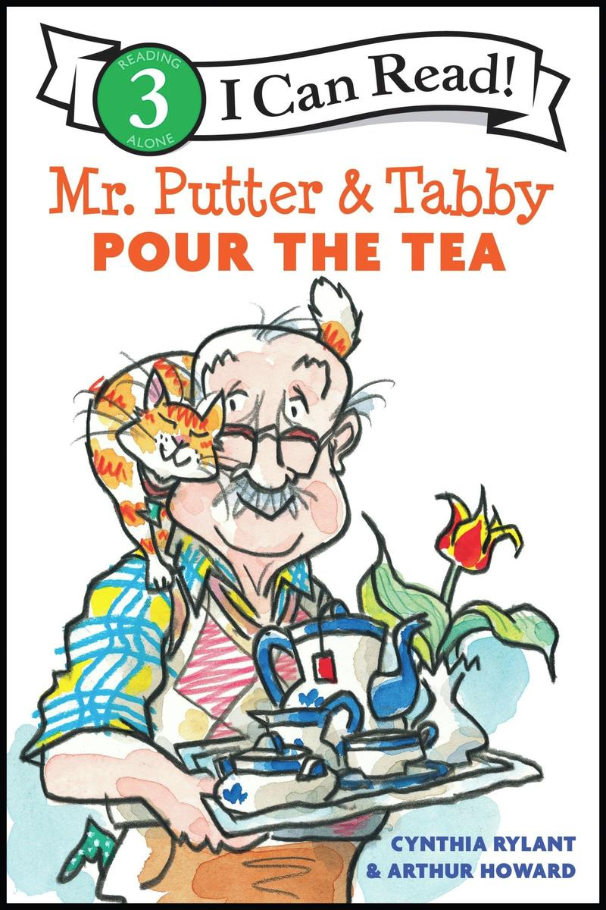
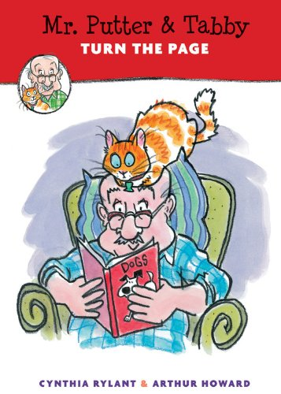

# 今天的文学猫角色：Tabby（虎斑猫）

宠物店里只有活泼可爱的小猫，普特先生却想找一只老猫。他自己已经老了，日子过得慢，没打算突然追上小猫的步伐。后来，在动物收容所，他遇见了黄毛稀疏、骨头咯吱作响、耳朵也有些背的 Tabby。那些容易让领养者迟疑的地方，对他倒都很熟悉：他自己的头发也稀了，关节也响，听力也不大好。

Tabby 是辛西娅·赖蓝特（Cynthia Rylant）笔下《普特先生和虎斑猫》（Mr. Putter & Tabby）系列的女主角。这套英语儿童读物由 Arthur Howard 绘图，1994 年出版的《Mr. Putter & Tabby Pour the Tea》写下了他们的相遇，书名说的是两位伙伴一起沏茶。她是一只上了年纪的母猫，黄色的毛与老态都在文字里出现；插画又给了她橘黄条纹、白色脸颊和一副长胡须。她挨着戴眼镜的老人时，两张脸上的胡须常常凑得很近。

相遇之前，普特先生已经有自己的房子、花园和生活习惯，缺的是能一起度过这些日子的伙伴。早晨吃英式松饼，下午喝茶，晚上想讲故事，却没有听众。Tabby 被带回家以后，并不需要学会说话，也不必替主人办一桩大事；她可以陪他待在花园里，在他讲述往事时发出呼噜声。赖蓝特把许多分量放在这样的陪伴上：同一份点心、同一个下午，有猫在场，便有了可以分享的对象。

这只猫的年纪尤其使故事显得亲切。儿童故事里的动物常常精力充沛，带着主人奔跑、闯祸、出门探险；Tabby 的出场容许读者先停下来，看一只不再年轻的猫。她没有因为被领回家就恢复幼猫的状态，老人也不必变得健步如飞。两者可以按已有的身体条件相处。书里把他们的衰老并排写出，语气轻巧，读起来像是彼此认出了合适的节奏，没有把老猫当成一项等待完成的救助功课。

系列采用短章节与彩色插画，让刚开始独立阅读的孩子也能进入这样缓慢的生活。Howard 的线条松动，猫的身子能弯成贴着肩膀的弧线，也能在《Mr. Putter & Tabby Turn the Page》的封面上，站到老人的头顶。她带着活生生的猫才有的随意，把端茶、读书这些安静动作变得有点滑稽。文字里的老态与画面里的顽皮放在一起，Tabby 就不会只剩下“需要照顾”这一个特点。

《沏茶》把共同生活铺开到四季：春天有郁金香花园，夏天可以晒太阳，冬天一起听歌剧。故事没有急着给他们安排远方，先让一只猫在日常里安顿下来。到了早晨，老人和猫睁开眼睛，便开始找对方。

### 资料来源

- Wake County Public Libraries，[《Mr. Putter and Tabby pour the tea》馆藏记录与内容简介](https://catalog.wake.gov/Record/137323)，Harcourt Brace，1994 年初版
- Cat Shepard，[《Mr. Putter and Tabby & Bruno》](https://www.ceshepard.com/mr-putter-and-tabby-bruno/)
- OverDrive，[《Mr. Putter and Tabby Pour the Tea》出版介绍](https://www.overdrive.com/media/10824146/mr-putter-and-tabby-pour-the-tea)，HarperCollins，2025 年版
- Bookreporter，[《Mr. Putter & Tabby Turn the Page》图书页](https://www.bookreporter.com/reviews/mr-putter-tabby-turn-the-page)，2014 年

### 视觉参考

1. 2025年沏茶篇封面，Arthur Howard绘：猫伏在老人肩头
   - 来源页面：<https://papercutsjp.com/item/UhelvOrckPk7VT5gyp7ImA>
   - 原始图片：<https://cdn1.bookmanager.com/i/m?b=UhelvOrckPk7VT5gyp7ImA&cb=1772019326>
   - 作者/机构：Arthur Howard／HarperCollins；Papercuts Bookshop
   - 说明：《Mr. Putter & Tabby Pour the Tea》I Can Read 版封面，呈现 Tabby 与普特先生亲密相伴的形象。

2. 2014年翻书篇封面，Arthur Howard绘：猫站在老人头上
   - 来源页面：<https://www.bookreporter.com/reviews/mr-putter-tabby-turn-the-page>
   - 原始图片：<https://www.bookreporter.com/sites/default/files/covers/0152060634.jpg>
   - 作者/机构：Arthur Howard／HMH Books for Young Readers；Bookreporter
   - 说明：《Mr. Putter & Tabby Turn the Page》封面以阅读场景呈现 Tabby 顽皮的身体姿态。
