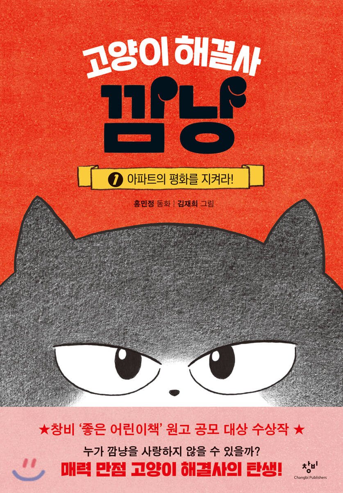
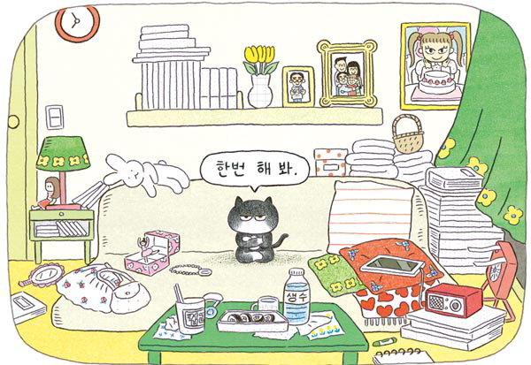

# 今天的文学猫角色：깜냥（黑喵）

雨夜里，一只猫拖着旅行箱来到公寓的门卫室。它只想借宿一晚，开口问过老门卫，没等对方答应，便进屋找了个地方睡觉。可门卫室的对讲机响个不停。黑喵（깜냥）挑了个看似能安稳过夜的地方，偏偏整栋楼有什么动静，最后都能传到它耳边。

韩国作家洪旼静（홍민정）的童话系列《问题终结者黑喵》（고양이 해결사 깜냥）从这个雨夜开始。2020 年出版的韩文首卷在简体中文版题为《真有办法呀黑喵：守护深夜公寓》。黑喵才一岁半左右，身子有点圆，黑毛间露出浅色的脸颊、肚皮和腿。金哉希（김재희）给它画了一双半眯的眼睛，神气得很。它能开口跟人商量借宿，吃饭会挑拣菜色，谁要伸手摸它的尾巴，它可不答应。

有人打来对讲电话，抱怨楼上太吵。黑喵找上门去，遇见一个为舞蹈社团的选拔练舞的女孩。楼下只听见咚咚的响声，黑喵走进屋里，看见的却是一个还想把舞练好的孩子。它自己也会跳舞，便教女孩怎么把动作跳好、把脚步放轻。这个临时上岗的门卫助手肯多看一眼住户在做什么，也肯花点时间陪对方试一试。楼下的人可以安静些，楼上的女孩也还能继续跳。

黑喵的好脾气得看用在什么地方。要它任人摸尾巴，没门；要它坐下来给两个等妈妈回家的孩子念绘本，它倒能待到妈妈回来。它很清楚自己什么时候想清静，什么时候愿意陪人。孩子碰到这么一位客人，可以听它念书，也可以跟它学跳舞，还得记着给那条尾巴留点儿地方。

这座公寓里的麻烦都很小。有人嫌垃圾有味道，有人要清理打碎的玻璃瓶，门卫连吃碗泡面的空当都难找。洪旼静让一只原本打算进屋睡觉的猫，在一晚之间摸到这份工作的门道。读者跟着它从门卫室走进住户家，也能看到那些隔着楼板互相听得见的邻居，各自在忙些什么。

黑喵还有地方要去。第二卷《又有办法啦黑喵：支援比萨小店》里，它循着香味进了一家比萨店，尝了店主正在试做的比萨，又自己提出要留下来帮厨。在公寓里暂代门卫，到了店里就给客人做比萨，它总能给自己找到一点活儿。读这个系列，光是猜黑喵下一回会在哪儿停脚，就有意思。至于别人送它的小礼物，它舍不得随手丢开，一件件收进那只随身带着的旅行箱。

### 资料来源

- 韩国出版文化协会 KOBIC，[《고양이 해결사 깜냥 1》图书介绍与书评](https://kobic.net/book/bookInfo/view.do?isbn=9788936447694)，2020 年昌批版
- 权容辉，[《도움 필요하면 달려가…이렇게 능력있는 고양이 보셨나요》](https://www.kookje.co.kr/news2011/asp/newsbody.asp?code=0500&key=20200410.22017003481)，《国际新闻》，2020 年 4 月 9 日
- KLWAVE，[《Black Cat Ggamnyang, the Problem Solver 2》作品介绍](https://klwave.or.kr/klw/books/408484/featuredView.do)
- 三民书局，[《問題終結者黑喵》系列图书页](https://www.sanmin.com.tw/product/index/011472000)
- 小花生，[《真有办法呀黑喵：守护深夜公寓》图书页及系列介绍](https://www.xiaohuasheng.cn/book?id=c773c65ad47a3d7d)，2022 年中信版

### 视觉参考

1. 2020 年韩文首卷封面，金哉希绘：黑喵的猫脸特写
   - 来源页面：<https://www.yes24.com/product/goods/89525316>
   - 原始图片：<https://image.yes24.com/goods/89525316/XL>
   - 作者/机构：金哉希（김재희）绘，昌批出版
   - 说明：韩文首卷的封面用近景突出黑喵半眯的眼睛。

2. 2020 年韩文首卷插画，金哉希绘：黑喵坐在沙发上
   - 来源页面：<https://www.kookje.co.kr/news2011/asp/newsbody.asp?code=0500&key=20200410.22017003481>
   - 原始图片：<https://db.kookje.co.kr/news2000/photo/2020/0410/L20200410.22017003481i1.jpg>
   - 作者/机构：金哉希（김재희）绘，《国际新闻》刊载
   - 说明：首卷室内插画画出坐在沙发上的黑喵和它翘起的尾巴。
