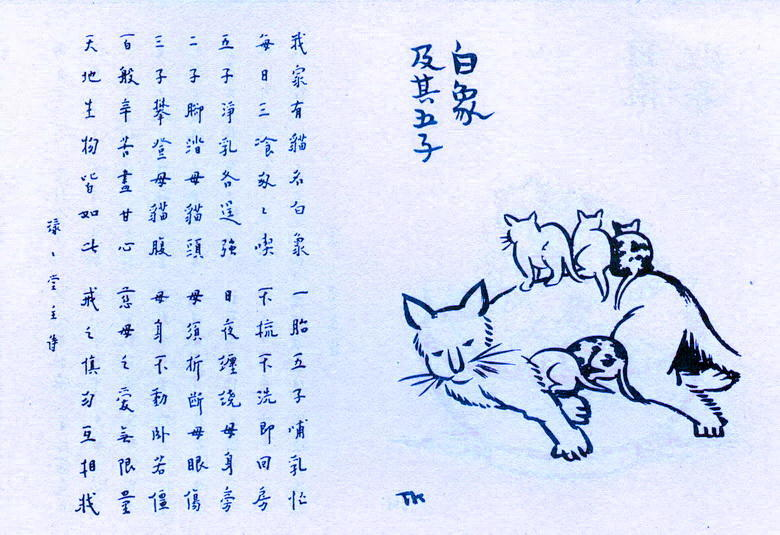
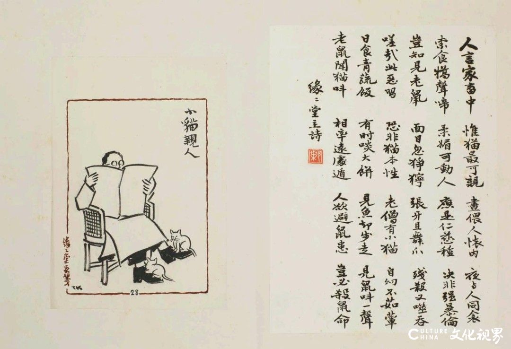

# 今天的文学猫角色：白象

收电灯费的人见了她，差点忘记收钱。白象从日光里走过来，一身雪白的毛，两只眼睛一黄一蓝，瞳孔细得只剩窄窄的一线。丰子恺管这双眼睛叫“日月眼”，看着那两种颜色，又想起话剧舞台上两盏光色不同的灯。他在散文《白象》里记下这只母猫，顺手也记下了看猫的人。连来查户口的警察，都把手头的事搁了一会儿。

白象在西湖边住下以前，已经跟着人走过战时和战后的两段路。抗战初年，段老太太带她逃往大后方，胜利后又带她回到上海。白象后来寄住在丰子恺的次女林先家，才由丰子恺带到杭州。上火车时，装她的是一只盛无锡面筋的笼子。到了杭州，段老太太仍惦记着她，常到林先家打听她的近况。丰子恺的幼女一吟就给白象拍照，托姐姐转交。照片又沿着白象来时的路线回到上海，补上了两地书信里难以写清的模样。

在丰家，白象也有她相中的位置。一吟放学回来，或者姐姐教完课回家，刚坐下，她便跳到膝头，自顾自睡着。两姐妹舍不得挪动她，想喝水、换鞋或看报，就请旁人代劳。有时丰子恺和妻子亲自送茶送报，忙了一圈，猫还在原处睡。丰子恺把自己和妻子也写进这场小小的忙乱里。白象连眼睛都用不着睁开，就能让屋里的人重新分派手头的事。

等自己有了小猫，白象也有了赖在她身上不走的家伙。丰家找来一只去掉盖子的旧箱子给她做产床，她生了五只，三只白的，两只花的。才过两星期，小猫已经能在她身上爬上爬下。丰子恺住在西湖边，看着母猫卧在那里任孩子们攀爬，便想到了游人爬孤山。两处景物都近在眼前，换到小猫的尺度，一只卧着的大猫就足够成为一座山。白象这个名字本来就把猫说得比实际大一圈，到了这段，小猫的动作让这个大字有了分量。《护生画集》第三集收有他画的《白象及其五子》，画里的小猫有的已经爬到背上，有的还挨着她的肚腹，白象伸着前腿伏在地上。

《白象》在1947年连载于《申报·自由谈》。写到白象最后一次走失时，丰子恺记下了邻人的几种说法。家人没能找回她，只能从邻人见过的一只大白猫推想她的死，死因始终无从确定。段老太太托林先来接她回上海，林先抵达杭州时，白象已经失踪了一天。丰子恺把文章的末尾留给了白象的两只小白猫。他照常跷起脚看报或喝酒，两只猫便一高一低，各自攀上一只脚。他说自己坐下时，竟渐渐觉得脚上本来就该有两只小猫。

### 资料来源

- 丰子恺，[《白象》](https://www.megbook.com.hk/mall/detail.jsp?proID=4228488)，西苑出版社《一辈子率真：写给孩子的散文》2026 年版试读，第 80 页起
- 上海译文出版社，[《护生画集（珍藏版）》目录](https://search.megbook.com.hk/mall/detail.jsp?proID=3557278)，第三集《白象及其五子》《小猫亲人》

### 视觉参考

1. 《护生画集》第三集，丰子恺绘：白象与五只小猫
   - 来源页面：<https://ishare.ifeng.com/c/s/7lUnunGOHnQ>
   - 原始图片：<https://e0.ifengimg.com/11/2019/0401/308DD663CAE394B1B87E720FFE9CD1109CB68207_size77_w780_h535.jpeg>
   - 作者/机构：丰子恺绘
   - 说明：丰子恺在《白象及其五子》中画下小猫攀着母猫身体的情景。

2. 《护生画集》第三集，丰子恺绘：两只小猫伏在读报人脚上
   - 来源页面：<https://www.culturechina.cn/m/324888.html>
   - 原始图片：<https://img.culturechina.cn/uploadfile/2026/0711/20260711100557291339.jpg>
   - 作者/机构：丰子恺绘，叶恭绰书，中国国家画院供图
   - 说明：《小猫亲人》画中小猫伏在读报人双脚上的姿势，与《白象》末尾两只小白猫的动作相照应。
