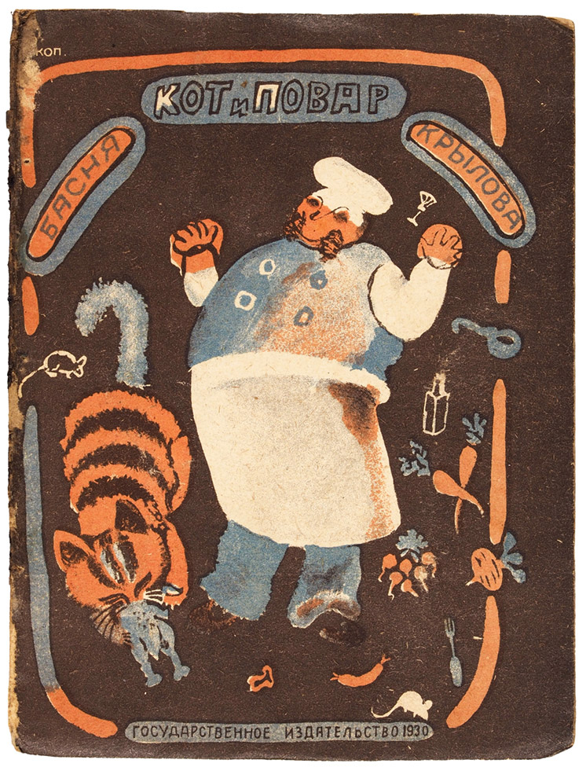
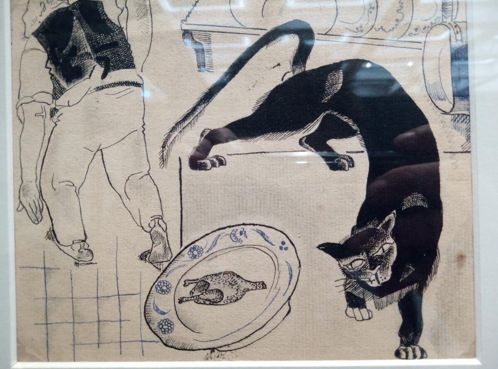

# 今天的文学猫角色：Васька（瓦西卡）

厨师一进厨房，先看见地上的馅饼残渣，再看见缩在醋桶后面的瓦西卡（Васька）。猫正对付一只小鸡，一边呼噜，一边低吼。厨师当场训起话来，瓦西卡接着吃。伊万·克雷洛夫（Иван Андреевич Крылов）在 1813 年首次发表的诗体寓言《猫和厨师》（Кот и Повар）里，让这一人一猫在厨房里各忙各的。等训话结束，烤鸡也吃光了。

瓦西卡本来是厨房的看守。厨师出门去酒馆，特地留下他，防着老鼠动那些吃食。这份差事原有几分道理，厨师自己也说，瓦西卡一向是只老实猫，以前大家还拿他的温顺做榜样。如今厨师替邻居们把话都说了，猜他们会把猫叫作骗子和小偷，往后连院子也别让他进，得像防狼进羊圈一样防他。邻居还没露面，瓦西卡已经在这一番话里从榜样变成了地方上的祸害。

瓦西卡全篇没有一句台词。克雷洛夫把厨师的长篇训话分成两截，每一截末尾都用括号插进猫的动静。第一次，瓦西卡还在吃那只鸡。第二次，诗里说：“А Васька слушает, да ест.” 大意是“瓦西卡听着，照吃”。朗读时，这一句来得格外快。厨师刚刚列完一长串罪名，读者就被拉回到醋桶后面，看猫嘴里的活儿还没停。后来这句俄语成了惯用语，常用来揶揄那些听着别人的劝说、手上照旧做自己那一套的人。

原诗里，瓦西卡给人的印象主要来自伏低的身子和吃东西时的响动。到了画家手里，他有了很不一样的身形。维拉·叶尔莫拉耶娃（Вера Ермолаева）为 1930 年版画的封面上，橘色虎斑猫弓着圆背，粗粗的黑纹横在身上，旁边的厨师举着两只手。亚历山大·杰伊涅卡（Александр Дейнека）在 1922 年为这则寓言画过一组插图，其中一幅把猫画得乌黑修长，身子从高处折下来，一只前爪伸向盘子旁边。厨师只占了画面左侧，猫的长尾巴几乎横过半张画。

克雷洛夫在诗末也说了几句道理，劝别的厨师把话刻在墙上，该动手的时候就别空费口舌。诗里还有个小小的玩笑。厨师开头问瓦西卡，当着这几面墙难道也不觉得羞耻吗？等到结尾，那面墙又成了可以刻下教训的地方。克雷洛夫把话留给厨师和墙，把烤鸡留给了瓦西卡。

### 资料来源

- 伊万·克雷洛夫，[《猫和厨师》俄文原作](https://ru.wikisource.org/w/index.php?title=Кот_и_Повар_(Крылов)&oldid=4739517)，《寓言》第三卷第八篇
- Gramota.ru，[俄语惯用语词条 «А Васька слушает да ест»](https://gramota.ru/biblioteka/spravochniki/spravochnik-po-frazeologii/a-vaska-slushaet-da-est)
- 俄罗斯国家图书馆，[叶尔莫拉耶娃绘《猫和厨师》馆藏目录](https://search.rsl.ru/ru/record/01009209463)，1930 年版
- 库尔斯克杰伊涅卡美术馆，[《亚历山大·杰伊涅卡》图录](https://deinekagallery.ru/upload/medialibrary/6be/6bef2a722e5beb5a33ff9fc7029cea0b.pdf)，第 24–25 页

### 视觉参考

1. 1930 年版封面，叶尔莫拉耶娃绘：橘色虎斑猫与厨师
   - 来源页面：<https://www.litfund.ru/auction/742/277/>
   - 原始图片：<https://storage09.litfund.ru/images/lots/742/742-277-16663-1-Y4107471.jpg>
   - 作者/机构：维拉·叶尔莫拉耶娃（Вера Ермолаева）
   - 说明：单行本封面用橘色条纹画出伏低身子的瓦西卡，厨师站在他旁边。

2. 1922 年插画，杰伊涅卡绘：黑猫朝烤鸡探身
   - 来源页面：<https://www.shkolazhizni.ru/culture/articles/111938/>
   - 原始图片：<https://www.shkolazhizni.ru/img/content/i265/265777_or.jpg>
   - 作者/机构：亚历山大·杰伊涅卡（Александр Дейнека）绘，Александр Смирнов 摄
   - 说明：展览照片中的插画描绘瓦西卡弓身靠近盛着烤鸡的盘子。
