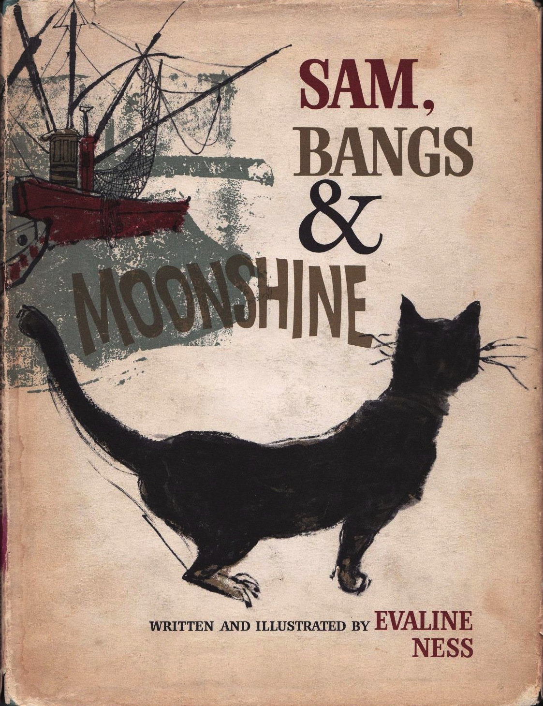
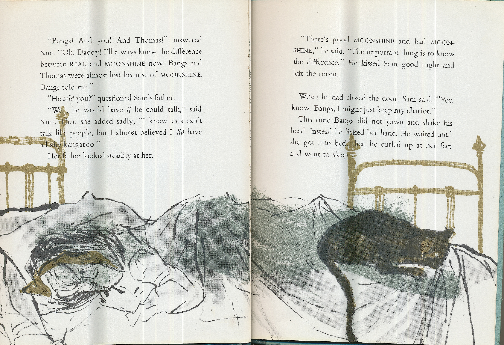

# 今天的文学猫角色：Bangs（邦斯）

莎莎（Sam）说，门槛上那块破地毯是龙拉的战车。老猫邦斯（Bangs）打了个哈欠，摇了摇头。莎莎还说，只要邦斯愿意，他就会开口说话。既然他肯听完这么多故事，什么时候回她一句，似乎也该由他自己决定。

这只老猫住在伊芙琳·尼丝（Evaline Ness）自写自画的《莎莎的月光》（Sam, Bangs & Moonshine）里。绘本于 1966 年初版，次年获得凯迪克金奖。尼丝在初版护封上把邦斯画成一只背朝读者的黑猫，尖耳朵和几根长胡须从轮廓里伸出来，尾巴高高扬起。他面朝港湾，渔船的桅杆和缆绳从他头顶斜过。翻进书里，港口的灰蓝和暗金仍在，莎莎想象中的狮子也能占去半张纸，邦斯却还是那副打哈欠的样子。

莎莎的父亲出海打鱼，母亲已经去世。她说妈妈是人鱼，又说家里养着狮子和小袋鼠。只有那只被她说成会讲话的猫，确实就在她身边。书里称邦斯年老而聪明，尼丝让他的聪明落在一个很小的动作上。女孩把门口的旧物说得神气十足，他听完，摇一下头，照旧陪着她。有了这个听众，莎莎可以把话说得很远，同时又有一只熟悉的猫待在近处。

邻居男孩托马斯（Thomas）听故事就认真多了。莎莎说小袋鼠去了港湾远处的蓝岩，他便出门去找，邦斯也跟了过去。风暴赶上涨潮，托马斯获救之后，猫仍然没有回来。读到这里，先前那个哈欠有了分量。邦斯原先随时可以从莎莎的故事里把头转开，此刻他有一副会被海水打湿的身体，莎莎只能等。等到他终于出现，浑身湿透，那个总由她替他决定会说什么的伙伴，已经有了一段她没法编给自己听的经历。

末尾，莎莎承认，猫没法像人一样说话，她自己却差点信了真有一只小袋鼠。父亲也让她知道，幻想可以有好坏之分。她于是对邦斯说，自己的战车或许还可以留着。尼丝把开头那个哈欠留到这里作了一个小小的回声。这回邦斯舔了舔她的手，等她上床，才在她脚边蜷起来睡觉。画里的黑尾巴从床沿垂下来，门槛上的破地毯还是她的战车。

### 资料来源

- 伊芙琳·尼丝，[《Sam, Bangs & Moonshine》初版书影及护封文字](https://sambangsandmoonshine.wordpress.com/bibliographic-details/)，Holt, Rinehart and Winston，1966 年
- Kirkus Reviews，[《Sam, Bangs & Moonshine》初版书评](https://www.kirkusreviews.com/book-reviews/a/phyllis-mcginley-14/sam-bangs-moonshine/)，1966 年
- 美国图书馆协会，[《Sam, Bangs & Moonshine》凯迪克金奖记录](https://www.ala.org/winner/sam-bangs-moonshine)
- 伊芙琳·尼丝著绘、白薇译，[《莎莎的月光》中文版书目与试读](https://book.douban.com/subject/25881664/)，二十一世纪出版社，2014 年

### 视觉参考

1. 1966 年初版护封，伊芙琳·尼丝绘：黑猫望向渔港
   - 来源页面：<https://sambangsandmoonshine.wordpress.com/bibliographic-details/dustjacket/>
   - 原始图片：<https://sambangsandmoonshine.wordpress.com/wp-content/uploads/2013/11/dustjacket.jpg>
   - 作者/机构：伊芙琳·尼丝（Evaline Ness）
   - 说明：初版护封把邦斯的黑色轮廓置于书名和渔船前方。

2. 1966 年初版末页跨页，伊芙琳·尼丝绘：邦斯蜷在莎莎脚边
   - 来源页面：<https://sambangsandmoonshine.wordpress.com/bibliographic-details/saminbed/>
   - 原始图片：<https://sambangsandmoonshine.wordpress.com/wp-content/uploads/2013/11/saminbed.jpg>
   - 作者/机构：伊芙琳·尼丝（Evaline Ness）
   - 说明：故事结尾，邦斯等莎莎上床后蜷在她脚边睡去。
