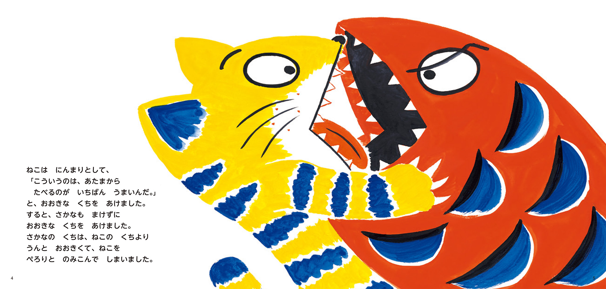
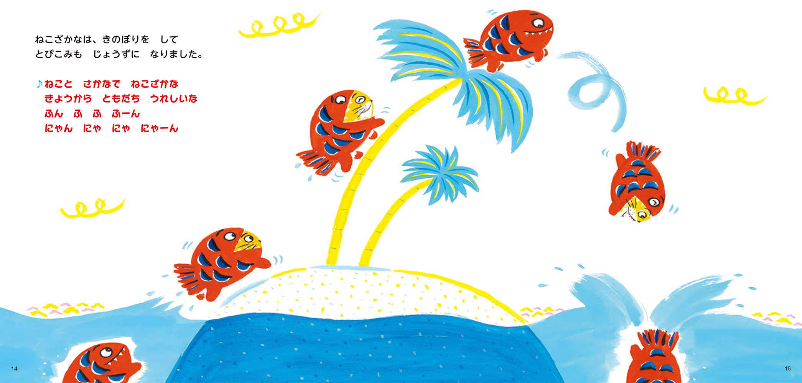

# 今天的文学猫角色：ねこ（《ねこざかな》）

猫钓到一条大鱼，咧嘴一笑，盘算着从鱼头吃起。它把嘴张得老大，鱼也把嘴张开了。鱼的嘴比猫的大得多，一口就把猫吞了进去。わたなべゆういち在绘本《ねこざかな》里画了两排迎面相对的尖牙。猫的爪子还搭在鱼身上，它还直直地望着鱼嘴。

在 2021 年由作者重新绘制的版本里，这只猫有张亮黄色的脸，嘴边留着一圈白，身上是一道道深蓝色的条纹。鱼则通体橘红，身上有一片片深蓝色的鳞纹。等猫把脸从鱼嘴里探出来，两种颜色就拼到了一起，鱼的牙齿沿着猫脸围了半圈。日语里的「ねこ」是猫，「さかな」是鱼，书名把两个词拼在一起。画里也看得见这道接缝：红色的鱼头上挨着一张黄色的猫脸，两双眼睛各有各的神情。

猫起初只惦记鱼肉，跟鱼待在一起之后，又跟鱼一起练起了跳水。书里有一整个跨页留给这一跳。同一个身影在画面上出现好几次，从水边攀上弯弯的树干，跃过树冠，再头朝下栽进水里。猫脸一会儿露在外面，一会儿又缩进鱼嘴，只剩鱼尾朝上。把目光沿着这些身影走一遍，就能看清这一跳的轨迹。画旁配了一段可以唱出来的短歌，唱的是猫和鱼从今天起做了朋友。

合在一起以后，猫的馋劲还在。水里有条小鱼晃过来，它忍不住一口吃掉，大鱼当场生起气来。猫抬眼看着小鱼游来的方向，头顶那只属于大鱼的眼睛却朝它瞪过来。开头相对而张的两张嘴，这时叠在一处，还是各管各的。画家用两只眼睛的朝向，就让人看清它们此刻各自关心什么。至于大鱼为什么生气，读者只要想想它自己也曾被钓起来，就懂了。

《ねこざかな》在 1978 年诞生于月刊绘本，1982 年以单行本出版。到了 2021 年，わたなべゆういち为这个开篇故事重画了全部页面。猫和鱼后来有了自己的系列。2014 年出版的《ねこと さかなで ねこざかな》还把组合倒了个个儿，让它们变成「さかなねこ」。两个词换了位置，翻开书前就有了一个问题：这一回轮到谁从谁的嘴里探出头来？

### 资料来源

- フレーベル館，[《ねこざかな》图书页与试读插图](https://book.froebel-kan.co.jp/book/detail/9784577049372)，2021 年重绘版，第 4–5、14–15、18–19 页
- CiNii Books，[《ねこざかな》2021 年版书目与内容简介](https://ci.nii.ac.jp/ncid/BD06155774)
- フレーベル館，[《ねこと さかなで ねこざかな》图书页](https://book.froebel-kan.co.jp/book/detail/9784577041628)，2014 年版

### 视觉参考

1. 2021 年重绘版，わたなべゆういち绘：猫和鱼张嘴对峙
   - 来源页面：<https://book.froebel-kan.co.jp/book/detail/9784577049372>
   - 原始图片：<https://book.froebel-kan.co.jp/images/book/img/raw/45ettXnPz2TLJF0LDk3amyvesWLkg5n42u9sPDzJ.jpg>
   - 作者/机构：わたなべゆういち／フレーベル館
   - 说明：重绘版第 4–5 页画出猫要吃鱼、鱼张嘴迎上去的一刻。

2. 2021 年重绘版，わたなべゆういち绘：猫和鱼爬树跳水
   - 来源页面：<https://book.froebel-kan.co.jp/book/detail/9784577049372>
   - 原始图片：<https://book.froebel-kan.co.jp/images/book/img/raw/F9kooDOqrheQbzQae18hK76SdDsyT5JHQWJHnUtZ.jpg>
   - 作者/机构：わたなべゆういち／フレーベル館
   - 说明：重绘版第 14–15 页用连续动作画出猫和鱼合在一起练习跳水。
