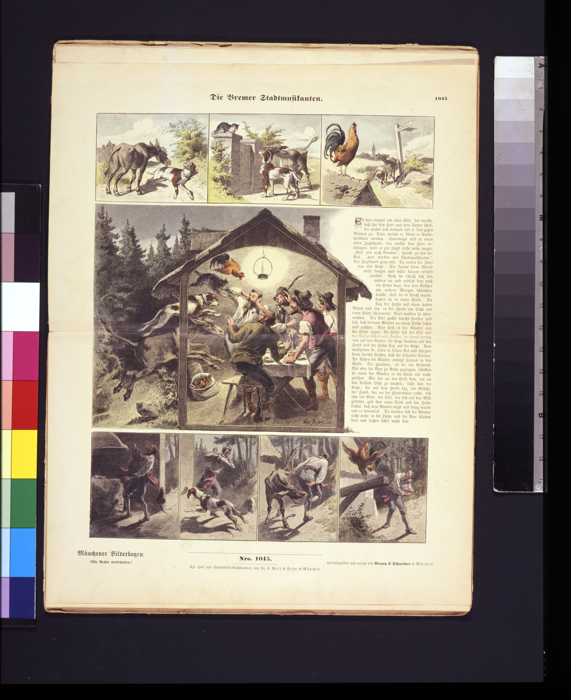
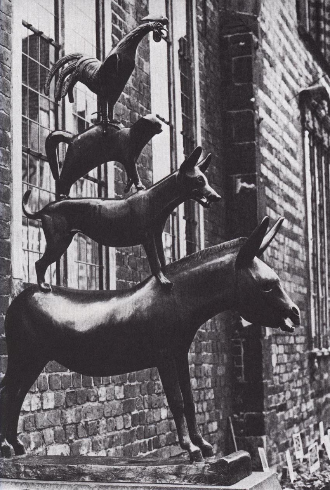

# 今天的文学猫角色：《不来梅的音乐家》里的老猫

老猫坐在路边，一张脸像下了三天雨。驴问它怎么了，它先说自己的牙齿已经钝了，再说起炉子。它如今宁可窝在炉后打呼噜，也懒得追老鼠，女主人便想把它淹死。它逃了出来，保住了命，却不知道接下来去哪儿。这是格林兄弟（Brüder Grimm）1857 年版《儿童与家庭童话集》里的《不来梅的音乐家》（Die Bremer Stadtmusikanten）。老猫没有名字，驴见面时管它叫“老洗胡子的”，仿佛已经瞧见它坐在那里舔爪擦脸。

驴给它出了个主意：去不来梅当市乐师，猫懂得夜里的音乐。驴已经和同行的猎狗分好了工，一个弹鲁特琴，一个敲定音鼓。轮到猫，只消提起它夜里会叫。童话没写老猫怎样看待自己的歌喉，只说它觉得这个主意不错，跟着走了。刚才它还得为捉不了老鼠而失去容身之处，转眼，平日里大概会招人嫌的夜间叫声，竟也成了一门可以拿到城里去的本事。驴说得轻巧，老猫答应得也干脆。

队伍又添了一只公鸡。夜里，四个伙伴在树林中找到一间强盗的屋子。驴扒着窗沿，狗跃上驴背，老猫再爬上狗背，公鸡飞到猫头上。它得站稳，既让底下的狗托住自己，又让最轻的公鸡有地方落脚。四个声音一齐响起来，猫只管照猫的样子叫。窗玻璃碎了，屋里的人以为闯进来一个鬼，拔腿就跑。格林兄弟把这场演奏写得很短，读起来却有清楚的先后。四副身子先一点点搭稳，满屋子的响声随后一下涌进来。

吃饱以后，老猫在灶上的暖灰旁睡了。开头它舍不得离开炉子，走了这么远，还是挑中这么个地方。偏有个强盗摸黑回来，把它发亮的眼睛认成了炭火，拿根硫磺火柴凑过去。老猫扑上他的脸，又嘶又抓。等那人跑回去报信，猫已经成了他嘴里一个伸着长指头的巫婆。从老猫这边看，事情简单得多：它好端端地睡着，有人把火柴伸到了眼前。四个伙伴就此住下，没人再来赶猫离开暖灰。

故事里的猫没走到不来梅。到了 1953 年，雕塑家格哈德·马尔克斯（Gerhard Marcks）却把它和同伴铸成了青铜群像，立在不来梅老市政厅西侧。青铜猫弓着身子，尾巴向里弯，四脚都踩在狗背上，公鸡就立在它上方。从市政厅旁仰头看，最先看见的是高处的鸡冠。再往下一层，才是那只给公鸡当落脚处的老猫。

### 资料来源

- 格林兄弟，[《不来梅的音乐家》德文原文](https://de.wikisource.org/wiki/Die_Bremer_Stadtmusikanten_%281857%29)，《儿童与家庭童话集》1857 年版，第 27 篇，第 145–148 页
- 不来梅公共艺术档案，[《不来梅的音乐家》青铜群像](https://www.kunst-im-oeffentlichen-raum-bremen.de/en/works/die-bremer-stadtmusikanten-1953-mitte-art2000kior.html)，1953 年

### 视觉参考

1. 1891 年彩色故事画页，鲁道夫·盖斯勒绘：老猫与伙伴
   - 来源页面：<https://commons.wikimedia.org/wiki/File:Die_Bremer_Stadtmusikanten_-_Rud._Geisler_del._LCCN2011645371.jpg>
   - 原始图片：<https://upload.wikimedia.org/wikipedia/commons/1/10/Die_Bremer_Stadtmusikanten_-_Rud._Geisler_del._LCCN2011645371.jpg>
   - 作者/机构：鲁道夫·盖斯勒（Rudolf Geisler）绘，美国国会图书馆藏
   - 说明：这张彩色画页在连续画格中描绘了老猫与伙伴相遇、吓跑强盗的场面。

2. 1953 年马尔克斯青铜群像：猫踩着狗背，头顶公鸡
   - 来源页面：<https://www.kunst-im-oeffentlichen-raum-bremen.de/en/works/die-bremer-stadtmusikanten-1953-mitte-art2000kior.html>
   - 原始图片：<https://www.kunst-im-oeffentlichen-raum-bremen.de/fileadmin/Media/Bilder/17schoppensteel%2C_die_bremer_stadtmusikanten_1953.jpg>
   - 作者/机构：格哈德·马尔克斯雕塑，不来梅公共艺术档案提供照片
   - 说明：群像立于不来梅老市政厅旁，保留了四个伙伴在窗前相叠的姿态。
