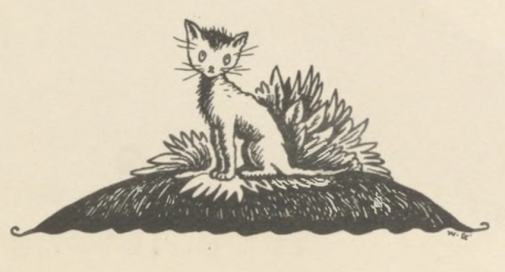
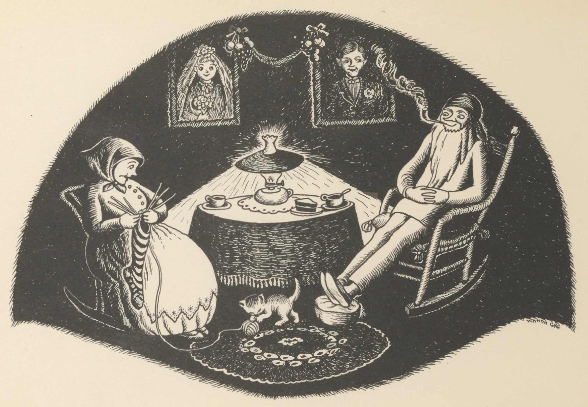

# 今天的文学猫角色：《100万只猫》里的小猫

屋外忽然安静下来。老两口从窗里往外看，方才还挤在门前的猫已经不见了。他们走出去，才在草丛里发现一只吓坏了的小猫。它瘦得厉害，毛也蓬乱。汪达·佳谷（Wanda Gág）给它画了一对尖耳朵，几根细长的胡须，额头上一撮深色的毛。草叶从它身后支起来，和它身上的乱毛有着相似的尖梢。老先生把成群的猫带回家时，谁也很难从里面认出它。等草地空下来，这张小脸才有了一幅自己的画。

在佳谷自写自绘、1928 年出版的《100万只猫》（Millions of Cats）里，这只小猫始终没有名字。老先生出门时，原本只想给寂寞的老伴找一只猫。他在山坡上挑来挑去，看见白猫、黑猫，也看见有条纹的猫，每抱起一只，就又发现一只舍不得丢下的。佳谷画猫群时，猫顺着山势一拨拨涌过来，读着读着，眼睛也跟着老先生忙起来。开头那些漂亮的猫各有招人喜欢的地方，谁会费神去找一只又瘦又乱的小猫呢？

老先生请猫们自己评一评，谁最漂亮，门外顿时全是抢着应答的声音。小猫后来解释，它觉得自己长得实在平常，当时一句话也没说，所以谁也没来找它的麻烦。佳谷让这只猫开口的时候，争吵已经过去了。它用一句朴素的话告诉老人，自己刚才在做什么。老两口把它抱起来时，也没有再请它证明什么。老太太看见它瘦弱，先叫了一声可怜的小猫，随后就把它带进屋里洗澡、梳毛。

佳谷画小猫长胖，只用了几只碗。碗沿着斜线排开，小猫一会儿探头喝奶，一会儿已经喝完，直起身来，留给读者看它渐渐圆起来的肚子。同一只猫在一幅画里出现好几次。前面的山坡上，多画一只猫，队伍就更长一点。到了这里，多画一次小猫，就过了一些日子。老先生最后仍然说自家的猫最漂亮，还拿自己见过的无数只猫作证。他记得自己走过多远、看过多少猫，读者却已经在这只猫身旁待了一阵，看过它一碗一碗地喝奶。

故事讲完了，佳谷又画了一会儿老两口的日子。灯罩下有茶杯，老太太手里织着东西，老先生坐在摇椅上。那只曾经缩在草间的小猫挨着老太太的裙边，伸爪去碰那颗还连着针线的毛线球。

### 资料来源

- 汪达·佳谷（Wanda Gág），[《Millions of Cats》原文与插图](https://www.gutenberg.org/cache/epub/74181/pg74181-images.html)，Coward-McCann 1928 年版
- 日本国立信息学研究所 CiNii Books，[林真美译《100萬隻貓》馆藏书目](https://ci.nii.ac.jp/ncid/BB18279237)

### 视觉参考

1. 1928 年原版插图，汪达·佳谷绘：独坐草间的小猫
   - 来源页面：<https://www.gutenberg.org/cache/epub/74181/pg74181-images.html#i_026>
   - 原始图片：<https://www.gutenberg.org/cache/epub/74181/images/i_026.jpg>
   - 作者/机构：汪达·佳谷（Wanda Gág）
   - 说明：争吵平息后，老两口在草间找到的唯一一只小猫。

2. 1928 年原版插图，汪达·佳谷绘：小猫在灯下拨毛线球
   - 来源页面：<https://www.gutenberg.org/cache/epub/74181/pg74181-images.html#i_031>
   - 原始图片：<https://www.gutenberg.org/cache/epub/74181/images/i_031.jpg>
   - 作者/机构：汪达·佳谷（Wanda Gág）
   - 说明：故事结尾，小猫已经在老两口家安顿下来。
