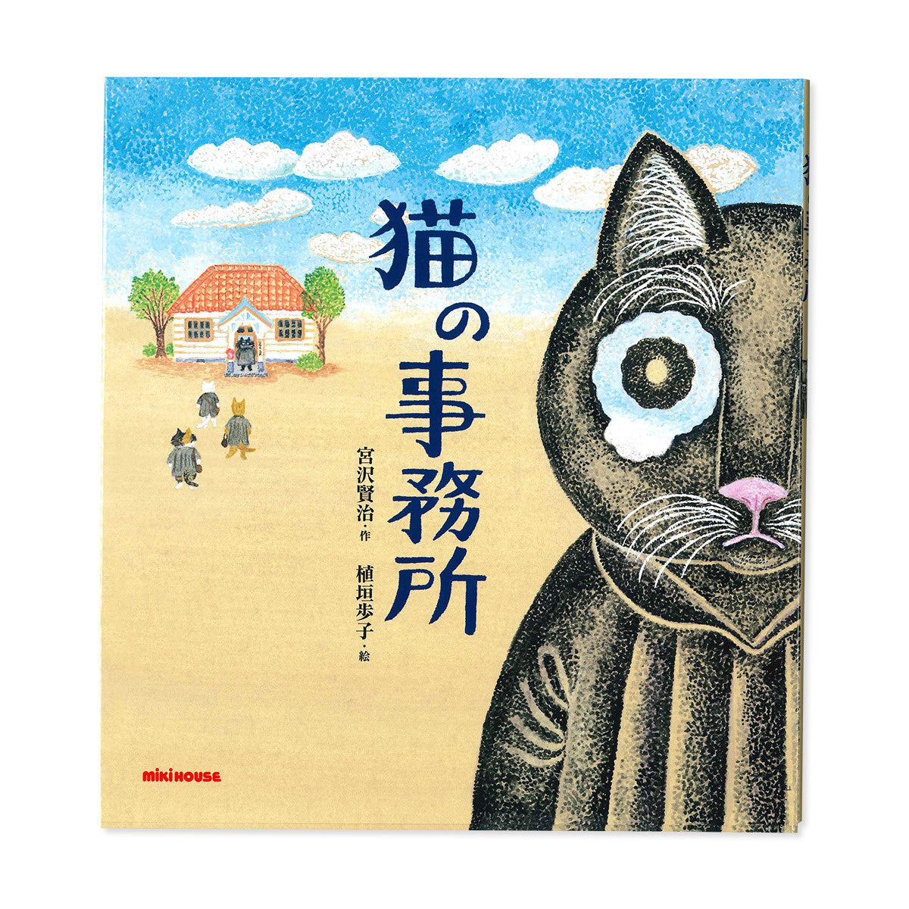
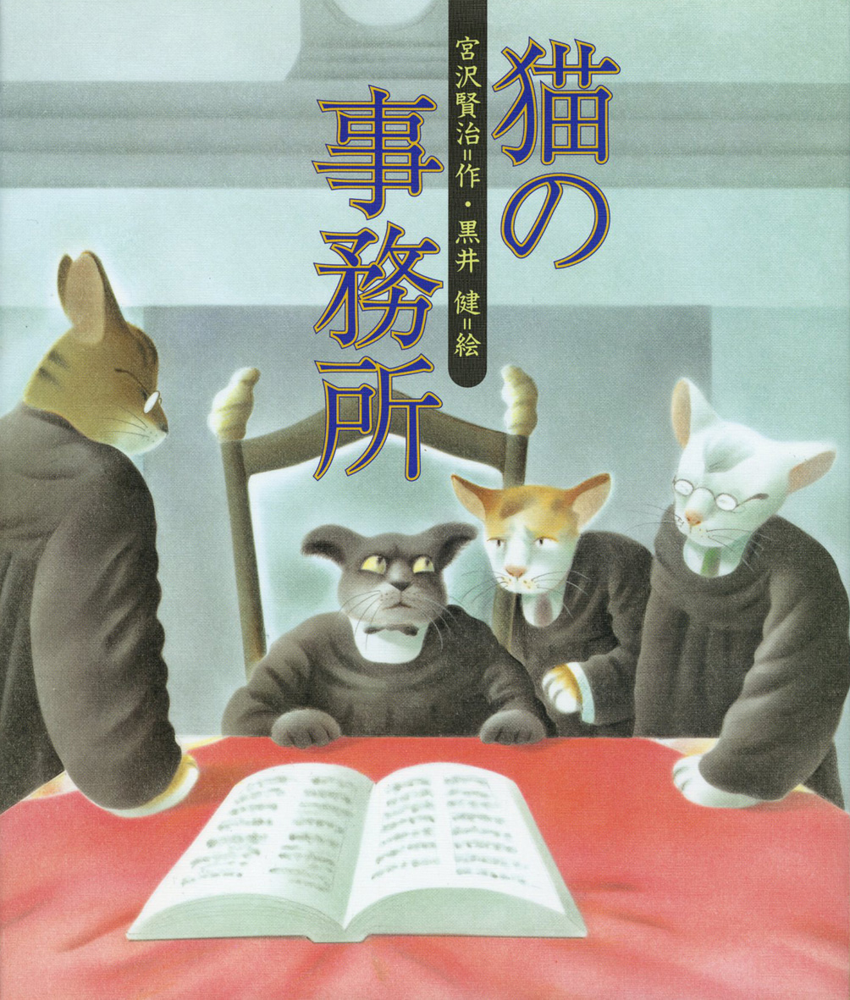

# 今天的文学猫角色：かま猫（灶猫）

事务长还没问完，第四书记已经把两只短短的前爪分别夹进了大账簿。来客要去白令一带找冰河鼠，顺便打听当地两位有头有脸的猫。第四书记早已翻到这两位的条目，就等着轮到自己开口。事务长和来客颇为佩服，另外三位书记却斜着眼瞧它，嗤地笑了一声。

这位第四书记叫灶猫（かま猫），出自宫泽贤治（宮沢賢治）的童话《猫咪事务所》（猫の事務所）。在筑摩书房《宫泽贤治全集》第八卷所收的版本里，猫也有专管地理和历史的事务所。来客敲门打听各地的风土，穿短黑缎衣的书记各坐一张桌子，翻账簿作答。第六事务所的所长是黑猫，手下有白猫、虎斑猫、三花猫和灶猫。书记的职位很受尊敬，一有空缺，附近的年轻猫就争着补上。灶猫能在四十个候选者中获选，这在它的同类中是件值得夸耀的事。

灶猫皮薄，睡在窗外，半夜会冻得连连打喷嚏，最后总得钻回灶膛。久而久之，烟灰把它的鼻子和耳朵熏得乌黑，脸看起来有点像狸。这样的夜晚过后，它白天依旧端端正正坐到小桌前，照例摸摸心爱的账簿封皮。宫泽贤治写它在寒夜里责怪自己，又写它一边掉泪一边攥紧拳头，决心再难也要做下去。黑猫所长曾替它说话，同样睡在灶膛里的猫也以它为荣。这两件事，它都记在心上。

它有时也想帮同事一点忙。隔桌的三花猫把笔滚到了地上，懒得起身，偏要趴在桌沿伸爪去够。灶猫眨了一会儿眼睛，拿不定主意，见对方越探越远，终于站了起来。三花猫正好一头栽下去，爬起来便嚷是灶猫推的。猫的前腿太短，本来是个滑稽的缘由。偏偏这只肯站起来的猫，连伸手之前那一会儿犹豫，都让人读得心紧。先前它替虎斑猫捡过便当盒，也挨过一顿抢白，这回还是没忍住要起来。

植垣步子（植垣歩子）为 2014 年绘本画的封面，把一只含泪的圆眼睛放到近处，红屋顶的事务所和走过去上班的猫都小小的。黑井健（黒井健）的 1994 年绘本则让几只黑衣猫围着红桌和摊开的账簿。账簿对灶猫有多要紧，要到它失去账簿的那天才看得清。它病休一天，回来发现账簿已经分到了另外三张桌子上。听见白猫从自己的账簿里读出本该由自己回答的一段话，它低着头，只觉得两颊发酸，耳边嗡嗡地响。到了午饭时间，灶猫把两只前爪搁在膝上，带来的便当一口也没吃。

### 资料来源

- 宫泽贤治，[《猫の事務所》](https://www.aozora.gr.jp/cards/000081/files/464_19941.html)，筑摩书房《宫泽贤治全集》第八卷，青空文库电子版
- 三起商行，[《猫の事務所》绘本介绍](https://www.mikihouse.co.jp/products/17-1154-687)，植垣步子绘，2014 年版
- 偕成社，[《猫の事務所》绘本介绍](https://www.kaiseisha.co.jp/books/9784039634207)，黑井健绘，1994 年版

### 视觉参考

1. 2014 年三起商行版封面，植垣步子绘：含泪的灶猫
   - 来源页面：<https://www.mikihouse.co.jp/pages/pickup-miyazawakenji>
   - 原始图片：<https://cdn.shopify.com/s/files/1/0593/3613/0738/files/wl_4_src.44993828.17-1132-953-89-1.jpg?v=1775016563319>
   - 作者/机构：植垣步子／三起商行
   - 说明：封面把灶猫含泪的半张脸与远处的事务所放在同一画面里。

2. 1994 年偕成社版封面，黑井健绘：红桌旁的猫与账簿
   - 来源页面：<https://www.kaiseisha.co.jp/books/9784039634207>
   - 原始图片：<https://s3-ap-northeast-1.amazonaws.com/kss-data001/book_images/9784039634207.jpg>
   - 作者/机构：黑井健／偕成社
   - 说明：封面以黑衣猫、红桌布和摊开的账簿呈现事务所的室内景象。
