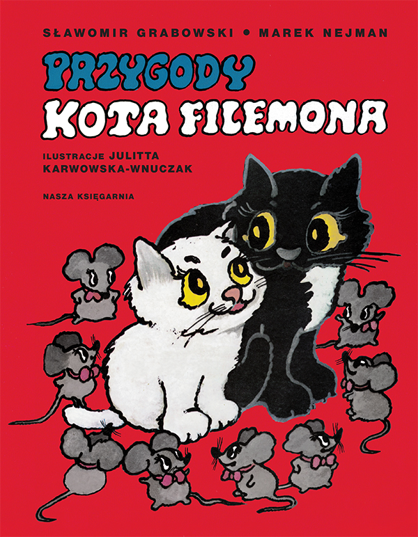
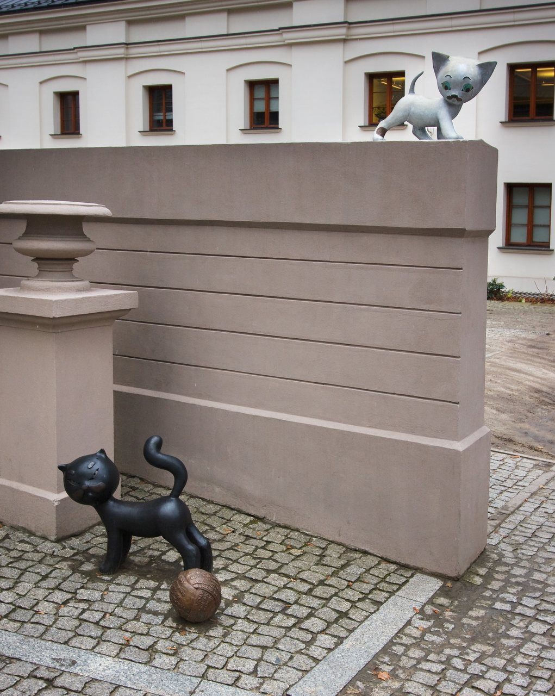

# 今天的文学猫角色：Filemon

老猫 Bonifacy 蹲在炉边，看见奶奶往一只小碟里倒牛奶。那碟子太小了，绝不会是给他的。接着，长凳上的布包里冒出一颗小猫脑袋。白猫 Filemon 耳后有块黑斑，走快一点，四只脚就互相绊住，想站稳，爪子又朝四面滑开。他还是一路把胡须往前探，什么都想伸爪碰一碰。爷爷奶奶看得直笑，炉边那位却觉得，屋里突然多了一只猫。

这是 Sławomir Grabowski 和 Marek Nejman 合写的波兰儿童故事集《Przygody kota Filemona》里，小猫头一回在乡下这间屋子亮相。书名的意思是“猫咪 Filemon 的冒险”。在 Nasza Księgarnia 的 2017 年版开篇里，读者先跟着 Bonifacy 看屋子。他有惯用的奶碗，知道熄了火的炉子哪里还暖，自称方圆一带数他最会捉鼠。换成 Filemon，同一间屋子里连一面镜子都值得盘问。后来他回忆，自己曾把镜中的倒影当作另一只有耳斑的小猫，结果打碎了镜子。那块黑斑是他的记号，也是他认错猫时留给读者的线索。

到了 2020 年版后段的一则故事里，Filemon 已经长大了一些。他声称自己早没从前那么好奇，可碰上连日下雨、全屋都要打瞌睡的时候，他偏要问 Bonifacy 屋里到底有几只老鼠。老猫索性转过身去装睡。书里常有这种两只猫各忙各的时刻。一个从安静里听出问题，另一个正费劲保住这点安静。连雨天的无聊也能让全屋接上话，小猫在炉下哼，狗在草垫上接，最后连打着呵欠的爷爷也把猫唱过的调子哼了起来。

Filemon 有过一次自认已经长大、可以出门闯荡的远行。两天后，他又饿又脏地回来了。提起这件事，Bonifacy 嘴上还说他要是走得更远，自己倒能落个清静。小猫把想家的缘由留在心里，那里头除了爷爷奶奶，还有这只怕他走丢、又嫌他扰了午睡的老猫。读到这里再想起刚来时那只小奶碟，便知道这间屋子早已给他留出了位置。

这对猫也走进了波兰的电视动画。2011 年，罗兹（Łódź）的电影博物馆外揭幕了一组双猫雕塑。黑猫在地上守着一团毛线，白猫站在矮墙上，探头往下看。雕塑给 Filemon 留了个高处，站在那里，他总有东西可看。

### 资料来源

- Sławomir Grabowski、Marek Nejman，[《Przygody kota Filemona》2017 年版试读](https://nk.com.pl/download/pdf/przygody_kota_filemona_fragment_1.pdf)，第 5–9 页
- Sławomir Grabowski、Marek Nejman，[《Przygody kota Filemona》2020 年版试读](https://nk.com.pl/download/pdf/przygody_kota_filemona_2020_fragment.pdf)，第 211–216 页
- 罗兹旅游组织，[罗兹童话之路「Kot Filemon」条目](https://lodz.travel/turystyka/co-zobaczyc/lodz-bajkowa/)

### 视觉参考

1. 2025 年版书封，两只猫被老鼠围在中间
   - 来源页面：<https://nk.com.pl/przygody-kota-filemona/p3708.html>
   - 原始图片：<https://nk.com.pl/img/covers/big/przygody-kota-filemona-2025.jpg>
   - 作者/机构：Julitta Karwowska-Wnuczak 绘，Nasza Księgarnia 出版
   - 说明：书封上，白猫 Filemon 挨着黑猫 Bonifacy，四周围着一群老鼠。

2. 2011 年揭幕的双猫雕塑，P. Wojtyczka 摄
   - 来源页面：<https://lodz.travel/turystyka/co-zobaczyc/lodz-bajkowa/>
   - 原始图片：<https://lodz.travel/files/public/user_upload/Koty_Filemon_i_Bonifacy_przed_Muzeum_Kinematografii__fot_P_Wojtyczka_Easy-Resize.com.jpg>
   - 作者/机构：Magdalena Walczak、Marcin Mielczarek 雕塑，P. Wojtyczka 摄
   - 说明：罗兹电影博物馆外，Filemon 站在墙上俯看地面的 Bonifacy。
