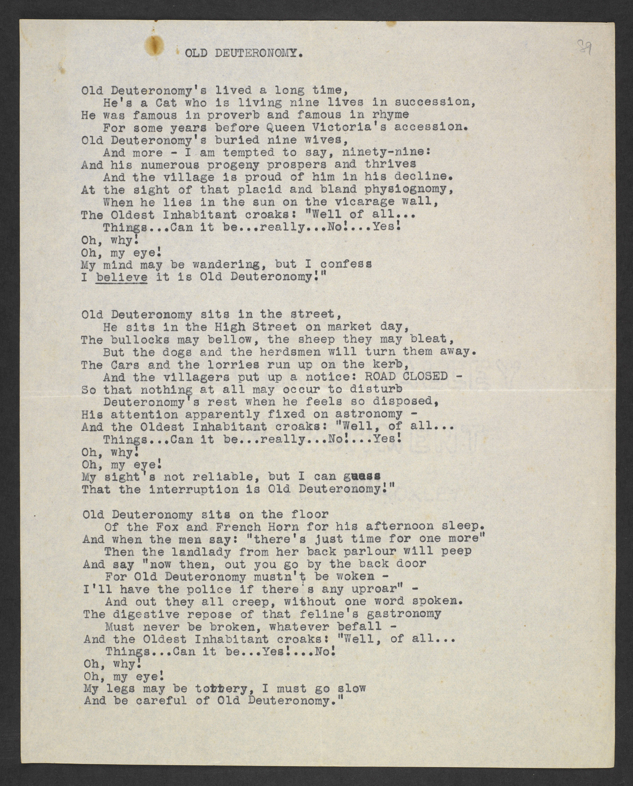
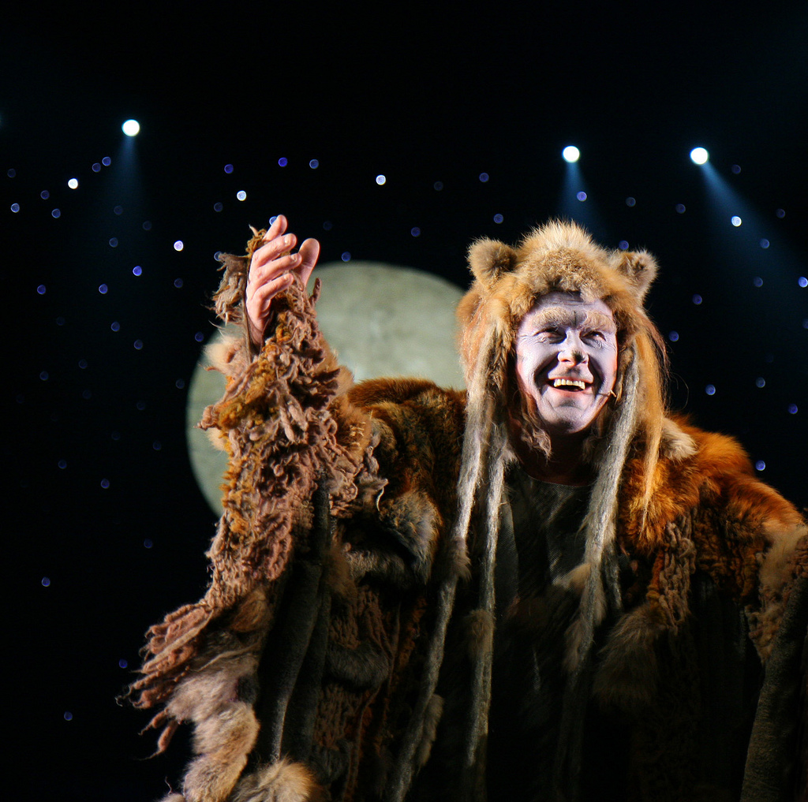

# 今天的文学猫角色：Old Deuteronomy（老杜特洛诺米）

赶集日，牛在叫，羊也在叫，老杜特洛诺米偏偏坐在大街上。牧人和狗把牲口往别处赶，小汽车和卡车开上了路缘，村民索性挂出一块封路的牌子，省得有谁打扰他歇息。这只公猫既不用叫，也不用摆出准备挠人的架势。全村已经知道，他想坐多久，就会坐多久。

老杜特洛诺米（Old Deuteronomy）是托马斯·斯特恩斯·艾略特（T. S. Eliot）写给这只猫的名字，也是诗的题目。Deuteronomy 本是《圣经》中《申命记》的英文书名。一只趴在牧师住宅的围墙上晒太阳的猫，顶着这样庄重的名字，诗人介绍起他的来历也煞有介事。维多利亚女王还没即位，他就已经进了俗语和歌谣。他埋葬过九位妻子，叙述者想了想，又觉得说成九十九位也无妨。他的子孙兴旺，村里人到了他年老的时候，仍以他为荣。

诗里写他有一张平静温和的脸。与之相映的是村里最年长的那个人，每回认出这张脸，都免不了一阵结结巴巴的惊叹。头一回，他说自己眼力衰退，却还是相信墙头上坐的就是老杜特洛诺米；到了集市那一节，他又说有一只耳朵听不清了，倒还能猜出是谁让大街乱成这样。一个上了年纪的人，打量一只老得连他也说不清来历的猫。两位各有各的慢，只有那只猫从头到尾都坐得住。

艾略特在 1938 年 11 月寄给艾利森·坦迪（Alison Tandy）的打字稿里，甚至让猫在大街上坐得仿佛正在研究天文。到次年问世的诗集《老负鼠的猫经》（Old Possum’s Book of Practical Cats）里，这一处写成了近乎一本正经的料理家务。两种措辞都给这只猫留足了面子。诗人煞费苦心替他设想他在忙什么，村里人费心维持秩序，他自己只消坐在那里。朗读这首诗时，可以留意村中老人那几声迟疑的惊叹怎样拖住了句子，最后又稳稳落到猫的全名上。

安德鲁·劳埃德·韦伯（Andrew Lloyd Webber）把诗集改编成音乐剧《猫》（Cats），1981 年在伦敦上演。老杜特洛诺米在剧里成了杰利克猫群敬重的长老，由他在舞会上选出一只获得新生的猫。2007 年华沙罗马音乐剧院的舞台上，兹比格涅夫·马恰斯（Zbigniew Macias）披着一身厚重的棕色毛皮戏服，耳旁垂下两绺灰白长毛，举手时满脸笑意。读完诗再看这个承担郑重职责的长老，很容易想起另一群同样敬重他的人。那群人管的是一条热闹的村街，挂出封路牌，只为让他好好歇一会儿。

### 资料来源

- T. S. 艾略特，[《Old Deuteronomy》前两节](https://www.barrowcliff.n-yorks.sch.uk/attachments/documents.asp?id=5780)，Hamilton Trust 阅读材料
- 约翰·萨瑟兰，[《托马斯·斯特恩斯·艾略特的〈擅长装扮的老猫经〉》](https://www.britishlibrary.cn/zh-cn/works/old-possums-book-of-practical-cats/)，大英图书馆，附 1938 年诗稿 Add MS 71002, f. 89r
- 音乐剧《猫》官网，[角色指南：Old Deuteronomy](https://www.catsthemusical.com/news/the-com-purr-lete-guide-to-the-characters-of-cats-f8rh7)
- Effie，[华沙罗马音乐剧院《猫》演出照片](https://commons.wikimedia.org/wiki/File:ZbyszekMacias.jpg)，2007 年

### 视觉参考

1. 1938 年艾略特打字稿，大英图书馆藏
   - 来源页面：<https://www.britishlibrary.cn/zh-cn/works/old-possums-book-of-practical-cats/>
   - 原始图片：<https://www.britishlibrary.cn/wp-content/uploads/2018/03/Letters-from-T-S-add_ms_71002_f89r.jpg>
   - 作者/机构：T. S. 艾略特／大英图书馆
   - 说明：艾略特随 1938 年 11 月 15 日致艾利森·坦迪的信寄出的同名诗打字稿。

2. 2007 年华沙版《猫》，Effie 摄：老杜特洛诺米
   - 来源页面：<https://commons.wikimedia.org/wiki/File:ZbyszekMacias.jpg>
   - 原始图片：<https://upload.wikimedia.org/wikipedia/commons/2/22/ZbyszekMacias.jpg>
   - 作者/机构：Effie（CC BY-SA 4.0）／Wikimedia Commons
   - 说明：兹比格涅夫·马恰斯在华沙罗马音乐剧院演出中扮演老杜特洛诺米。
