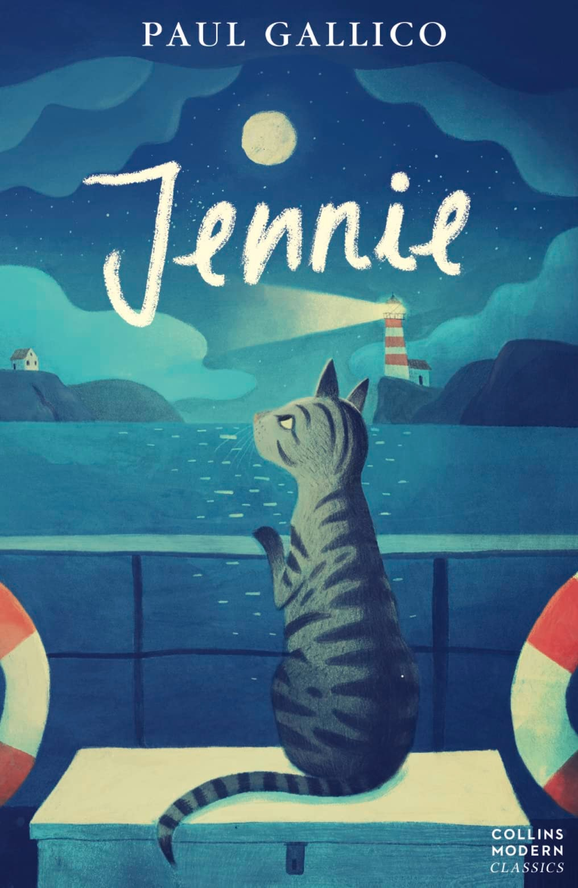
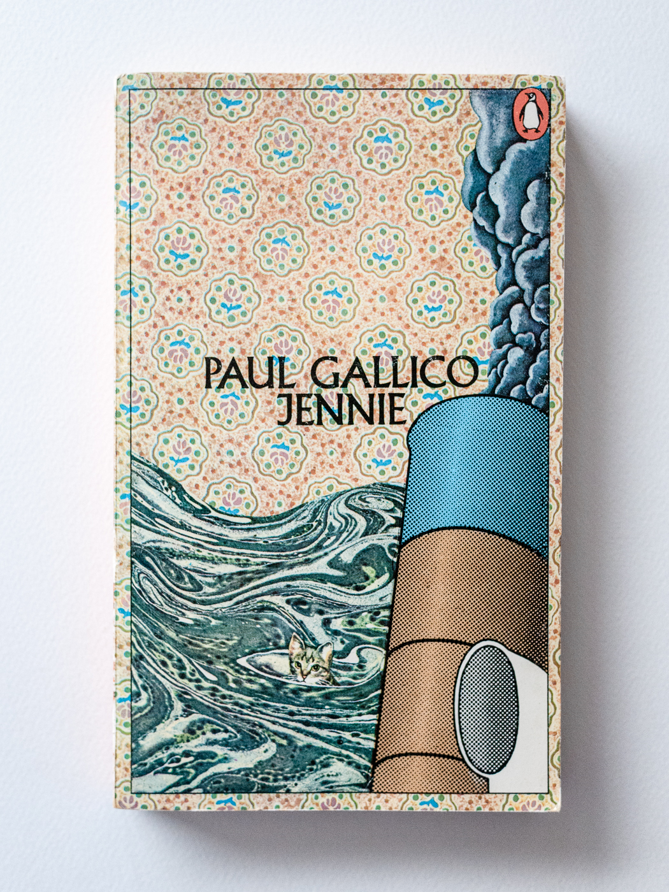

# 今天的文学猫角色：Jennie（珍妮）

拿不定主意的时候，先洗个脸。珍妮（Jennie）教给新伙伴的这条规矩，听起来很像一句玩笑，却是她行走街头的生活经验。害怕、困惑、不知下一步怎么办，都可以先停下来舔舔毛。对一个刚刚变成猫、连怎样喝奶都不会的男孩来说，这位老师从最小的动作开始，重新教他使用自己的身体。

珍妮是美国作家保罗·葛立轲（Paul Gallico）1950年小说《珍妮》（Jennie）里的母猫；这部书在美国出版时题为《The Abandoned》，意思是“被遗弃者”。住在伦敦的男孩彼得（Peter）原本渴望养猫，一次交通事故后醒来，却发现自己成了白猫。人的语言再也不能替他求援，他还遭到别的猫攻击。收留他的珍妮身形瘦削，带着虎斑纹，脸部和喉部有白毛，一双眼睛明亮而温和。她把受伤的陌生猫带到藏身处，替他清理身体，再给他找来食物。

这位街头老师懂得许多人平常看不懂的猫习惯。怎样舔饮液体、怎样吃下一只老鼠、怎样整理全身的毛，都需要学习。还有一条规矩是出门之前必须在门槛处停一停，查看外面是否安全。人眼中磨蹭不前的小动作，在珍妮这里有着实际用途。葛立轲让一个保留人类头脑的孩子不断发问，也让读者跟着发现：有了四只脚、胡须和尾巴，熟悉的伦敦就会出现另一套尺度，吃饭、走路和寻找落脚处都得从头摸索。

珍妮肯照顾同类，却很难再相信人。她曾经有家，主人搬走时把她留了下来。码头的看守人愿意给两只猫食物和安稳的住处，她仍要在吃饱后离开。流浪给了她经验，也留下了随时准备撤退的戒心。她带彼得偷渡上开往故乡格拉斯哥的船，于是城市街角之外，又出现船员、海水和新的危险。她能带路，也会犯错；遇到过高的地方，她同样会惊慌。彼得需要帮助时的可靠，与她自己也会害怕的时刻，始终存在于同一只猫身上。

这份关系还曾跨出小说，进入另一位创作者的记忆。小岛秀夫在谈阅读经验的文章里回忆，高中时读到《珍妮》，跟着她学习猫的生存方式，读着读着便仿佛披上了一层猫皮。他记住的是这只受过伤、仍然任性而温柔的母猫。书里关于猫的细节因此没有停留在知识上：读者学会辨认一个动作，也开始在意做出这个动作的她。

不同年代的封面把她的旅行画出了不同气氛。1972年企鹅版由Tony Meeuwissen设计，以拼贴把猫脸、翻涌的水纹和轮船烟囱放在一起，航行显得有些惊险；Collins Modern Classics版则让虎斑猫坐在月夜甲板上，长尾垂过座椅，望向水面另一边的灯塔。出发的猫有一整片陌生世界要面对，而珍妮还得教会身边那只白猫，下一步该怎样迈出去。

### 资料来源

- [HarperCollins／HarperReach：《Jennie》作品与作者介绍](https://www.harperreach.com/products/jennie-collins-modern-classics-paul-gallico-9780008778811/)。
- [Geraldine Pinch：Fantasy Reads – Jennie](https://geraldinepinch.co.uk/fantasy-reads-jennie/)，角色外貌、生活规矩与遭遇。
- [HarperCollins版《Jennie》公开试读，LitRes](https://www.litres.ru/book/paul-gallico/jennie-42409926/chitat-onlayn/)，版权页、目录与Vivian French导言。
- [读书共和国：《创作的基因》试读](https://www.bookrepclub.com.tw/index.php?at=bookdetial&cl=book&id=16878&mainclass=3&md=index&subclass=28)，小岛秀夫谈《珍妮》的阅读经验。
- [Fonts In Use：1972年企鹅版封面及设计署名](https://fontsinuse.com/uses/4023/jennie-by-paul-gallico-1972-pengiun-edition)。

### 视觉参考

1. Collins Modern Classics版封面：月夜甲板上的虎斑猫
   - 来源页面：<https://bookhero.co.nz/products/jennie-by-paul-gallico-9780007395194>
   - 原始图片：<https://bookhero.co.nz/cdn/shop/files/16871843482190.jpg?v=1748745288>
   - 作者/机构：HarperCollins／Book Hero
   - 说明：《珍妮》Collins Modern Classics版封面，以虎斑猫和灯塔表现航行题材。

2. 1972年企鹅版，Tony Meeuwissen设计：浪间的猫
   - 来源页面：<https://fontsinuse.com/uses/4023/jennie-by-paul-gallico-1972-pengiun-edition>
   - 原始图片：<https://original.fontsinuse.com/fontsinuse.com/use-images/12/12149/12149.jpeg>
   - 作者/机构：Tony Meeuwissen设计；André Mora摄影；Penguin出版
   - 说明：1972年《珍妮》封面以猫、波浪和轮船烟囱组成拼贴画面。
