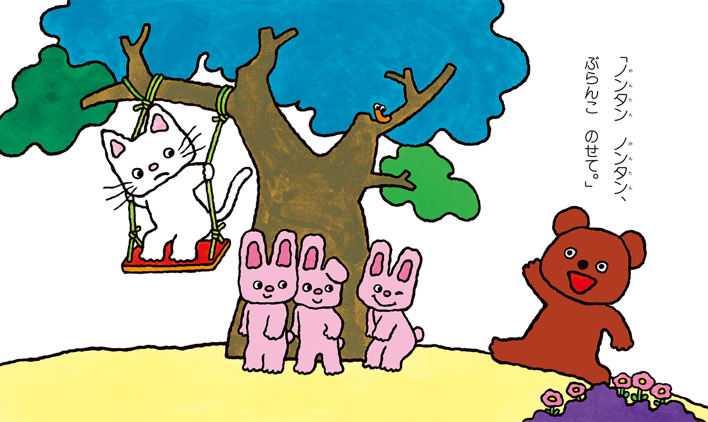
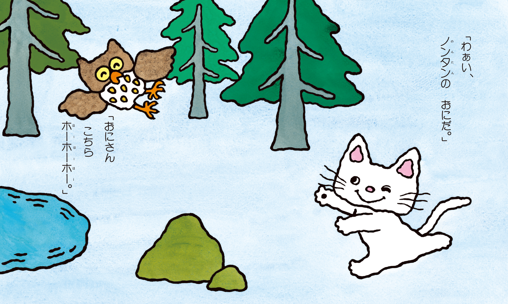

# 今天的文学猫角色：ノンタン

秋千荡起来了，ノンタン却不肯下来。小熊和兔子们等在树边，想换着玩，他只顾自己继续荡。等到朋友们生气、准备离开，这只白色小猫才着了急：秋千可以一个人占着，玩伴却会走掉。

ノンタン是清野幸子（キヨノサチコ）创作的猫男孩，圆脸、尖耳朵，粉红色的小鼻子，两边伸出几根长胡须。1976年8月，他在偕成社出版的《ノンタンぶらんこのせて》和《ノンタンおやすみなさい》中登场。两本书的题名分别是请他让别人坐秋千、向他道晚安；一个要他轮流，一个要他睡觉，偏偏都是这只小猫不大愿意照办的事。他爱和朋友玩，也很容易把自己的兴致放在前面，故事便从这些小小的冲突里长出来。

秋千这一回，大家最后用数到十的办法轮换。数完还跟着一截带有小火车声音的数数歌，唱到约定的地方，就该换人了。等待因此有了可以听见、可以一同参与的长度。对ノンタン来说，放开秋千并不等于游戏结束，他仍然在伙伴中间。书里没有先把他变成一个懂事的小榜样，再准许他回来；那个舍不得停下来的孩子，也能学会继续和大家玩。

夜里的ノンタン同样舍不得停。他睡不着，跑去找朋友，别人却已经上床，只有猫头鹰还醒着。两人在黑暗里玩追逐，猫头鹰自在，他却被石头绊住，又跌进水洼，弄得满身泥。白天那副神气的白猫模样，到了夜里便有些狼狈。他的冒失来自一件很容易理解的事：自己还精神着，就盼着整个世界陪自己再玩一会儿。日常作息在这里变成了身体能感觉到的经验，困意和疲倦比一串劝告更有分量。

这副猫模样也经历过一次改写。清野幸子最初画的是一只雪白的小狐狸；编辑建议换成孩子更熟悉的动物，她才把主人公改为白色小猫。最早带去出版社的故事，后来成为《あかんべノンタン》，写他向别人做鬼脸。担心这个淘气鬼一上来就惹大人反感，出版社先推出秋千和晚安两册。即使如此，早年的批评仍嫌他的画风像漫画、主人公不够乖，孩子们却很快把他当成了朋友。

读ノンタン，很适合把声音放出来。短句的反复、数数的节拍和游戏里的呼喊，让小猫的急切带上了动作感。他会争抢，会闯祸，也会重新和伙伴凑到一起。清野幸子谈起儿童时，曾把玩耍看作让孩子自身的容量变大的过程。翻回那棵挂着秋千的树，几个小动物一起等、一起数，游戏已经比独自荡秋千时宽敞了。

### 资料来源

- 偕成社，[《ノンタンぶらんこのせて》图书页](https://www.kaiseisha.co.jp/books/9784032170108)，1976年8月
- 偕成社，[《ノンタンおやすみなさい》图书页](https://www.kaiseisha.co.jp/books/9784032170207)，1976年8月
- 偕成社 Kaisei web，[《「ノンタン」シリーズ最初の3冊は？》](https://kaiseiweb.kaiseisha.co.jp/s/osusume/osm240429/)，2024年4月29日
- 偕成社，[《ノンタンが生まれるまで》](https://www.kaiseisha.co.jp/special/nontan/story)
- 偕成社，[ノンタン官方网站：角色介绍与作者的话](https://www.kaiseisha.co.jp/special/nontan/)

### 视觉参考

1. 1976年《ノンタンぶらんこのせて》，清野幸子绘：独占秋千
   - 来源页面：<https://www.kaiseisha.co.jp/books/9784032170108>
   - 原始图片：<https://s3-ap-northeast-1.amazonaws.com/kss-data001/book_images/9784032170108.IN01.jpg>
   - 作者/机构：清野幸子／偕成社
   - 说明：原作内页，ノンタン坐在秋千上，兔子和小熊前来邀他轮换。

2. 1976年《ノンタンおやすみなさい》，清野幸子绘：与猫头鹰追逐
   - 来源页面：<https://www.kaiseisha.co.jp/books/9784032170207>
   - 原始图片：<https://s3-ap-northeast-1.amazonaws.com/kss-data001/book_images/9784032170207.IN02.jpg>
   - 作者/机构：清野幸子／偕成社
   - 说明：原作内页，ノンタン和唯一还醒着的猫头鹰在夜里玩追逐。
