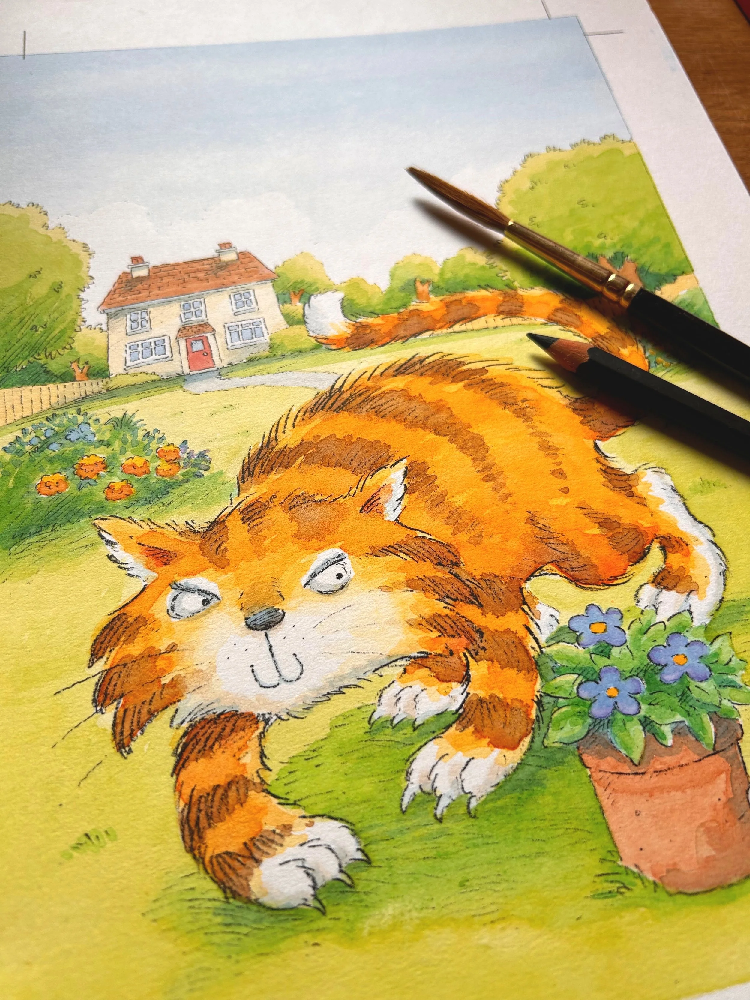
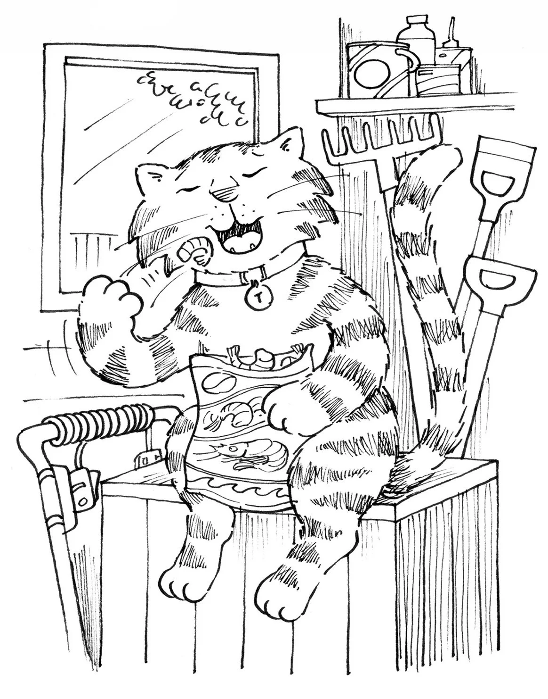

# 今天的文学猫角色：Tuffy（塔菲）

塔菲闯了祸，总能抢先替自己说上几句。他把死鸟带回家，小主人伤心得哭起来；可在他看来，自己不过做了猫会做的事，人类的反应未免太大。英国作家安妮·范恩（Anne Fine）的《杀手猫日记》（The Diary of a Killer Cat）把叙述权交给了这位嫌疑犯。读者听见的，是一只猫理直气壮的自辩：别人眼里的劣迹，在他的讲述里总有另一套来龙去脉。

他住在小女孩 Ellie 一家，有人疼爱，也有人管束。他贪玩、贪吃，不喜欢被搂得透不过气，更不乐意听人夸他“可爱”。被当作温顺的小宠物欣赏，显然有损他对自己的评价。范恩让他既保留捕猎、舔嘴、四处惹事的猫习性，又拥有一个格外会顶嘴的声音。人类越认真地训诫，他越能从自己的立场找出理由。猫没有按照主人的愿望生活，主人却不断指望他学会那套规矩，家里的争执就从这里生出来。

书里的笑声带着一点不安。Ellie 对死去的小动物感到难过，这份难过并没有因为塔菲擅长狡辩就消失；塔菲也不会只为安慰她，立即改成一只没有捕猎欲望的猫。他把自己的解释讲给读者听，家里的人却无法像读者那样听懂他的陈词。这使他的日记有了特别的亲近感：我们仿佛被拉到一旁，听他抱怨全家如何大惊小怪，同时又看得见那些被他轻轻带过的麻烦。读这本书，需要一边听他说，一边自己判断。

最能检验这种判断的，是他拖进猫门的一只死兔子。家人认出那是邻居的宠物，认定塔菲又犯了案；父亲甚至趁夜把兔子放回笼里，想掩盖这场灾难。后来才知道，兔子早已自然死亡，塔菲并没有杀它。他确实闯过祸，却不能因此包办所有罪名。这个转折保住了他的猫脾气，也让先入为主的人类出了洋相：大家忙着善后，偏偏没弄清需要善后的究竟是什么。

Steve Cox 为这个系列画出的塔菲，是一只身躯圆厚、长着条纹和白色口鼻的猫，眉眼间常有不耐烦或得意的神情。范恩曾任英国儿童文学桂冠作家，她在这里把短小的家庭故事写成一场声音鲜明的喜剧；Cox 的画则给那股口气配上了身体。在他展示的一幅系列插画里，塔菲独占一袋从家中冷冻柜拿来的虾，坐着吃得心满意足。嘴巴忙着享用，爪子还捏着下一只，暂时用不着为自己辩护。

### 资料来源

- Penguin / Puffin，[《The Diary of a Killer Cat》图书介绍](https://www.penguin.co.uk/books/31566/the-diary-of-a-killer-cat-by-anne-fineillus-steve-cox/9780140369311)
- Scholastic，[《The Diary of a Killer Cat》阅读指南](https://images.scholastic.co.uk/assets/a/3b/84/killer-cat-113109.pdf)，故事摘要及分章讨论
- 三民网路书店，[安妮·范恩作品目录中的《杀手猫日记》介绍](https://www.sanmin.com.tw/search?au=%E5%AE%89%E5%A6%AE&pi=8)，接力出版社 2017 年版
- Steve Cox，[《The Diary of a Killer Cat》插画作品页](https://www.stevecoxillustration.com/killer-cat)

### 视觉参考

1. Steve Cox 水彩原稿：花园里的塔菲
   - 来源页面：<https://www.stevecoxillustration.com/killer-cat>
   - 原始图片：<https://images.squarespace-cdn.com/content/v1/65e45df8af345c3927be64f8/e4269566-b0c9-4e84-bb3e-086d5c5e7132/Original_+Tuffy_Killer_Cat__Steve_CoxArtwork.jpg>
   - 作者/机构：Steve Cox
   - 说明：原插画家展示的塔菲水彩原稿照片，保留了画笔与纸张。

2. Steve Cox 系列插画：塔菲独享一袋虾
   - 来源页面：<https://www.stevecoxillustration.com/killer-cat>
   - 原始图片：<https://images.squarespace-cdn.com/content/v1/65e45df8af345c3927be64f8/32ebdb1b-e581-4640-913d-a444d7fbf4d8/Tuffy+with+prawns.jpg>
   - 作者/机构：Steve Cox
   - 说明：系列插画呈现塔菲享用从家中冷冻柜拿来的虾，展示他的贪吃与自得。
