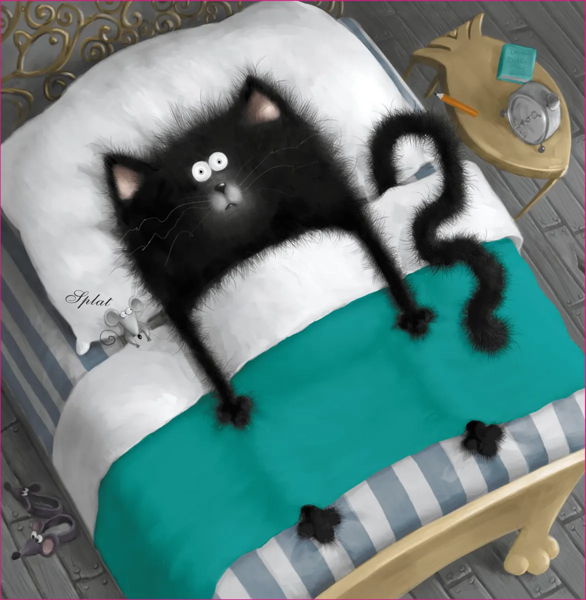
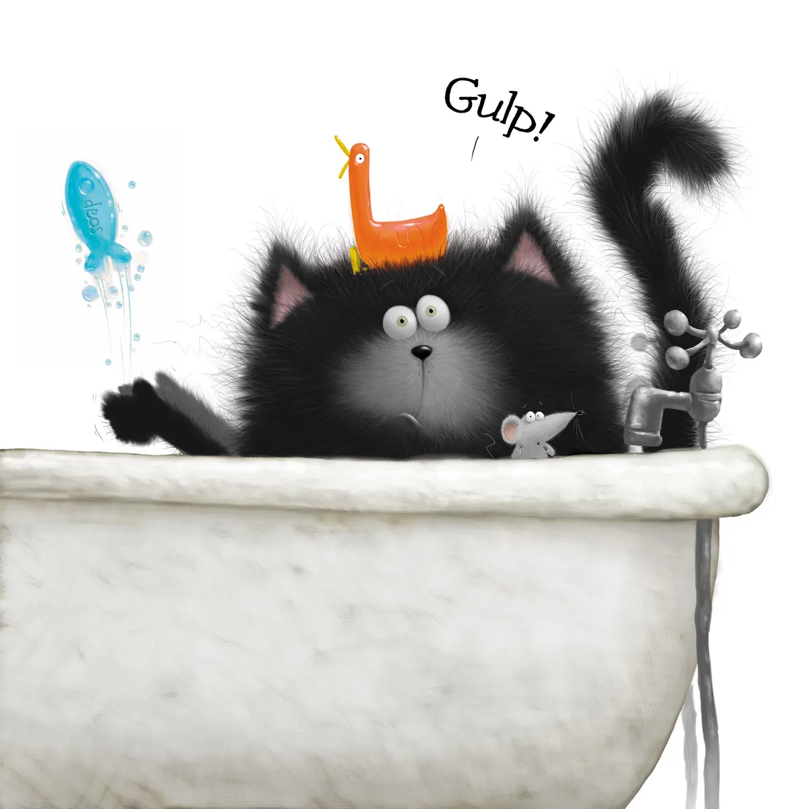

# 今天的文学猫角色：Splat（啪嗒猫）

第一天上学还没开始，啪嗒猫（Splat）已经紧张起来：新同学会喜欢他吗？躺在床上的他瞪着圆眼睛，尾巴在被子外弯来扭去。出门时，他给自己带上一位特别的伙伴，把小老鼠 Seymour 藏进午餐盒。别人上学带午饭，他还要带上一点熟悉的、安全的东西。

这只小黑猫出自英国作家兼画家罗布·斯科顿（Rob Scotton）2008 年出版的绘本《啪嗒猫第一天上学》（Splat the Cat）。斯科顿为他写故事，也亲手画出那身不服帖的毛。角色的起点来自一次割草：作者看见邻居家的猫在围栏上失去平衡，落地的样子颇不体面，脑中随即冒出“Splat”这个词。这个带着摔落声响的名字，配上后来那副常常手忙脚乱的模样，倒很贴切。

啪嗒猫的身体毛茸茸的，四肢细长，圆眼睛挤在脸中央；黑毛周围根根散开的轮廓，让他连安静躺着都显得有点慌张。斯科顿给了他一条很会表达情绪的尾巴，尾巴抬起、弯曲，占去画面里一大片地方。与他相伴的小灰鼠则小得多，有尖鼻子和圆耳朵。把这两个身形悬殊的朋友放在一起，单看画面就能体会到他们的亲近：老鼠可以待在黑猫的枕边，也可以陪他出现在浴缸边沿。

他容易害怕，却并不因此拒绝别人。第一本书把他的担忧放进一个孩子很熟悉的处境：去陌生地方，加入一个新集体。午餐盒里的伙伴让他安心，可当 Seymour 跑出来，猫咪同学们又兴奋起来，原先的安稳立刻变成了麻烦。老师的帮助让这个开学日有了转机，也让啪嗒猫逐渐发现，学校能够接纳自己，那个不寻常的小伙伴也有自己的用处。故事没有急着把他的紧张抹掉，先让他带着紧张走进教室。

这段猫鼠友谊贯穿了啪嗒猫的世界。按追逐游戏里的老规矩，猫该追老鼠；他却愿意和 Seymour 一起冒险，需要帮助时也让这个小伙伴靠近。Seymour 胆子大，又有主意，两者的差别给画面添了许多趣味。啪嗒猫因此有了具体的性格：他会把小事想得很大，会借朋友的陪伴鼓起勇气，也肯把比自己小得多的伙伴当作可靠的朋友。

后来的故事继续把他放进游泳课、学校演出、节日和睡前时刻。系列也从大开本绘本延伸到供初学者阅读的短篇读物，不过那只担心新事物的小黑猫始终很容易认出来。斯科顿的画常把日常窘境留在最醒目的地方：一张严肃的猫脸，脑袋上却顶着玩具鸭，旁边还有一只小灰鼠探头。啪嗒猫努力应付生活的样子，就这样被毛发、眼神和那条不肯安静的尾巴一起画了出来。

### 资料来源

- 罗布·斯科顿，[《Splat the Cat》角色介绍与原作插画](https://www.robscotton.com/splat.html)
- 罗布·斯科顿，[Meet Rob](https://www.robscotton.com/about.html)
- The World of Splat the Cat，[Books：2008 年《Splat the Cat》图书简介与系列书目](https://splatthecat.com/books.html)
- The World of Splat the Cat，[Splat & Friends](https://splatthecat.com/friends.html)

### 视觉参考

1. 作者官网，斯科顿绘：躺在床上、尾巴翘起的啪嗒猫
   - 来源页面：<https://www.robscotton.com/splat.html>
   - 原始图片：<https://www.robscotton.com/img/tail-wiggled-bed-1173.webp>
   - 作者/机构：罗布·斯科顿（Rob Scotton）
   - 说明：作者展示的原作画面，呈现啪嗒猫躺在床上、尾巴翘起的模样。

2. 《Splish, Splash, Splat!》，斯科顿绘：浴缸里的啪嗒猫
   - 来源页面：<https://www.robscotton.com/splat.html>
   - 原始图片：<https://www.robscotton.com/img/print-splat-in-bath-1200.webp>
   - 作者/机构：罗布·斯科顿（Rob Scotton）
   - 说明：作者展示的《Splish, Splash, Splat!》插画，啪嗒猫与 Seymour 同在浴缸中。
