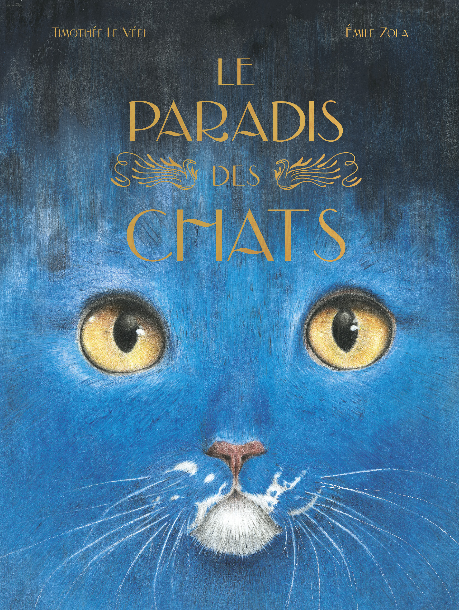
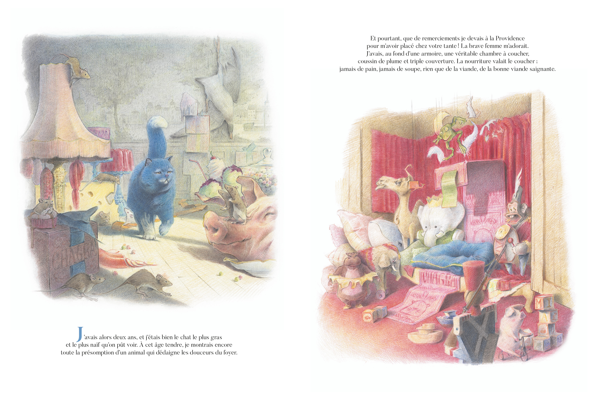

# 今天的文学猫角色：《猫的天堂》中的安哥拉猫

隔着窗子看见别的猫在屋顶打架，他认定自己找到了天堂。那些猫竖着尾巴，在阳光下的蓝色石板上翻滚，连叫骂都像欢呼。至于他自己，睡的是羽毛垫，盖着三层毯子，吃的是鲜肉，却已经舒服得无聊，连抚摸都嫌乏味。他推想：人把窗户关得那么严，外面一定藏着好东西，就像关紧的橱柜里藏着肉。

这只没有名字的安哥拉公猫，出自埃米尔·左拉（Émile Zola）的短篇《猫的天堂》（Le Paradis des chats）。作品于1868年刊于《La Tribune》，1874年收入《给妮侬的新故事》（Nouveaux Contes à Ninon）。故事外还有一层讲述：一位姑母把猫留给了叙述者，某个冬夜，他便在暖烘烘的炉灰前，听猫回忆年轻时的出走。猫说自己当年两岁，又胖又天真；讲故事的人却先说他是自己所认识的最蠢的动物。还没踏上屋顶，这份自白就已经带着笑声。

他的可笑之处，是把家里的规矩带到了整座城市。饿了便问屋顶上有什么吃的，听见回答是“找到什么吃什么”，竟不知如何是好；看见别人桌上的肉排，又觉得那当然可以拿走。他从未理解，厨房里的肉怎么会不属于猫。左拉用食欲给他量世界：最初连天沟里的水都胜过甜牛奶，受饿以后，记忆里的鲜肉又变得无比诱人。他对生活的判断总有一副肚肠在后面推动，连宏大的理想也逃不过饥饿。

不过，他并不只有懒惰。刚到屋顶时，他也真心喜欢过脚下温软的泥、太阳的热度和同伴的叫声，兴奋里掺着害怕，仍想跟着大家一起叫。臃肿的身体在锌皮上滑动，被嘲笑也照样觉得有趣。那阵笨拙的快乐，让后来退缩的他仍然像一只活猫：陌生生活曾吸引过他，只是他的身体和习惯都没有为它做好准备。

2023年，Timothée Le Véel为这篇作品绘制了新的绘本形象：蓝色的猫、金黄的眼睛，以及塞满动物玩具的室内。满屋缩小成玩物的野兽，和这只向往出门的家猫放在一起，给他的烦闷添了几分滑稽。原作没有指定毛色，蓝色是这位插画家的选择；左拉写得最清楚的外貌，则是那一身妨碍行动的肥肉。

陪他游荡的老公猫最后把他送回家，却拒绝同住、分肉的邀请，独自重返屋顶。两只猫都尝过街头的滋味，得出的答案依旧不同。家猫回去后挨了鞭打，竟还能惦记接下来的肉；等到炉边讲完往事，他把有肉可吃、即使被关被打也温暖的房间称作天堂。左拉随即收住话头：“Je parle pour les chats.”——“我说的是猫。”

### 资料来源

- 埃米尔·左拉，[《Le Paradis des chats》全文](https://lecturia.org/fr/nouvelles/emile-zola-le-paradis-des-chats/20716/)，收入《Nouveaux Contes à Ninon》（1874），第I—VI节
- 法国国家图书馆，[《Le paradis des chats》作品规范记录](https://catalogue.bnf.fr/ark:/12148/cb18034490r)，初刊及结集信息
- Voie Livres，[《Le paradis des chats — Timothée Le Véel — Emile Zola》](https://www.voielivres.ch/le-paradis-des-chats-timothee-le-veel-emile-zola/)，2023年绘本书评与内页

### 视觉参考

1. 2023年绘本封面，Le Véel绘：金眼睛的蓝色猫脸
   - 来源页面：<https://www.voielivres.ch/le-paradis-des-chats-timothee-le-veel-emile-zola/>
   - 原始图片：<https://www.voielivres.ch/wp-content/uploads/2024/04/LeParadisDesChats_VoieLivresCOUV.jpg>
   - 作者/机构：Timothée Le Véel／Kaléidoscope，Voie Livres刊载
   - 说明：2023年《Le Paradis des chats》绘本封面中的家猫形象。

2. 2023年绘本内页，Le Véel绘：家猫与满屋玩具
   - 来源页面：<https://www.voielivres.ch/le-paradis-des-chats-timothee-le-veel-emile-zola/>
   - 原始图片：<https://www.voielivres.ch/wp-content/uploads/2024/04/LeParadisDesChats_VoieLivres6.jpg>
   - 作者/机构：Timothée Le Véel／Kaléidoscope，Voie Livres刊载
   - 说明：同一绘本中描绘家猫受宠生活的跨页插画。
