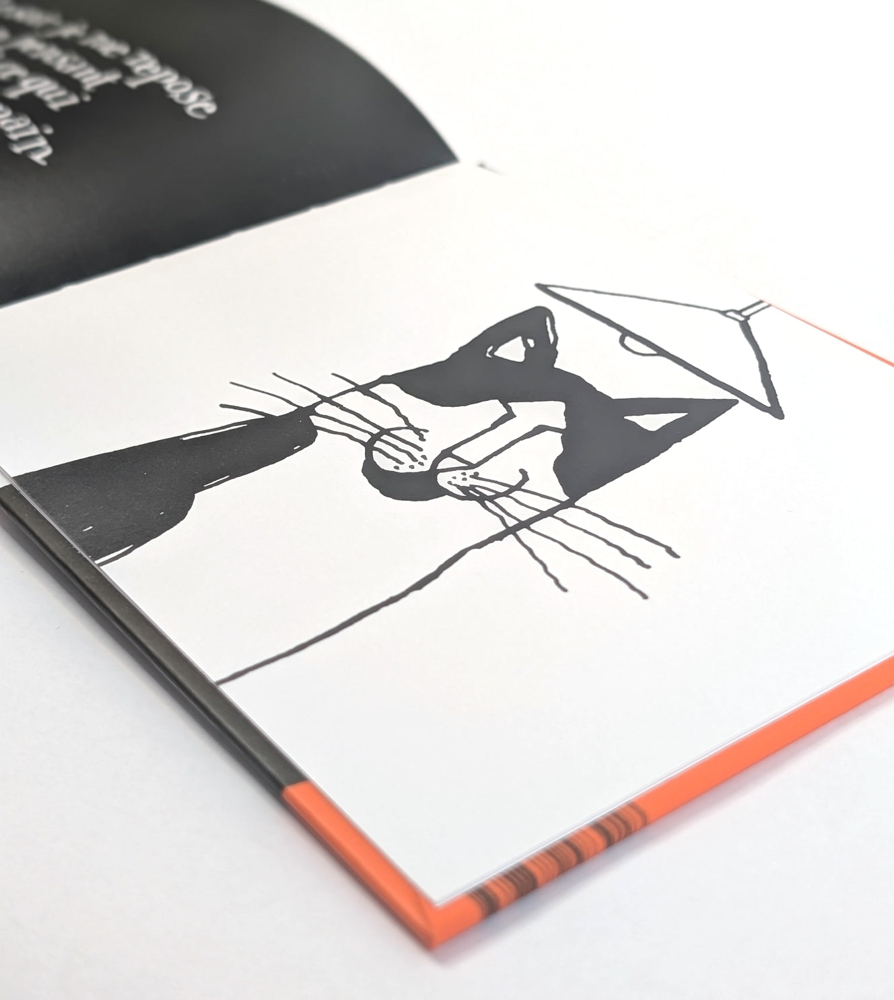
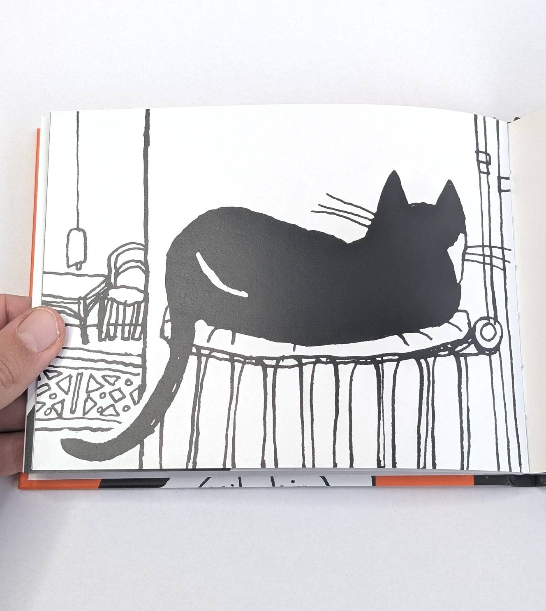

# 今天的文学猫角色：Milton

Milton 生起闷气来，会一声不响地面朝墙壁，待上好几个小时。读者看不见他的表情，却很容易认出那副拒绝交谈的背影：这只猫有自己的脾气，也有充分的耐心，把脾气一直坚持下去。

这位黑白分明的小主人公出自 Haydé 的法语绘本《Moi, Milton》，书名就是“我，Milton”。系列从 1997 年开始由瑞士出版社 La Joie de lire 推出，第一本获得了“瑞士最美图书”奖。作者全名 Haydé Ardalan，在洛桑学习平面设计，曾长期为杂志绘制插图。到了 Milton 的世界里，她把猫的身体压缩成浓黑的块面，把家具、灯具和细长的胡须留给线条。大块黑色落在白纸上，猫的轮廓便先于文字抓住了目光。

他的脸尤其容易辨认：尖耳朵立着，白色从额鼻之间延伸到嘴边，长胡须向两侧伸出去。Haydé 不靠细密的毛发让他显得逼真；黑白交界的形状、眼睛的方向，已经足够传达这张脸的神气。在出版社展示的内页中，一只灯罩悬在他头顶附近，细细的灯线与胡须相遇，家里的普通物件也成了画面的玩笑。读这种图画，需要的只是稍稍停一停，看看一只猫怎样占据纸页。

《Moi, Milton》让他用自己的口吻介绍生活。他记得自己从前很小，也会到屋顶上看看外面发生了什么；等到不高兴，又可以转身去面对墙。好奇与固执并排存在，谁也没有被改造成一个等待纠正的缺点。这里没有急着展开的大冒险，也不必先弄清一长串人物关系，读者从几个短小的日常片段里，就能摸到他的性子。他观察外面的世界，同时牢牢守住自己愿意亲近或退开的距离。

这种自我介绍的趣味，也藏在图画给他的分量里。暖气片上的 Milton 蜷成一团，尾巴垂到下方，身体是画面里最沉的一块黑；周围的桌椅和管道只用细线勾勒。家具好像成了他的陪衬，房间的重心也跟着他挪到了那个舒适的位置。即使他背向读者、不做任何热闹的动作，画面仍由他掌管。大人能认出同居一室的猫，小读者则不需要养猫的经验，也能看懂那副自顾自安顿下来的样子。

这位主人公后来继续走进《Milton chez le vétérinaire》《Milton chez le voisin》等绘本，去看兽医，也到邻居家去。但认识他，可以从最初这本薄薄的自述开始。书中的猫愿意告诉你一点过去，领你看一眼他的生活；至于什么时候暂时不想理人，他会把脸转向墙壁，自己作出决定。

### 资料来源

- La Joie de lire，[《Moi, Milton》图书介绍及公开内页](https://www.lajoiedelire.ch/products/moi-milton)，所列版本出版于 2007 年
- La Joie de lire，[Haydé 作者简介与作品目录](https://www.lajoiedelire.ch/pages/illustrateurs/hayde)

### 视觉参考

1. 《Moi, Milton》内页，Haydé 绘：灯罩旁的猫脸
   - 来源页面：<https://www.lajoiedelire.ch/products/moi-milton>
   - 原始图片：<https://www.lajoiedelire.ch/cdn/shop/files/moi_milton-01.jpg?v=1747924192>
   - 作者/机构：Haydé / La Joie de lire
   - 说明：出版社展示的实书内页照片，呈现 Milton 的黑白面部与室内灯具。

2. 《Moi, Milton》内页，Haydé 绘：暖气片上的猫
   - 来源页面：<https://www.lajoiedelire.ch/products/moi-milton>
   - 原始图片：<https://www.lajoiedelire.ch/cdn/shop/files/moi_milton-03.jpg?v=1747924192>
   - 作者/机构：Haydé / La Joie de lire
   - 说明：同书另一幅内页照片，呈现 Milton 蜷卧在暖气片上的背影。
