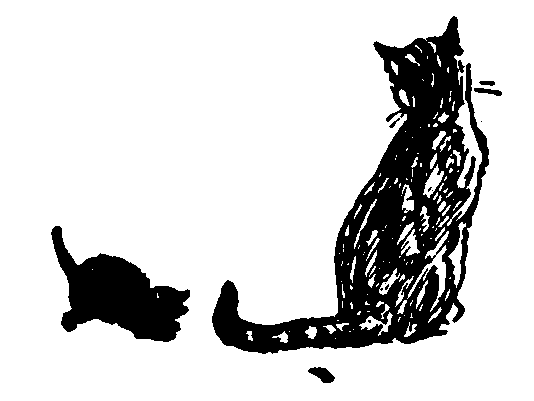
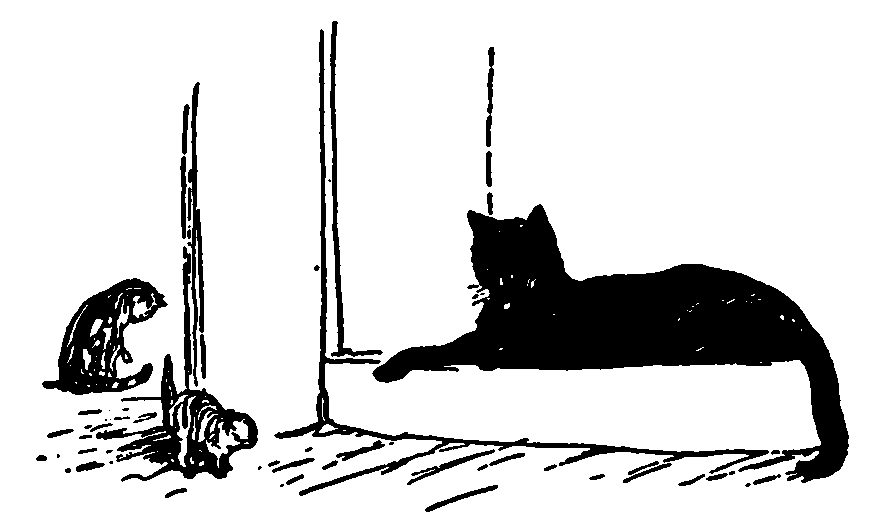

# 今天的文学猫角色：Pinkle Purr

还没睁眼时，Pinkle Purr 只是小小的一团黑毛，带着几只小爪子。等眼睛终于能看见东西，他看见的是母亲 Tattoo；世界上的事情，也都先从她那里学。他给自己的办法很简单：“我要问问妈妈。”这只后来会独自出去探险的黑猫，最初连认识世界都要借助母亲。

Pinkle Purr 出现在阿兰·亚历山大·米尔恩（A. A. Milne）1927 年的儿童诗集《Now We Are Six》中，诗题就是他的名字。写《小熊维尼》的米尔恩，在这首短诗里只用了四节，就让一只猫走过了从幼小到成年的时光。没有给他安排漫长旅程，也没有一场必须战胜的灾难；变化发生在身体的大小、出门时的态度，以及他每次怎样说起母亲。这些细小的差别，已经足够让读者认出成长。

他的黑毛后来长得柔滑，身体一天比一天大，终于和当初觉得庞大的母亲一样大了。这时他把两只猫看作一对朋友，做什么都要一起。第一节里凡事请教的幼猫，到了第二节，已经能与母亲并肩。米尔恩没有把这种亲密写得郑重：一句近乎孩子口吻的话，就把依赖悄悄换成了作伴。Pinkle Purr 的可亲也正在这里，他对关系的理解总是那么直接，仿佛自己此刻的感受，就是全世界通行的道理。

等到探险的兴头上来，他又有了新的判断：自己想做的事情，跟母亲有什么关系呢？于是道一声回头见，就顾着自己的安排去了。他没有突然变成恶猫，却也不再事事想到 Tattoo。诗里这份笃定带着一点喜剧意味：读者还记得那个张口便要问妈妈的小家伙，他本人却已经忙于独立。四节诗不断重复母子身份，又让每节末尾的话改变，读起来轻快，时间却就在这些重复之间过去了。

为诗集画插图的厄内斯特·谢泼德（E. H. Shepard），也抓住了大小关系的变化。幼时的小黑猫伏在母亲身旁，体形还抵不过她的一截尾巴；长大后，他舒展着身体卧在门槛上，占去大块画面。画中的猫保留着猫的坐姿、尾巴和懒散劲头，不需要穿衣说教，便能把诗里的自信表现出来。文字中的成长，因而又多了一种可以直接看见的尺度。

末节把 Pinkle Purr 夸成了披着煤黑皮毛的巨大豹子。这个称呼让他的成年形象大得有些滑稽，也和开头那团小得不成样子的黑毛遥相呼应。此时又有一只新近出生的棕色小猫在玩耍，母亲的身份仍被诗句郑重保留着。Pinkle Purr 懒洋洋地俯视 Tattoo，叫她“亲爱的小 Tat”。曾经那么大的妈妈，如今连名字都被他叫小了。

### 资料来源

- A. A. Milne，[《Now We Are Six》中的〈Pinkle Purr〉](https://en.wikisource.org/wiki/Now_We_Are_Six/Pinkle_Purr)，维基文库校订文本，第 93—94 页
- Susannah Fullerton，[〈A.A. Milne & Pinkle Purr〉](https://susannahfullerton.com.au/a-a-milne-pinkle-purr/)，2025 年 10 月 1 日

### 视觉参考

1. 《Now We Are Six》谢泼德插图：小黑猫与母亲
   - 来源页面：<https://en.wikisource.org/wiki/File:Now_We_Are_Six_-p105.png>
   - 原始图片：<https://upload.wikimedia.org/wikipedia/commons/c/c0/Now_We_Are_Six_-p105.png>
   - 作者/机构：E. H. Shepard／Wikimedia Commons
   - 说明：〈Pinkle Purr〉开篇插图，描绘幼小的黑猫和母亲 Tattoo。

2. 《Now We Are Six》谢泼德插图：长大的黑猫卧在门槛上
   - 来源页面：<https://en.wikisource.org/wiki/File:Now_We_Are_Six_-p106.png>
   - 原始图片：<https://upload.wikimedia.org/wikipedia/commons/f/f0/Now_We_Are_Six_-p106.png>
   - 作者/机构：E. H. Shepard／Wikimedia Commons
   - 说明：〈Pinkle Purr〉结尾插图，长大的黑猫俯看门边的母亲与幼猫。
