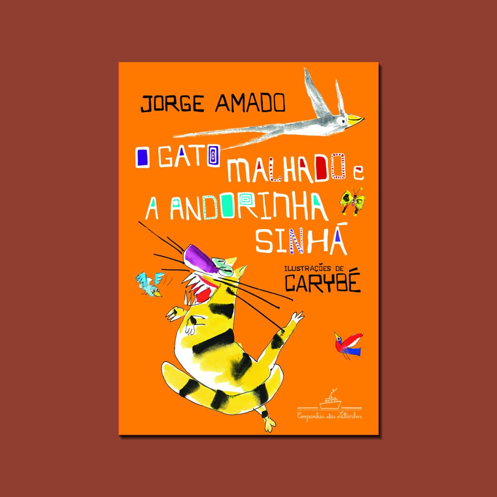
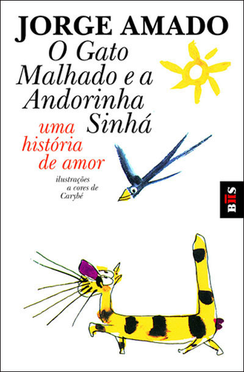

# 今天的文学猫角色：Gato Malhado（花斑猫）

花斑猫喜欢在粗糙的树干上蹭痒，一棵番石榴树却把这当成了爱情。她得意地向公园里的树木炫耀，还特意除去树干上的疙瘩，变得光滑漂亮，等他再来。猫发现再也蹭不着痒，转身走了。这个有点刻薄的笑话，很适合用来认识他：别的居民忙着议论情意，他只惦记自己的舒服，连惹出了怎样的风波都未必知道。

这只猫出自巴西作家若热·亚马多（Jorge Amado）的《花斑猫与燕子西尼娅》（O Gato Malhado e a Andorinha Sinhá）。他的名字就是“花斑猫”，没有另外的姓名。在公园里，他性情乖僻，不爱与人来往，走到哪里，哪里便匆忙散开。他对自己的坏名声似乎也不在乎；只有老猫头鹰偶尔替他说话，觉得大家可能误解了他。亚马多写他的有趣之处，正在这点距离：猫确有自私冷淡的一面，邻居们也乐于把他一直认作危险的家伙。

春天来了，燕子西尼娅（Andorinha Sinhá）没有跟着众人躲开。对一个习惯让别人害怕的家伙，这已经足够新鲜。两只动物交上朋友，感情渐深，花斑猫竟写起了十四行诗。过完春夏，连公园居民也开始重新打量他：这么久都没闯祸，或许他没有传说中那么坏。原先他蹭完树就走，如今却有了想要接近、想要说话的对象；这个变化落在日常行为里，比一句“他变温柔了”更让人信服。

然而，西尼娅已经许配给夜莺。他们的爱情还要面对公园里对猫的戒心，以及不同种类之间的界限。花斑猫向她设想过婚事，前提却是自己不再是一只猫。读到这里，他先前那副不在乎别人的样子便有了另一层意味：当他终于愿意关心另一个生命，才发现双方愿意亲近，也未必能得到周围世界的允许。这篇童话篇幅不长，却让一只猫从可以被拿来取笑的怪脾气邻居，变成了会使读者牵挂的角色。

他的视觉形象也带着诙谐。Carybé的插画给他黄色的身体、黑色斑纹、夸张的胡须和紫色鼻子；长长的尾巴与飞行的燕子，使两个形体显得既不同又相互呼应。2008年巴西版沿用这些插画，由Kiko Farkas重新设计版式。鲜亮的颜色保留了动物童话的轻快，读下去却会发现，这个公园容纳的感情远比封面上的热闹复杂。

这本书起初只是一份家里的礼物。1948年，住在巴黎的亚马多把故事写给刚满一岁的儿子，手稿随后收了起来。直到1976年，儿子找回它，交给Carybé阅读；画家在打字稿上画下水彩插图，促成了同年的出版。亚马多的女儿Paloma后来回忆，父亲曾犹豫要不要让这篇旧作面世，儿子便请画家帮忙劝服。于是，那只一度被收在孩子旧物里的猫，带着一身鲜明的斑纹，终于走到了读者面前。

### 资料来源

- Companhia das Letras，[《O gato malhado e a andorinha Sinhá》图书页](https://www.companhiadasletras.com.br/9788574063423-o-gato-malhado-e-a-andorinha-sinha-4054/p)，2008年版简介与版本信息
- 若热·亚马多，[《O Gato Malhado e a Andorinha Sinhá》节选](https://sites.google.com/agrupalbertoiria.edu.pt/oficinadeleituraeescrita/ano-letivo-202122/comentar/o-gato-malhado-e-a-andorinha-sinh%C3%A1)，Dr. Alberto Iria学校阅读写作栏目，标注Leya 1999年版
- Paloma Jorge Amado，[〈O Gato Malhado e a Andorinha Sinhá〉](https://www.portugalbrasil200anos.org/blog/o-gato-malhado-e-a-andorinha-sinh)，Associação Portugal Brasil 200 Anos
- Google Books，[《花斑猫与燕子西尼娅》书目](https://books.google.com/books/about/花斑猫与燕子西尼娅.html?id=OUJMzQEACAAJ)，人民文学出版社，2018年

### 视觉参考

1. 2008年巴西版封面，Carybé绘：花斑猫与飞鸟
   - 来源页面：<https://www.companhiadasletras.com.br/9788574063423-o-gato-malhado-e-a-andorinha-sinha-4054/p>
   - 原始图片：<https://ciadasletras.vtexassets.com/arquivos/ids/190292/cdl-9788574063423.jpg?v=639232747760700000>
   - 作者/机构：Carybé／Companhia das Letrinhas
   - 说明：巴西版以Carybé的猫与飞鸟插画呈现两位主角的形象。

2. 2001年BIS版封面，Carybé绘：长尾猫与燕子
   - 来源页面：<https://www.fnac.pt/O-Gato-Malhado-e-a-Andorinha-Sinha-Jorge-Amado/a174327>
   - 原始图片：<https://static.fnac-static.com/multimedia/PT/images_produits/PT/ZoomPE/4/4/2/9789722020244/tsp20110829201612/O-Gato-Malhado-e-a-Andorinha-Sinha.jpg>
   - 作者/机构：Carybé／BIS；FNAC
   - 说明：葡萄牙版封面呈现花斑猫修长的身体与俯冲的燕子。
