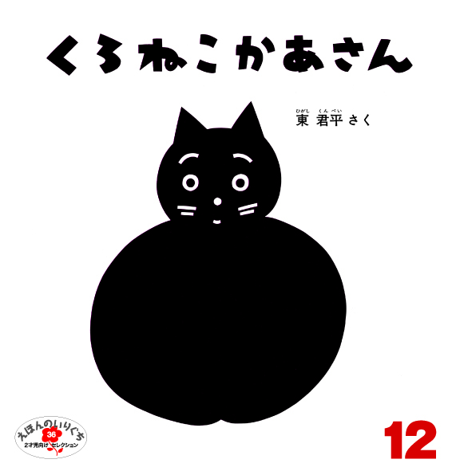
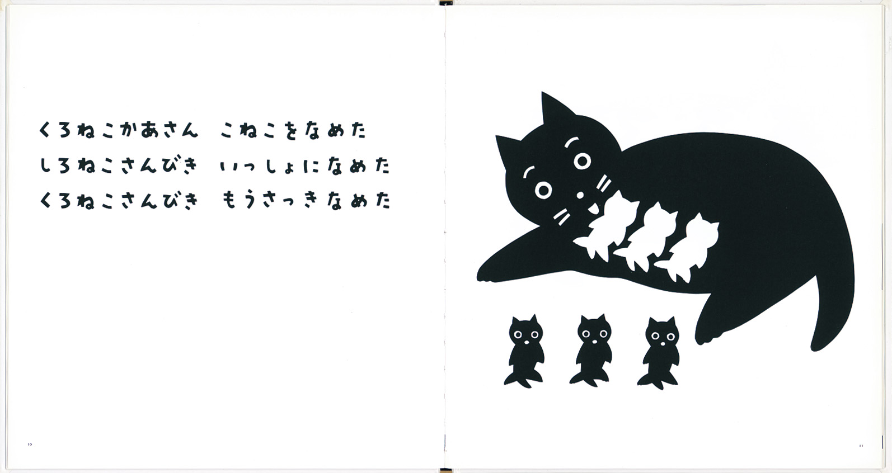

# 今天的文学猫角色：くろねこかあさん

黑猫妈妈舔着小猫，三只白猫挤在她身上，也跟着舔起来；另外三只黑猫站在旁边，早就已经舔过了。同一件小事，在这个家里总能分出两种步调。她有六个孩子，日常的忙碌便这样被排成一行行短句，读起来像一首可以接着往下念的儿歌。

这位母亲出自日本绘本作家东君平（Higashi Kunpei）的《くろねこかあさん》，书名意思就是“黑猫妈妈”。作品最初发表于1985年2月的《こどものとも年少版》，1990年由福音馆书店推出精装单行本。她没有另一个需要记住的名字，书里的称呼已经把她和孩子们连在一起。故事也不急着替她安排远行或冒险：生下小猫、照看小猫，足够占满这本薄薄的绘本。

东君平用剪纸表现这一家。妈妈有尖耳朵、圆眼睛，躯干是一大片饱满的黑色，眉毛和胡须则留下几笔白。她看上去厚实而柔软，却没有依靠毛发的细密线条来表现触感。舔小猫的内页尤其有趣：三只白猫嵌在她黑色的身体里，轮廓清清楚楚；三只黑猫排在外面的白纸上，也一样醒目。画面没有把白色只留给背景，黑白两边都住着猫，读者的目光会在妈妈的身体内外来回寻找。

她出门时，白猫们睡起午觉，黑猫们却担心得哭了；她磨爪子时，白猫们跟着学，黑猫们爬上了柱子。妈妈是这些场面的中心：她每做一个动作，孩子们就各有回应。两组小猫也没有被固定成听话与淘气的两队，睡得安稳和挂念母亲都能让人理解。那些细小的不同，使六个孩子不至于只成为围在她身边的一团背景。

文字反复念到猫妈妈、三只白猫、三只黑猫，画面又让读者一次次把它们找齐。数量、颜色和动作由此连在一起，朗读时可以听节奏，停下来又有东西可看。妈妈的性格并不靠长篇对白交代，她低头舔孩子、带出孩子们模仿的动作，照料的关系就已经成立了。作品把视线放得很近，近到一次舔毛也能容下谁正在参与、谁已经做完的小小差别。

东君平既写文字，也做图画，这让句子的反复和剪影的排列彼此配合。读这本书不必等一个谜底或大结局，可以顺着猫妈妈的动作，听六只小猫怎样把一个家变得热闹。再回头看那张舔毛的画，三只白猫仍贴在她身上，另外三只黑猫安安稳稳地站在一旁，一页纸上正好容下全家。

### 资料来源

- 福音馆书店“こどものとも ひろば”，[《えほんのいりぐち2022年12月号『くろねこ かあさん』》内容介绍、作者简介及公开内页](https://www.kodomonotomo-pr.com/2022/10/3903/)
- 福音馆书店，[《くろねこかあさん》出版书目信息与内容介绍](https://www.hanmoto.com/bd/isbn/9784834010183)，版元ドットコム，1990年单行本

### 视觉参考

1. 2022年月刊版封面，东君平绘：端坐的黑猫妈妈
   - 来源页面：<https://www.kodomonotomo-pr.com/2022/10/3903/>
   - 原始图片：<https://www.kodomonotomo-pr.com/wp-content/uploads/2022/10/iri_12_kuroneko.jpg>
   - 作者/机构：东君平／福音馆书店
   - 说明：2022年12月“えほんのいりぐち”版本以黑猫妈妈为封面主角。

2. 福音馆版内页，东君平绘：猫妈妈舔小猫
   - 来源页面：<https://www.kodomonotomo-pr.com/2022/10/3903/>
   - 原始图片：<https://www.kodomonotomo-pr.com/wp-content/uploads/2022/10/1018.IN01.jpg>
   - 作者/机构：东君平／福音馆书店
   - 说明：出版社公开内页展示妈妈与三只白猫、三只黑猫的不同动作。
