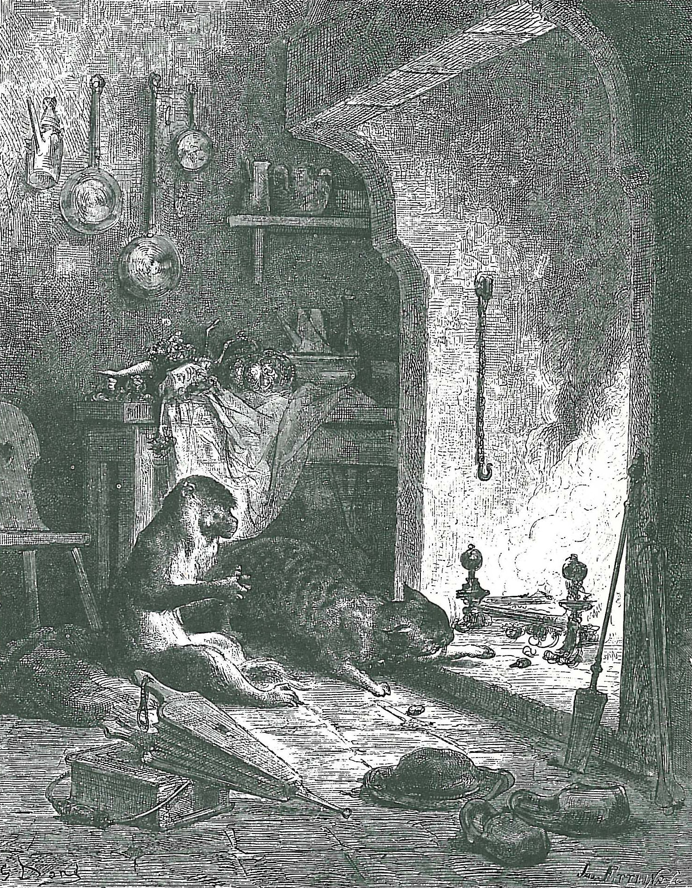
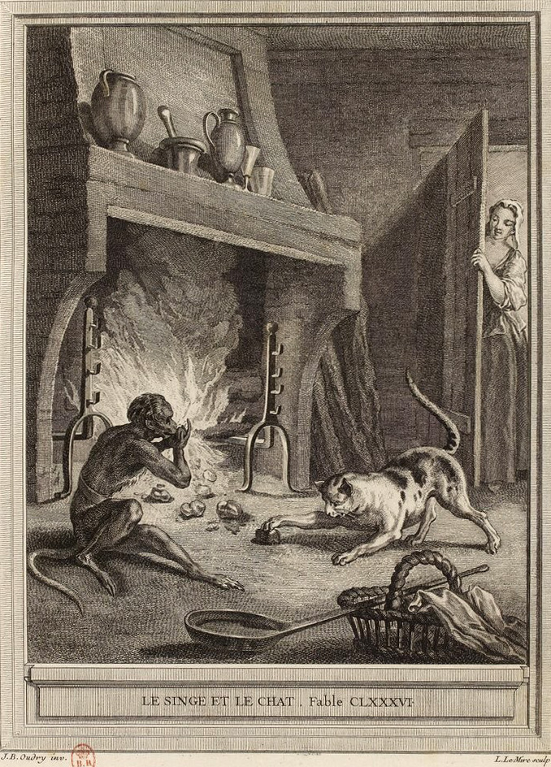

# 今天的文学猫角色：Raton

Raton 对奶酪的兴趣比对老鼠大。若屋里有什么东西遭了殃，主人也不必去怀疑邻居：家里这只猫和那只猴子，就足够把事情解释清楚。他偷吃时并不缺心眼，可等到火边烤起栗子，轮到分配谁出力、谁享用，他便输给了自己的同伙。

这只猫出自让·德·拉封丹（Jean de La Fontaine）的《猴子与猫》（Le Singe et le Chat），收入《寓言》第九卷第十七篇。猫与猴子 Bertrand 同住一屋，共有一个主人，既是伙伴，也是偷嘴的搭档。拉封丹先把他们并排写成两个捣蛋鬼，随后才让两者之间的差别显露出来。Raton 因而不是一个误入圈套的纯洁受害者：他本来就想占主人的便宜，只是在合伙做坏事时，没算清伙伴会怎样对待自己。

猴子的办法很省事。他称猫为兄弟，说今天该让他露一手，又把自己说成天生不适合从火里取栗子的动物。这番恭维给 Raton 安排了一个能干者的位置，也把危险全推到他的爪子上。猫立即行动，轻轻拨开灰烬，缩回趾头，再一次次探过去。他取出一颗、两颗、三颗，猴子就在旁边一颗颗吃掉。女仆出现，两只动物只好散开；猫的不满，落在已经付出的工夫与没有得到的食物之间。

拉封丹让这只猫留下形象，靠的是那只反复伸缩的爪子。原文没有细写毛色，却把试探热灰的动作写得很细：他知道烫，也会躲，仍继续替猴子取栗。贪吃可以解释他为什么靠近炉火，受奉承则解释了他为什么肯承担这份差事。他有小偷的机灵，也有急于显本事时的轻信；读者看着他谨慎地处理眼前的危险，同时漏看身旁更容易忽略的危险。

这篇寓言的锋芒还伸向人的世界。末尾，拉封丹把 Raton 的处境比作受人恭维、远赴他地冒险，最终替某位国王谋利的诸侯。猫的爪子让这层政治讽刺有了具体的痛感：称赞和头衔归出力者，栗子归另一个人。故事很短，读来却不只有一句劝人提防骗子的训诫，还能看到共同的贪念怎样掩住了同伙之间的不平等。

后来的画家把这场厨房里的分工画得分明。古斯塔夫·多雷（Gustave Doré）让猫伏低身子，爪子贴近炉沿，猴子坐在一旁；Le Mire 根据 Oudry 绘稿刻制的版本，则让猫弓起背，伸长前腿，门边已经出现女仆。两个版本都把视线引向炉火附近：猫仍在忙，猴子留在远离热灰的位置。

### 资料来源

- 让·德·拉封丹，[《Le Singe, et le Chat》](https://fr.wikisource.org/wiki/Le_Singe,_et_le_Chat)，《寓言》第九卷第十七篇，Wikisource 原文
- Wikimedia Commons，[《Le Singe et le Chat》多雷插画档案](https://commons.wikimedia.org/wiki/File:Le_Singe_et_le_Chat.jpg)
- Wikimedia Commons，[Le Mire 据 Oudry 绘稿刻制的《Le singe et le chat》](https://commons.wikimedia.org/wiki/File:Le_Mire-Oudry-La_Fontaine-Le_singe_et_le_chat.jpg)，1755—1759 年版，法国国家图书馆藏

### 视觉参考

1. 《猴子与猫》插图，多雷绘：猫伸爪取栗，猴子在旁
   - 来源页面：<https://commons.wikimedia.org/wiki/File:Le_Singe_et_le_Chat.jpg>
   - 原始图片：<https://upload.wikimedia.org/wikipedia/commons/5/55/Le_Singe_et_le_Chat.jpg>
   - 作者/机构：Gustave Doré / Wikimedia Commons
   - 说明：多雷为拉封丹寓言所绘插图，表现 Raton 在炉边替猴子取栗的场面。

2. 1755—1759年版，Le Mire据Oudry绘稿刻：炉边的猫与猴
   - 来源页面：<https://commons.wikimedia.org/wiki/File:Le_Mire-Oudry-La_Fontaine-Le_singe_et_le_chat.jpg>
   - 原始图片：<https://upload.wikimedia.org/wikipedia/commons/6/64/Le_Mire-Oudry-La_Fontaine-Le_singe_et_le_chat.jpg>
   - 作者/机构：Noël Le Mire 据 Jean-Baptiste Oudry 绘稿刻制 / Bibliothèque nationale de France
   - 说明：出自 Desaint & Saillant 版拉封丹寓言，猫伸爪取栗时，猴子正往嘴边送食物。
